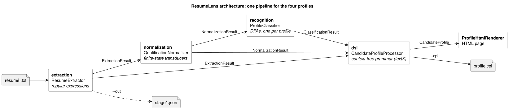
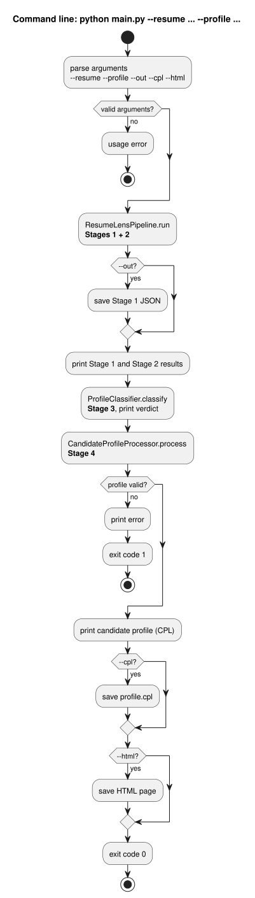

# Module Design

This document describes the modules of ResumeLens: what each one does, its public classes and functions,
and the inputs and outputs that connect the four stages. Formal models are described in the stage documents:
[Stage 1](stage1-extraction-regex.md), [Stage 2](stage2-normalization-fst.md),
[Stage 3](stage3-recognition-automata.md), [Stage 4](stage4-candidate-profile-language.md).

**Contents**

1. Architecture
2. Data passed between stages
3. Package `extraction` (Stage 1)
4. Package `normalization` (Stage 2)
5. Package `recognition` (Stage 3)
6. Package `dsl` (Stage 4 and visualization)
7. `pipeline` and the command line
8. Design decisions

---

## 1. Architecture

ResumeLens is a pipeline: each stage reads only the output of the previous stages. All four profiles go
through the same code; a profile is **data** (an order in `normalization/profiles.py` and a pattern in
`recognition/patterns.py`), not a separate implementation.

PlantUML source: [`diagrams/architecture.puml`](diagrams/architecture.puml)

| Package | Folder | Formal model | Library |
|---|---|---|---|
| `extraction` | `src/resume_lens/extraction/` | Regular expressions | `re` |
| `normalization` | `src/resume_lens/normalization/` | Finite-state transducers | `pyformlang.fst` |
| `recognition` | `src/resume_lens/recognition/` | Deterministic finite automata | `pyformlang.finite_automaton` |
| `dsl` | `src/resume_lens/dsl/` | Context-free grammar | `textX` |
| `pipeline`, CLI | `src/resume_lens/pipeline.py`, `__init__.py`, `main.py` | — | `argparse` |

Dependencies point only forward: `normalization` does not import `recognition` or `dsl`. `recognition`
uses `normalization` (profile orders, sorter). `dsl` uses all three, both to build profiles and to
validate them semantically.

## 2. Data passed between stages

| Object | Module | Fields | Produced by → used by |
|---|---|---|---|
| `ExtractedItem` | `extraction.models` | `value: str`, `category: Category`, `start: int`, `end: int` | Stage 1 → Stage 4 (category and spellings of skills) |
| `Experience` | `extraction.models` | `years: int`, `description: str` | Stage 1 → Stage 4 |
| `ExtractionResult` | `extraction.models` | `name`, `emails`, `phones`, `links`, `experience`, `degrees`, `items`; property `qualifications: list[str]` | Stage 1 → Stage 2 (`qualifications`), Stage 4 |
| `NormalizationResult` | `normalization.normalizer` | `mapping: dict[str, str]` (raw → canonical), `canonical: list[str]`, `unrecognized: list[str]` | Stage 2 → Stage 3 (`canonical`), Stage 4 |
| `ProfileVerdict` | `recognition.classifier` | `profile`, `accepted: bool`, `sequence: tuple[str, ...]`, `missing_stage: str \| None`; property `status` | Stage 3 → Stage 4 |
| `ClassificationResult` | `recognition.classifier` | `verdicts: dict[str, ProfileVerdict]`; property `accepted_profiles` | Stage 3 → Stage 4, CLI |
| `CandidateProfile` | `dsl.processor` | `text: str` (CPL), `model` (textX object model) | Stage 4 → CLI, HTML |

Example for the Wednesday Addams résumé:

| Stage | Output |
|---|---|
| 1 | `qualifications = ["JS", "React.js", "NodeJS", "Postgres", "Git"]` |
| 2 | `canonical = ["JAVASCRIPT", "REACT", "NODE_JS", "POSTGRESQL", "GIT"]` |
| 3 | `FULL_STACK_DEVELOPER: ACCEPTED`, the other three `REJECTED` |
| 4 | a valid CPL document and its HTML page |

---

## 3. Package `extraction` (Stage 1)

| Module | Element | Input | Output | Description |
|---|---|---|---|---|
| `patterns.py` | `Category` (enum) | — | — | Kinds of information: `NAME`, `EMAIL`, `PHONE`, `LINK`, `EXPERIENCE`, `DEGREE`, `PROGRAMMING_LANGUAGE`, `FRAMEWORK_LIBRARY`, `DATABASE`, `TOOL`, `OTHER_QUALIFICATION` |
| | `QUALIFICATION_CATEGORIES` | — | `tuple[Category, ...]` | The five categories whose matches go to Stage 2 |
| | `RegexPattern` | `category`, `expression`, `description`, `flags` | compiled pattern | A regular expression with the explanation of its language |
| | `RegexPattern.find_all(text)` | `str` | `list[re.Match]` | All matches in the text |
| | `PATTERNS` | — | `dict[Category, RegexPattern]` | One pattern per category |
| `extractor.py` | `ResumeExtractor(patterns=None)` | optional pattern set | — | Applies the patterns |
| | `extract(text)` | `str` | `ExtractionResult` | Full extraction; `ValueError` if `text` is `None` |
| | `extract_file(path)` | path | `ExtractionResult` | Reads a UTF-8 file and extracts |
| | `extract_name(text)` | `str` | `str \| None` | First name line; all-caps names in title case |
| | `extract_emails` / `extract_phones` / `extract_links` / `extract_degrees` | `str` | `list[str]` | Distinct values in order of appearance (links: same account kept once) |
| | `extract_experience(text)` | `str` | `list[Experience]` | "N years of experience …" statements |
| | `extract_qualifications(text)` | `str` | `list[ExtractedItem]` | Every qualification match, sorted by position |
| `models.py` | `ExtractionResult.by_category(category)` | `Category` | `list[str]` | Distinct values of one category |
| | `.programming_languages`, `.frameworks`, `.databases`, `.tools`, `.other_qualifications` | — | `list[str]` | Views by category |
| | `.qualifications` | — | `list[str]` | Distinct qualification strings, in order of appearance (input of Stage 2) |
| | `to_dict()` / `from_dict(d)` | — / `dict` | `dict` / `ExtractionResult` | Conversion for persistence |
| | `save_json(path)` / `load_json(path)` | path | `Path` / `ExtractionResult` | JSON file (creates folders) |

## 4. Package `normalization` (Stage 2)

| Module | Element | Input | Output | Description |
|---|---|---|---|---|
| `catalog.py` | `CANONICAL_VARIANTS` | — | `dict[str, tuple[str, ...]]` | 80 canonical tokens and their 144 surface variants |
| `transducers.py` | `FormalDefinition` | — | 7-tuple | `states`, `input_alphabet`, `output_alphabet`, `delta`, `omega`, `initial_state`, `final_states` |
| | `CleaningTransducer()` | — | — | T_clean: lower-cases letters, deletes separators |
| | `CleaningTransducer.apply(text)` | `str` | `str \| None` | Cleaned string; `None` if a symbol is outside Σ |
| | `QualificationTransducer(canonical, variants, cleaner=None)` | token, variants | — | T_canonical: a trie of the cleaned variants that outputs the token; `ValueError` if no variant or a variant is not over Σ |
| | `QualificationTransducer.translate(cleaned)` | `str` | `str \| None` | Canonical token or `None` |
| | `.formal_definition()` (both classes) | — | `FormalDefinition` | The explicit 7-tuple |
| | `.write_dot(path)` (both classes) | path | file | Graphviz diagram |
| | `union_of(transducers)` | iterable of `QualificationTransducer` | `pyformlang` `FST` | T_norm = ∪ T_i |
| `normalizer.py` | `QualificationNormalizer(catalog=None)` | optional catalogue | — | Builds T_clean and T_norm; `ValueError` if a cleaned variant belongs to two tokens |
| | `normalize_term(raw)` | `str` | `str \| None` | T_norm(T_clean(raw)) |
| | `normalize(qualifications)` | `Iterable[str]` | `NormalizationResult` | Normalizes the Stage 1 list |
| | `canonical_tokens` | — | `list[str]` | All tokens of the catalogue |
| `profiles.py` | `ProfileOrder(name, groups)` | — | — | Ordered groups of tokens of one profile |
| | `ProfileOrder.rank(token)` | `str` | `(group, index) \| None` | Position of a token in the profile order |
| | `PROFILES`, `get_profile(name)` | name | `ProfileOrder` | The four profile orders; `ValueError` for an unknown name |
| `sorter.py` | `QualificationSorter.sort(tokens, profile)` | tokens, `ProfileOrder \| str` | `list[str]` | Distinct tokens in profile order, tokens outside the profile last (alphabetical) |

## 5. Package `recognition` (Stage 3)

| Module | Element | Input | Output | Description |
|---|---|---|---|---|
| `patterns.py` | `PatternStage(name, required, optional=())` | — | — | One stage: "at least one of `required`" |
| | `ProfilePattern(name, stages)` | — | — | Ordered stages; `ValueError` if a token is in two stages |
| | `ProfilePattern.tokens` | — | `list[str]` | The alphabet Σ of the profile automaton |
| | `ProfilePattern.is_satisfied_by(tokens)` | `Iterable[str]` | `bool` | Reference semantics (used as a test oracle and by Stage 4) |
| | `PATTERNS`, `get_pattern(name)`, `NAMED_SETS` | name | `ProfilePattern` | The four patterns and readable names of token sets |
| `automaton.py` | `ProfileAutomaton(pattern)` | `ProfilePattern` | — | Builds the pyformlang DFA |
| | `transitions()` | — | `list[(source, symbol, target)]` | δ as triples |
| | `formal_definition()` | — | `AutomatonDefinition` | The explicit 5-tuple (Q, Σ, δ, q0, F) |
| | `automaton_type` | — | `"DFA"` | Checked with `is_deterministic()` |
| | `accepts(sequence)` | `Iterable[str]` | `bool` | Runs the DFA |
| | `trace(sequence)` | `Iterable[str]` | `Trace` | Visited states, symbols read, symbol without transition |
| | `missing_stage(sequence)` | `Iterable[str]` | `str \| None` | First unsatisfied stage of a rejected word |
| `classifier.py` | `ProfileClassifier(patterns=None, orders=None)` | optional patterns/orders | — | One automaton per profile |
| | `sequence_for(tokens, profile)` | tokens, name | `tuple[str, ...]` | Sorted (profile order) and projected onto Σ |
| | `classify_profile(tokens, profile)` | tokens, name | `ProfileVerdict` | Verdict for one profile |
| | `classify(tokens)` | `Iterable[str]` | `ClassificationResult` | Verdicts for the four profiles |
| | `ClassificationResult.to_dict()` / `.status(profile)` | — | `dict` / `"ACCEPTED" \| "REJECTED"` | Reporting helpers |

## 6. Package `dsl` (Stage 4 and visualization)

| Module | Element | Input | Output | Description |
|---|---|---|---|---|
| `candidate_profile.tx` | grammar | — | — | The CPL context-free grammar (textX) |
| `builder.py` | `CandidateProfileBuilder.build(extraction, normalization, classification)` | Stage 1–3 results | `str` | CPL document; `Unknown Candidate` when there is no name |
| `language.py` | `CandidateProfileLanguage(canonical_tokens=None, patterns=None)` | optional vocabularies | — | textX metamodel + semantic checks |
| | `parse(text)` | `str` | textX model | Validated model; `ProfileValidationError` (with `line`, `col`) otherwise |
| | `parse_file(path)` | path | textX model | Same, from a file |
| | `is_valid(text)` | `str` | `bool` | Validation without exception |
| `processor.py` | `CandidateProfileProcessor(builder=None, language=None)` | — | — | Stage 4 entry point |
| | `process(extraction, normalization, classification)` | Stage 1–3 results | `CandidateProfile` | Build + validate |
| | `process_resume(text)` | `str` | `CandidateProfile` | Runs Stages 1–4 on raw text |
| | `CandidateProfile.save(path)` / `save_html(path)` / `to_html()` | path | `Path` / `str` | Write the CPL file / the HTML page |
| `visualization.py` | `ProfileHtmlRenderer.render(model, source=None)` | textX model, optional CPL text | `str` | Self-contained HTML page |
| | `ProfileHtmlRenderer.save(model, path, source=None)` | | `Path` | Write the page (creates folders) |
| | `profile_label(name)` | `str` | `str` | `DEVOPS_ENGINEER` → `DevOps Engineer` |

## 7. `pipeline` and the command line

| Element | Input | Output | Description |
|---|---|---|---|
| `ResumeLensPipeline.run(text, profile)` (`pipeline.py`) | résumé text, profile name | `StageTwoOutput(extraction, normalization, profile, sorted_qualifications)` | Stages 1 and 2 chained |
| `main(argv=None)` (`__init__.py`) | command-line arguments | exit code `0` / `1` (`2` from `argparse`) | Runs Stages 1–4 and prints each stage |
| `main.py` | — | — | Adds `src/` to the path and calls `main()`, so `python main.py …` works without installing |

Command-line flow:

PlantUML source: [`diagrams/cli-flow.puml`](diagrams/cli-flow.puml)

## 8. Design decisions

- **One generic implementation for all profiles.** Profiles are data: `ProfileOrder` for Stage 2 sorting
  and `ProfilePattern` for Stage 3. One builder creates every DFA, and one grammar describes every
  candidate. Adding a profile means adding those two definitions, not new code.
- **Each stage keeps its own responsibility.** Stage 1 never maps synonyms and Stage 2 never decides a
  profile. This is why `Postgres` reaches Stage 2 unchanged and `DOCKER` is simply ignored by the Full
  Stack automaton.
- **Canonical tokens are the shared alphabet.** Stage 2's output alphabet is the input alphabet Σ of
  every Stage 3 automaton and the `CanonicalToken` vocabulary of Stage 4.
- **Explicit formal definitions in code.** `formal_definition()` returns the 7-tuple of every transducer
  and the 5-tuple of every automaton, so the documentation can be checked against the implementation.
- **Validation after generation.** Stage 4 parses the text it has just generated. An inconsistent result
  (for example a verdict that does not agree with the pattern) is never shown or saved.
