# Stage 2 — Qualification Normalization with Finite-State Transducers

**Contents**

1. Model and notation
2. T_clean — lexical cleaning transducer
3. Construction of the qualification transducers T_i
4. T_norm — union of the qualification transducers
5. Mathematical argumentation
6. Sorting the output by profile
7. Catalogue of qualification transducers
8. Formal definition of every T_i
9. Limitations

## 1. Model and notation

A finite-state transducer is a 7-tuple **M = (Q, Σ, Γ, δ, ω, q0, F)**:

| Component             | Meaning                                                        |
| --------------------- | -------------------------------------------------------------- |
| Q                     | finite set of states                                           |
| Σ                     | input alphabet                                                 |
| Γ                     | output alphabet                                                |
| δ ⊆ Q × (Σ ∪ {ε}) × Q | transition relation                                            |
| ω : δ → Γ\*           | output relation: the string written when a transition is taken |
| q0 ∈ Q                | initial state                                                  |
| F ⊆ Q                 | set of accepting states                                        |

We write q —a/y→ p when (q, a, p) ∈ δ and ω(q, a, p) = y. A **run** on w = a1 a2 … ak is a path q0 —b1/y1→ q1 —b2/y2→ … —bm/ym→ qm with bj ∈ Σ ∪ {ε} and b1 b2 … bm = w (the ε's are erased). The run is **accepting** if qm ∈ F, and its output is y1 y2 … ym. The **translation relation** of M is

> T(M) = { (w, y) ∈ Σ* × Γ* | some accepting run on w outputs y }

and its **domain** is dom(M) = { w | ∃ y : (w, y) ∈ T(M) }. δ is _partial_: every pair (q, a) that does not appear in a table has no transition, so a word that would need it has no accepting run and is rejected.

Normalization of a Stage 1 string x is the cascade

> normalize(x) = N(h(x))

where **h** is the function computed by T_clean (section 2) and **N** the one computed by T_norm = T_1 ∪ … ∪ T_80 (sections 3–4): 80 transducers, one per canonical qualification, built from 144 surface variants.

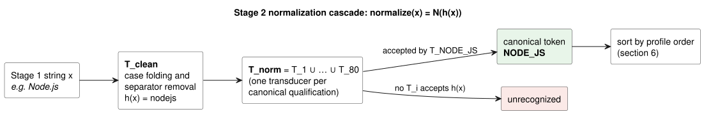

PlantUML source: [`fst/normalization-cascade.puml`](fst/normalization-cascade.puml)

Implementation: `src/resume_lens/normalization/transducers.py` (`CleaningTransducer`, `QualificationTransducer`, `union_of`) using `pyformlang.fst.FST` (`add_transition`, `add_start_state`, `add_final_state`, `union`, `translate`). In pyformlang the empty input/output is the symbol `"epsilon"` / the empty list `[]`.

## 2. T_clean — lexical cleaning transducer

**Purpose.** Remove differences that are only typographic (letter case and separators), so that `Scikit-learn`, `scikit learn` and `SCIKIT_LEARN` all become `scikitlearn`.

**M_clean = (Q, Σ, Γ, δ, ω, q0, F)**

- **Q** = {q0}
- **Σ** = {A, …, Z} ∪ {a, …, z} ∪ {0, …, 9} ∪ {`+`, `#`} ∪ {␣, `-`, `.`, `_`, `/`} — |Σ| = 26 + 26 + 10 + 2 + 5 = 69 (␣ is the blank space)
- **Γ** = {a, …, z} ∪ {0, …, 9} ∪ {`+`, `#`} — |Γ| = 26 + 10 + 2 = 38
- **q0** = q0
- **F** = {q0}
- **δ** = { (q0, x, q0) | x ∈ Σ } — one loop per input symbol, |δ| = 69
- **ω**(q0, x, q0) = lower(x) if x ∈ {A,…,Z}; x if x ∈ {a,…,z} ∪ {0,…,9} ∪ {+, #}; ε if x ∈ {␣, -, ., \_, /}

**Transition table** (grouped by symbol class; each row stands for one transition per symbol of the class):

| Input class        | Symbols               | # transitions | δ(q0, x) | ω(q0, x)                   |
| ------------------ | --------------------- | ------------- | -------- | -------------------------- |
| Upper-case letters | A … Z                 | 26            | q0       | lower(x): A→a, B→b, …, Z→z |
| Lower-case letters | a … z                 | 26            | q0       | x                          |
| Digits             | 0 … 9                 | 10            | q0       | x                          |
| Kept symbols       | `+`, `#`              | 2             | q0       | x                          |
| Separators         | ␣, `-`, `.`, `_`, `/` | 5             | q0       | ε                          |
| **Total**          |                       | **69**        |          |                            |

PlantUML source: [`fst/T_clean.puml`](fst/T_clean.puml)

**Example run** on `Node.js`: q0 —N/n→ q0 —o/o→ q0 —d/d→ q0 —e/e→ q0 —./ε→ q0 —j/j→ q0 —s/s→ q0 ∈ F, output `nodejs`.

| Input x        | h(x)               |
| -------------- | ------------------ |
| `Scikit-learn` | `scikitlearn`      |
| `React.js`     | `reactjs`          |
| `Tensor Flow`  | `tensorflow`       |
| `CI/CD`        | `cicd`             |
| `C++`          | `c++`              |
| `Café`         | rejected (`é` ∉ Σ) |

## 3. Construction of the qualification transducers T_i

For every canonical qualification c_i (e.g. `REACT`) the catalogue gives a list of surface variants (e.g. `React`, `React.js`, `ReactJS`). Let

> V_i = { h(v) | v is a variant of c_i } (the _cleaned_ variants, e.g. V_REACT = {react, reactjs})

and Pref(V_i) the set of all prefixes of words of V_i (including ε). T_i = (Q_i, Σ_i, Γ_i, δ_i, ω_i, q0, F_i) is built as a **prefix tree (trie) with an output state**:

| Component | Definition                                                                                       |
| --------- | ------------------------------------------------------------------------------------------------ |
| Q_i       | { q*u \| u ∈ Pref(V_i) } ∪ {qF}, with q*ε = q0 (states are numbered q0, q1, … in creation order) |
| Σ_i       | the characters that occur in V_i                                                                 |
| Γ_i       | { c_i } (one output symbol: the canonical token)                                                 |
| δ_i       | (q_u, a, q_ua) for every ua ∈ Pref(V_i), a ∈ Σ_i ∪ (q_v, ε, qF) for every v ∈ V_i                |
| ω_i       | ω(q_u, a, q_ua) = ε and ω(q_v, ε, qF) = c_i                                                      |
| q0        | q_ε                                                                                              |
| F_i       | { qF }                                                                                           |

Hence |Q_i| = |Pref(V_i)| + 1 and |δ_i| = (|Pref(V_i)| − 1) + |V_i|. Both identities are checked for every transducer in section 8.

**Why the extra state qF and the ε-transition?** If the canonical token were written on the last character of a variant, a variant that is a prefix of another (`react` ⊂ `reactjs`, `node` ⊂ `nodejs`, `mongo` ⊂ `mongodb`) would write the token once when passing through `react` and once more at the end of `reactjs`. With the token written only on the ε-edge into qF, and qF having no outgoing transitions, the token is written **exactly once** and only when the whole input has been read.

Example — T_REACT (full table in section 8):

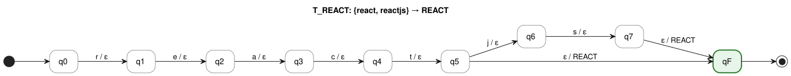

PlantUML source: [`fst/T_REACT.puml`](fst/T_REACT.puml)

## 4. T_norm — union of the qualification transducers

T_norm = T_1 ∪ … ∪ T_n is built with `FST.union` (pyformlang renames the states of each T_i so that they are disjoint):

- **Q** = Q_1 ⊎ … ⊎ Q_n (disjoint union)
- **Σ** = Σ_1 ∪ … ∪ Σ_n, **Γ** = Γ_1 ∪ … ∪ Γ_n = {c_1, …, c_n}
- **δ** = δ_1 ∪ … ∪ δ_n, **ω** = ω_1 ∪ … ∪ ω_n
- **Initial states** {q0_1, …, q0_n}. pyformlang allows several initial states; this is equivalent to one new initial state q_s with the transitions (q_s, ε, q0_i) and output ε for every i.
- **F** = {qF_1, …, qF_n}

| Measure                      | Value |
| ---------------------------- | ----- |
| Transducers in the union (n) | 80    |
| \|Q\|                        | 907   |
| \|Σ\|                        | 31    |
| \|Γ\|                        | 80    |
| \|δ\|                        | 866   |
| Initial states               | 80    |
| Accepting states             | 80    |

## 5. Mathematical argumentation

### Proposition 1 — T_clean computes a total function (a string homomorphism)

Let g : Σ → Γ ∪ {ε} be g(x) = lower(x) for x ∈ {A,…,Z}, g(x) = x for x ∈ {a,…,z} ∪ {0,…,9} ∪ {+, #} and g(x) = ε for a separator, and extend it to h : Σ* → Γ* by h(ε) = ε and h(wa) = h(w) g(a). Then **T(M_clean) = { (w, h(w)) | w ∈ Σ\* }**.

_Proof_ (induction on |w|). For w = ε the only run is the empty run, which stays in q0 ∈ F and outputs ε = h(ε). Assume the claim for w. Since Q = {q0} and δ contains exactly one transition (q0, a, q0) for every a ∈ Σ and no ε-transition, the only run on wa is the run on w followed by q0 —a/g(a)→ q0; it ends in q0 ∈ F and outputs h(w) g(a) = h(wa). ∎

Consequences: M_clean is **deterministic** (one transition per (state, symbol), no ε-moves), **total** on Σ* (dom = Σ*) and runs in O(|w|) steps. Any string with a symbol outside Σ has no run and is rejected.

### Proposition 2 — each T_i maps exactly its variants to its canonical token

For the construction of section 3: **T(T_i) = V_i × {c_i}**, i.e. dom(T_i) = V_i and every accepted word is translated to the single token c_i.

_Proof._ (⊇) Let v = a1 … ak ∈ V*i. Every prefix a1 … aj belongs to Pref(V_i), so the states q*ε = q0, q_a1, q_a1a2, …, q_v exist and are joined by the character transitions, each with output ε; from q_v (v ∈ V_i) the transition (q_v, ε, qF) writes c_i. The run ends in qF ∈ F and outputs ε^k c_i = c_i.

(⊆) Take an accepting run on w. It ends in qF, and the only transitions entering qF are the ε-transitions (q_v, ε, qF) with v ∈ V_i. qF has no outgoing transitions, so that ε-transition is the last step and is taken exactly once. Before it, the run only uses character transitions, and by construction q0 —a1…aj→ q_u implies u = a1 … aj (the state remembers the prefix read). So the run read w = v ∈ V_i and wrote ε…ε c_i = c_i. ∎

Consequences: the character part of δ_i is a partial **function** (a trie has one child per letter), so every input has at most one run; T_i is a **functional** transducer even though it uses ε-transitions. Translating w costs O(|w|) steps.

### Proposition 3 — T_norm is functional

By definition of union, T(T_norm) = ⋃_i T(T_i) = ⋃_i (V_i × {c_i}). The program checks, when the normalizer is built (`QualificationNormalizer._check_disjoint`, test TC-N-20), that **V_i ∩ V_j = ∅ for i ≠ j**. Therefore each word w belongs to at most one V_i, and T(T_norm) is the graph of a partial function

> N : Γ_clean\* ⇀ {c_1, …, c_n}, N(w) = c_i ⟺ w ∈ V_i.

### Proposition 4 — the cascade defines equivalence classes of qualifications

normalize = N ∘ h is the composition of two functional transductions, hence again a (partial) function, and it can itself be realised by a single FST (rational transductions are closed under composition). For each canonical token c_i the set of surface strings normalised to it is

> [c_i] = normalize⁻¹(c_i) = h⁻¹(V_i) = { x ∈ Σ\* | h(x) ∈ V_i }.

V_i is finite, hence regular, and regular languages are closed under inverse homomorphism, so **every class [c_i] is a regular language**. The classes are pairwise disjoint (Proposition 3), so normalization partitions the recognised strings into equivalence classes: x ≡ x' ⟺ normalize(x) = normalize(x'). Example: `JS`, `Javascript`, `Java Script` and `java-script` are all in [JAVASCRIPT]; `Java` is not (h(`Java`) = `java` ∉ V_JAVASCRIPT).

### Proposition 5 — the sorted output does not depend on the résumé order

For a profile P with groups G_1, …, G_m (section 6) let r_P(c) = (g, k) when c is the k-th token of group G_g. Each token occurs at most once in a profile (test TC-N-29), so r_P is injective. Define the strict total order on canonical tokens

> c <\_P d ⟺ (c, d ∈ dom r_P and r_P(c) <\_lex r_P(d)) or (c ∈ dom r_P and d ∉ dom r_P) or (c, d ∉ dom r_P and c <\_alphabetical d).

`QualificationSorter.sort` returns Sort_P(S) = the elements of the **set** {c | c occurs in S} listed in increasing <\_P order. Since a set does not depend on the order or multiplicity of the elements of S, Sort_P(π(S)) = Sort_P(S) for every permutation π and every repetition of tokens (tested on all 5! = 120 permutations in TC-N-24). ∎

## 6. Sorting the output by profile

Before Stage 3 the canonical tokens are de-duplicated and sorted by <\_P (Proposition 5). Tokens that are not part of P go to the end in alphabetical order.

### 6.1 FULL_STACK_DEVELOPER (predefined)

| g   | Group G_g       | Tokens in order (k = 1, 2, …)                                                                                     |
| --- | --------------- | ----------------------------------------------------------------------------------------------------------------- |
| 1   | FRONTEND        | JAVASCRIPT, TYPESCRIPT, REACT, ANGULAR, VUE, NEXT_JS                                                              |
| 2   | BACKEND         | NODE_JS, EXPRESS, DJANGO, FLASK, FASTAPI, SPRING_BOOT, REST_API, GRAPHQL, MICROSERVICES                           |
| 3   | DATABASE        | SQL, POSTGRESQL, MYSQL, MARIADB, SQLITE, SQL_SERVER, ORACLE, NOSQL, MONGODB, REDIS, CASSANDRA, DYNAMODB, FIREBASE |
| 4   | VERSION_CONTROL | GIT, GITHUB, GITLAB                                                                                               |

- Résumé (Stage 1): `Git, NodeJS, JS, Postgres, React.js`
- normalize: `GIT, NODE_JS, JAVASCRIPT, POSTGRESQL, REACT`
- Sort_P: **`JAVASCRIPT, REACT, NODE_JS, POSTGRESQL, GIT`**

### 6.2 MACHINE_LEARNING_ENGINEER (predefined)

| g   | Group G_g            | Tokens in order (k = 1, 2, …)                                                                                     |
| --- | -------------------- | ----------------------------------------------------------------------------------------------------------------- |
| 1   | PROGRAMMING_LANGUAGE | PYTHON                                                                                                            |
| 2   | DATA_PROCESSING      | PANDAS, NUMPY, DATA_PIPELINES                                                                                     |
| 3   | ML_LIBRARY           | SCIKIT_LEARN                                                                                                      |
| 4   | DL_FRAMEWORK         | TENSORFLOW, PYTORCH, KERAS                                                                                        |
| 5   | ML_DEVELOPMENT       | ML_MODEL_DEVELOPMENT, DEEP_LEARNING                                                                               |
| 6   | DATABASE             | SQL, POSTGRESQL, MYSQL, MARIADB, SQLITE, SQL_SERVER, ORACLE, NOSQL, MONGODB, REDIS, CASSANDRA, DYNAMODB, FIREBASE |
| 7   | VERSION_CONTROL      | GIT, GITHUB, GITLAB                                                                                               |

- Résumé (Stage 1): `Git, PostgreSQL, TensorFlow, Pandas, Python`
- normalize: `GIT, POSTGRESQL, TENSORFLOW, PANDAS, PYTHON`
- Sort_P: **`PYTHON, PANDAS, TENSORFLOW, POSTGRESQL, GIT`**

### 6.3 DEVOPS_ENGINEER (defined by the team)

| g   | Group G_g              | Tokens in order (k = 1, 2, …)              |
| --- | ---------------------- | ------------------------------------------ |
| 1   | OS_SCRIPTING           | LINUX, BASH, PYTHON                        |
| 2   | VERSION_CONTROL        | GIT, GITHUB, GITLAB                        |
| 3   | CI_CD                  | CI_CD, JENKINS, GITHUB_ACTIONS             |
| 4   | CONTAINERS             | DOCKER, KUBERNETES                         |
| 5   | INFRASTRUCTURE_AS_CODE | INFRASTRUCTURE_AS_CODE, TERRAFORM, ANSIBLE |
| 6   | CLOUD                  | AWS, AZURE, GCP                            |
| 7   | MONITORING             | PROMETHEUS, GRAFANA                        |

- Résumé (Stage 1): `Kubernetes, Terraform, GitHub Actions, Linux, Docker, AWS, Git`
- normalize: `KUBERNETES, TERRAFORM, GITHUB_ACTIONS, LINUX, DOCKER, AWS, GIT`
- Sort_P: **`LINUX, GIT, GITHUB_ACTIONS, DOCKER, KUBERNETES, TERRAFORM, AWS`**

### 6.4 DATA_ENGINEER (defined by the team)

| g   | Group G_g            | Tokens in order (k = 1, 2, …)                                                                                     |
| --- | -------------------- | ----------------------------------------------------------------------------------------------------------------- |
| 1   | PROGRAMMING_LANGUAGE | PYTHON, SCALA, JAVA                                                                                               |
| 2   | DATA_PROCESSING      | SPARK, HADOOP, DATABRICKS, KAFKA                                                                                  |
| 3   | ORCHESTRATION_ETL    | AIRFLOW, ETL, DATA_PIPELINES, DBT                                                                                 |
| 4   | DATABASE             | SQL, POSTGRESQL, MYSQL, MARIADB, SQLITE, SQL_SERVER, ORACLE, NOSQL, MONGODB, REDIS, CASSANDRA, DYNAMODB, FIREBASE |
| 5   | DATA_WAREHOUSE       | SNOWFLAKE, BIGQUERY                                                                                               |
| 6   | CLOUD                | AWS, AZURE, GCP                                                                                                   |
| 7   | VERSION_CONTROL      | GIT, GITHUB, GITLAB                                                                                               |

- Résumé (Stage 1): `Airflow, Apache Spark, Python, SQL, Snowflake, Kafka, Git`
- normalize: `AIRFLOW, SPARK, PYTHON, SQL, SNOWFLAKE, KAFKA, GIT`
- Sort_P: **`PYTHON, SPARK, KAFKA, AIRFLOW, SQL, SNOWFLAKE, GIT`**

## 7. Catalogue of qualification transducers

| Transducer                                            | Surface variants                                                                                                                     | V_i (cleaned)                                                                                             | \|Q_i\| | \|δ_i\| |
| ----------------------------------------------------- | ------------------------------------------------------------------------------------------------------------------------------------ | --------------------------------------------------------------------------------------------------------- | ------- | ------- |
| [T_JAVASCRIPT](#t_javascript)                         | `JS`, `JavaScript`, `Java Script`, `ECMAScript`, `ES6`                                                                               | `ecmascript`, `es6`, `javascript`, `js`                                                                   | 25      | 27      |
| [T_TYPESCRIPT](#t_typescript)                         | `TS`, `TypeScript`                                                                                                                   | `ts`, `typescript`                                                                                        | 13      | 13      |
| [T_PYTHON](#t_python)                                 | `Python`, `Python3`, `Python 3`                                                                                                      | `python`, `python3`                                                                                       | 9       | 9       |
| [T_JAVA](#t_java)                                     | `Java`                                                                                                                               | `java`                                                                                                    | 6       | 5       |
| [T_C_PLUS_PLUS](#t_c_plus_plus)                       | `C++`, `CPP`                                                                                                                         | `c++`, `cpp`                                                                                              | 7       | 7       |
| [T_C_SHARP](#t_c_sharp)                               | `C#`, `CSharp`, `C Sharp`                                                                                                            | `c#`, `csharp`                                                                                            | 9       | 9       |
| [T_GO](#t_go)                                         | `Golang`                                                                                                                             | `golang`                                                                                                  | 8       | 7       |
| [T_KOTLIN](#t_kotlin)                                 | `Kotlin`                                                                                                                             | `kotlin`                                                                                                  | 8       | 7       |
| [T_SWIFT](#t_swift)                                   | `Swift`                                                                                                                              | `swift`                                                                                                   | 7       | 6       |
| [T_RUST](#t_rust)                                     | `Rust`                                                                                                                               | `rust`                                                                                                    | 6       | 5       |
| [T_PHP](#t_php)                                       | `PHP`                                                                                                                                | `php`                                                                                                     | 5       | 4       |
| [T_RUBY](#t_ruby)                                     | `Ruby`                                                                                                                               | `ruby`                                                                                                    | 6       | 5       |
| [T_SCALA](#t_scala)                                   | `Scala`                                                                                                                              | `scala`                                                                                                   | 7       | 6       |
| [T_REACT](#t_react)                                   | `React`, `React.js`, `ReactJS`                                                                                                       | `react`, `reactjs`                                                                                        | 9       | 9       |
| [T_ANGULAR](#t_angular)                               | `Angular`, `AngularJS`, `Angular.js`                                                                                                 | `angular`, `angularjs`                                                                                    | 11      | 11      |
| [T_VUE](#t_vue)                                       | `Vue`, `Vue.js`, `VueJS`                                                                                                             | `vue`, `vuejs`                                                                                            | 7       | 7       |
| [T_NEXT_JS](#t_next_js)                               | `Next.js`, `NextJS`                                                                                                                  | `nextjs`                                                                                                  | 8       | 7       |
| [T_NODE_JS](#t_node_js)                               | `Node`, `Node.js`, `NodeJS`                                                                                                          | `node`, `nodejs`                                                                                          | 8       | 8       |
| [T_EXPRESS](#t_express)                               | `Express.js`, `ExpressJS`                                                                                                            | `expressjs`                                                                                               | 11      | 10      |
| [T_DJANGO](#t_django)                                 | `Django`                                                                                                                             | `django`                                                                                                  | 8       | 7       |
| [T_FLASK](#t_flask)                                   | `Flask`                                                                                                                              | `flask`                                                                                                   | 7       | 6       |
| [T_FASTAPI](#t_fastapi)                               | `FastAPI`, `Fast API`                                                                                                                | `fastapi`                                                                                                 | 9       | 8       |
| [T_SPRING_BOOT](#t_spring_boot)                       | `Spring Boot`, `SpringBoot`                                                                                                          | `springboot`                                                                                              | 12      | 11      |
| [T_PANDAS](#t_pandas)                                 | `pandas`                                                                                                                             | `pandas`                                                                                                  | 8       | 7       |
| [T_NUMPY](#t_numpy)                                   | `NumPy`, `Num Py`                                                                                                                    | `numpy`                                                                                                   | 7       | 6       |
| [T_SCIKIT_LEARN](#t_scikit_learn)                     | `Scikit-learn`, `scikit learn`, `scikitlearn`, `sklearn`                                                                             | `scikitlearn`, `sklearn`                                                                                  | 19      | 19      |
| [T_TENSORFLOW](#t_tensorflow)                         | `TensorFlow`, `Tensor Flow`                                                                                                          | `tensorflow`                                                                                              | 12      | 11      |
| [T_PYTORCH](#t_pytorch)                               | `PyTorch`, `Py Torch`                                                                                                                | `pytorch`                                                                                                 | 9       | 8       |
| [T_KERAS](#t_keras)                                   | `Keras`                                                                                                                              | `keras`                                                                                                   | 7       | 6       |
| [T_MATPLOTLIB](#t_matplotlib)                         | `Matplotlib`                                                                                                                         | `matplotlib`                                                                                              | 12      | 11      |
| [T_SQL](#t_sql)                                       | `SQL`                                                                                                                                | `sql`                                                                                                     | 5       | 4       |
| [T_NOSQL](#t_nosql)                                   | `NoSQL`, `No SQL`                                                                                                                    | `nosql`                                                                                                   | 7       | 6       |
| [T_POSTGRESQL](#t_postgresql)                         | `PostgreSQL`, `Postgres`                                                                                                             | `postgres`, `postgresql`                                                                                  | 12      | 12      |
| [T_MYSQL](#t_mysql)                                   | `MySQL`, `My SQL`                                                                                                                    | `mysql`                                                                                                   | 7       | 6       |
| [T_MARIADB](#t_mariadb)                               | `MariaDB`                                                                                                                            | `mariadb`                                                                                                 | 9       | 8       |
| [T_SQLITE](#t_sqlite)                                 | `SQLite`                                                                                                                             | `sqlite`                                                                                                  | 8       | 7       |
| [T_SQL_SERVER](#t_sql_server)                         | `SQL Server`, `SQLServer`                                                                                                            | `sqlserver`                                                                                               | 11      | 10      |
| [T_ORACLE](#t_oracle)                                 | `Oracle`                                                                                                                             | `oracle`                                                                                                  | 8       | 7       |
| [T_MONGODB](#t_mongodb)                               | `MongoDB`, `Mongo DB`, `Mongo`                                                                                                       | `mongo`, `mongodb`                                                                                        | 9       | 9       |
| [T_REDIS](#t_redis)                                   | `Redis`                                                                                                                              | `redis`                                                                                                   | 7       | 6       |
| [T_CASSANDRA](#t_cassandra)                           | `Cassandra`                                                                                                                          | `cassandra`                                                                                               | 11      | 10      |
| [T_DYNAMODB](#t_dynamodb)                             | `DynamoDB`                                                                                                                           | `dynamodb`                                                                                                | 10      | 9       |
| [T_FIREBASE](#t_firebase)                             | `Firebase`                                                                                                                           | `firebase`                                                                                                | 10      | 9       |
| [T_SNOWFLAKE](#t_snowflake)                           | `Snowflake`                                                                                                                          | `snowflake`                                                                                               | 11      | 10      |
| [T_BIGQUERY](#t_bigquery)                             | `BigQuery`, `Big Query`                                                                                                              | `bigquery`                                                                                                | 10      | 9       |
| [T_GIT](#t_git)                                       | `Git`                                                                                                                                | `git`                                                                                                     | 5       | 4       |
| [T_GITHUB](#t_github)                                 | `GitHub`                                                                                                                             | `github`                                                                                                  | 8       | 7       |
| [T_GITLAB](#t_gitlab)                                 | `GitLab`                                                                                                                             | `gitlab`                                                                                                  | 8       | 7       |
| [T_DOCKER](#t_docker)                                 | `Docker`                                                                                                                             | `docker`                                                                                                  | 8       | 7       |
| [T_KUBERNETES](#t_kubernetes)                         | `Kubernetes`, `K8s`                                                                                                                  | `k8s`, `kubernetes`                                                                                       | 14      | 14      |
| [T_AWS](#t_aws)                                       | `AWS`, `Amazon Web Services`                                                                                                         | `amazonwebservices`, `aws`                                                                                | 21      | 21      |
| [T_AZURE](#t_azure)                                   | `Azure`                                                                                                                              | `azure`                                                                                                   | 7       | 6       |
| [T_GCP](#t_gcp)                                       | `GCP`, `Google Cloud`, `Google Cloud Platform`                                                                                       | `gcp`, `googlecloud`, `googlecloudplatform`                                                               | 23      | 24      |
| [T_LINUX](#t_linux)                                   | `Linux`                                                                                                                              | `linux`                                                                                                   | 7       | 6       |
| [T_JUPYTER](#t_jupyter)                               | `Jupyter`, `Jupyter Notebook`, `Jupyter Notebooks`                                                                                   | `jupyter`, `jupyternotebook`, `jupyternotebooks`                                                          | 18      | 19      |
| [T_JENKINS](#t_jenkins)                               | `Jenkins`                                                                                                                            | `jenkins`                                                                                                 | 9       | 8       |
| [T_POSTMAN](#t_postman)                               | `Postman`                                                                                                                            | `postman`                                                                                                 | 9       | 8       |
| [T_JIRA](#t_jira)                                     | `Jira`                                                                                                                               | `jira`                                                                                                    | 6       | 5       |
| [T_MLFLOW](#t_mlflow)                                 | `MLflow`                                                                                                                             | `mlflow`                                                                                                  | 8       | 7       |
| [T_AIRFLOW](#t_airflow)                               | `Airflow`, `Apache Airflow`                                                                                                          | `airflow`, `apacheairflow`                                                                                | 21      | 21      |
| [T_SPARK](#t_spark)                                   | `Spark`, `Apache Spark`, `PySpark`                                                                                                   | `apachespark`, `pyspark`, `spark`                                                                         | 25      | 26      |
| [T_HADOOP](#t_hadoop)                                 | `Hadoop`, `Apache Hadoop`                                                                                                            | `apachehadoop`, `hadoop`                                                                                  | 20      | 20      |
| [T_KAFKA](#t_kafka)                                   | `Kafka`, `Apache Kafka`                                                                                                              | `apachekafka`, `kafka`                                                                                    | 18      | 18      |
| [T_DATABRICKS](#t_databricks)                         | `Databricks`                                                                                                                         | `databricks`                                                                                              | 12      | 11      |
| [T_DBT](#t_dbt)                                       | `dbt`                                                                                                                                | `dbt`                                                                                                     | 5       | 4       |
| [T_GITHUB_ACTIONS](#t_github_actions)                 | `GitHub Actions`                                                                                                                     | `githubactions`                                                                                           | 15      | 14      |
| [T_TERRAFORM](#t_terraform)                           | `Terraform`                                                                                                                          | `terraform`                                                                                               | 11      | 10      |
| [T_ANSIBLE](#t_ansible)                               | `Ansible`                                                                                                                            | `ansible`                                                                                                 | 9       | 8       |
| [T_PROMETHEUS](#t_prometheus)                         | `Prometheus`                                                                                                                         | `prometheus`                                                                                              | 12      | 11      |
| [T_GRAFANA](#t_grafana)                               | `Grafana`                                                                                                                            | `grafana`                                                                                                 | 9       | 8       |
| [T_BASH](#t_bash)                                     | `Bash`, `Shell Scripting`                                                                                                            | `bash`, `shellscripting`                                                                                  | 20      | 20      |
| [T_REST_API](#t_rest_api)                             | `REST API`, `REST APIs`, `RESTful API`, `RESTful APIs`, `REST-API`                                                                   | `restapi`, `restapis`, `restfulapi`, `restfulapis`                                                        | 17      | 19      |
| [T_GRAPHQL](#t_graphql)                               | `GraphQL`                                                                                                                            | `graphql`                                                                                                 | 9       | 8       |
| [T_MICROSERVICES](#t_microservices)                   | `Microservices`                                                                                                                      | `microservices`                                                                                           | 15      | 14      |
| [T_CI_CD](#t_ci_cd)                                   | `CI/CD`                                                                                                                              | `cicd`                                                                                                    | 6       | 5       |
| [T_ETL](#t_etl)                                       | `ETL`, `ELT`                                                                                                                         | `elt`, `etl`                                                                                              | 7       | 7       |
| [T_INFRASTRUCTURE_AS_CODE](#t_infrastructure_as_code) | `Infrastructure as Code`, `IaC`                                                                                                      | `iac`, `infrastructureascode`                                                                             | 24      | 24      |
| [T_ML_MODEL_DEVELOPMENT](#t_ml_model_development)     | `Machine Learning`, `Machine-learning`, `Machine Learning Model`, `Machine Learning Models`, `Predictive Model`, `Predictive Models` | `machinelearning`, `machinelearningmodel`, `machinelearningmodels`, `predictivemodel`, `predictivemodels` | 39      | 42      |
| [T_DEEP_LEARNING](#t_deep_learning)                   | `Deep Learning`, `Deep-learning`                                                                                                     | `deeplearning`                                                                                            | 14      | 13      |
| [T_DATA_PIPELINES](#t_data_pipelines)                 | `Data Processing`, `Data-processing`, `Data Processing Pipeline`, `Data-processing pipelines`, `Data Pipeline`, `Data Pipelines`     | `datapipeline`, `datapipelines`, `dataprocessing`, `dataprocessingpipeline`, `dataprocessingpipelines`    | 33      | 36      |

## 8. Formal definition of every T_i

### T_JAVASCRIPT

Transforms `JS`, `JavaScript`, `Java Script`, `ECMAScript`, `ES6` → **JAVASCRIPT**

**M_JAVASCRIPT = (Q, Σ, Γ, δ, ω, q0, F)**

- **Q** = {q0, q1, q2, q3, q4, q5, q6, q7, q8, q9, q10, q11, q12, q13, q14, q15, q16, q17, q18, q19, q20, q21, q22, q23, qF} — |Q| = |Pref(V)| + 1 = 24 + 1 = 25
- **Σ** = {`6`, `a`, `c`, `e`, `i`, `j`, `m`, `p`, `r`, `s`, `t`, `v`}
- **Γ** = {JAVASCRIPT}
- **q0** = q0
- **F** = {qF}
- **V** = dom(M) = {`ecmascript`, `es6`, `javascript`, `js`}; T(M) = V × {JAVASCRIPT} (Proposition 2)
- **δ** and **ω** — |δ| = (|Pref(V)| − 1) + |V| = 23 + 4 = 27:

| #   | q   | a ∈ Σ ∪ {ε} | δ(q, a) | ω(q, a)    |
| --- | --- | ----------- | ------- | ---------- |
| 1   | q0  | `e`         | q1      | ε          |
| 2   | q0  | `j`         | q13     | ε          |
| 3   | q1  | `c`         | q2      | ε          |
| 4   | q1  | `s`         | q11     | ε          |
| 5   | q2  | `m`         | q3      | ε          |
| 6   | q3  | `a`         | q4      | ε          |
| 7   | q4  | `s`         | q5      | ε          |
| 8   | q5  | `c`         | q6      | ε          |
| 9   | q6  | `r`         | q7      | ε          |
| 10  | q7  | `i`         | q8      | ε          |
| 11  | q8  | `p`         | q9      | ε          |
| 12  | q9  | `t`         | q10     | ε          |
| 13  | q10 | ε           | qF      | JAVASCRIPT |
| 14  | q11 | `6`         | q12     | ε          |
| 15  | q12 | ε           | qF      | JAVASCRIPT |
| 16  | q13 | `a`         | q14     | ε          |
| 17  | q13 | `s`         | q23     | ε          |
| 18  | q14 | `v`         | q15     | ε          |
| 19  | q15 | `a`         | q16     | ε          |
| 20  | q16 | `s`         | q17     | ε          |
| 21  | q17 | `c`         | q18     | ε          |
| 22  | q18 | `r`         | q19     | ε          |
| 23  | q19 | `i`         | q20     | ε          |
| 24  | q20 | `p`         | q21     | ε          |
| 25  | q21 | `t`         | q22     | ε          |
| 26  | q22 | ε           | qF      | JAVASCRIPT |
| 27  | q23 | ε           | qF      | JAVASCRIPT |

δ is undefined for every other pair (q, a).

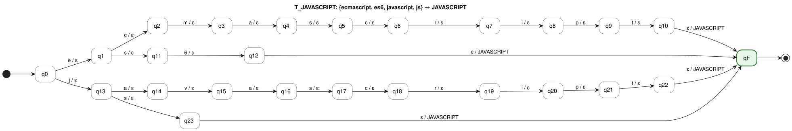

PlantUML source: [`fst/T_JAVASCRIPT.puml`](fst/T_JAVASCRIPT.puml)

Example: `ecmascript` ⟼ JAVASCRIPT; `ecmascrip` has no accepting run (rejected).

### T_TYPESCRIPT

Transforms `TS`, `TypeScript` → **TYPESCRIPT**

**M_TYPESCRIPT = (Q, Σ, Γ, δ, ω, q0, F)**

- **Q** = {q0, q1, q2, q3, q4, q5, q6, q7, q8, q9, q10, q11, qF} — |Q| = |Pref(V)| + 1 = 12 + 1 = 13
- **Σ** = {`c`, `e`, `i`, `p`, `r`, `s`, `t`, `y`}
- **Γ** = {TYPESCRIPT}
- **q0** = q0
- **F** = {qF}
- **V** = dom(M) = {`ts`, `typescript`}; T(M) = V × {TYPESCRIPT} (Proposition 2)
- **δ** and **ω** — |δ| = (|Pref(V)| − 1) + |V| = 11 + 2 = 13:

| #   | q   | a ∈ Σ ∪ {ε} | δ(q, a) | ω(q, a)    |
| --- | --- | ----------- | ------- | ---------- |
| 1   | q0  | `t`         | q1      | ε          |
| 2   | q1  | `s`         | q2      | ε          |
| 3   | q1  | `y`         | q3      | ε          |
| 4   | q2  | ε           | qF      | TYPESCRIPT |
| 5   | q3  | `p`         | q4      | ε          |
| 6   | q4  | `e`         | q5      | ε          |
| 7   | q5  | `s`         | q6      | ε          |
| 8   | q6  | `c`         | q7      | ε          |
| 9   | q7  | `r`         | q8      | ε          |
| 10  | q8  | `i`         | q9      | ε          |
| 11  | q9  | `p`         | q10     | ε          |
| 12  | q10 | `t`         | q11     | ε          |
| 13  | q11 | ε           | qF      | TYPESCRIPT |

δ is undefined for every other pair (q, a).

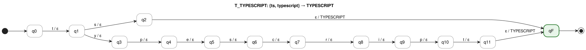

PlantUML source: [`fst/T_TYPESCRIPT.puml`](fst/T_TYPESCRIPT.puml)

Example: `typescript` ⟼ TYPESCRIPT; `typescrip` has no accepting run (rejected).

### T_PYTHON

Transforms `Python`, `Python3`, `Python 3` → **PYTHON**

**M_PYTHON = (Q, Σ, Γ, δ, ω, q0, F)**

- **Q** = {q0, q1, q2, q3, q4, q5, q6, q7, qF} — |Q| = |Pref(V)| + 1 = 8 + 1 = 9
- **Σ** = {`3`, `h`, `n`, `o`, `p`, `t`, `y`}
- **Γ** = {PYTHON}
- **q0** = q0
- **F** = {qF}
- **V** = dom(M) = {`python`, `python3`}; T(M) = V × {PYTHON} (Proposition 2)
- **δ** and **ω** — |δ| = (|Pref(V)| − 1) + |V| = 7 + 2 = 9:

| #   | q   | a ∈ Σ ∪ {ε} | δ(q, a) | ω(q, a) |
| --- | --- | ----------- | ------- | ------- |
| 1   | q0  | `p`         | q1      | ε       |
| 2   | q1  | `y`         | q2      | ε       |
| 3   | q2  | `t`         | q3      | ε       |
| 4   | q3  | `h`         | q4      | ε       |
| 5   | q4  | `o`         | q5      | ε       |
| 6   | q5  | `n`         | q6      | ε       |
| 7   | q6  | `3`         | q7      | ε       |
| 8   | q6  | ε           | qF      | PYTHON  |
| 9   | q7  | ε           | qF      | PYTHON  |

δ is undefined for every other pair (q, a).

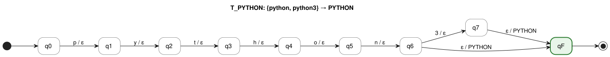

PlantUML source: [`fst/T_PYTHON.puml`](fst/T_PYTHON.puml)

Example: `python3` ⟼ PYTHON; `python3x` has no accepting run (rejected).

### T_JAVA

Transforms `Java` → **JAVA**

**M_JAVA = (Q, Σ, Γ, δ, ω, q0, F)**

- **Q** = {q0, q1, q2, q3, q4, qF} — |Q| = |Pref(V)| + 1 = 5 + 1 = 6
- **Σ** = {`a`, `j`, `v`}
- **Γ** = {JAVA}
- **q0** = q0
- **F** = {qF}
- **V** = dom(M) = {`java`}; T(M) = V × {JAVA} (Proposition 2)
- **δ** and **ω** — |δ| = (|Pref(V)| − 1) + |V| = 4 + 1 = 5:

| #   | q   | a ∈ Σ ∪ {ε} | δ(q, a) | ω(q, a) |
| --- | --- | ----------- | ------- | ------- |
| 1   | q0  | `j`         | q1      | ε       |
| 2   | q1  | `a`         | q2      | ε       |
| 3   | q2  | `v`         | q3      | ε       |
| 4   | q3  | `a`         | q4      | ε       |
| 5   | q4  | ε           | qF      | JAVA    |

δ is undefined for every other pair (q, a).

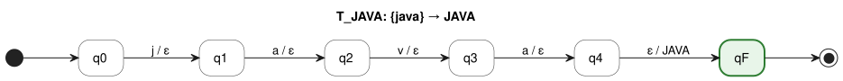

PlantUML source: [`fst/T_JAVA.puml`](fst/T_JAVA.puml)

Example: `java` ⟼ JAVA; `jav` has no accepting run (rejected).

### T_C_PLUS_PLUS

Transforms `C++`, `CPP` → **C_PLUS_PLUS**

**M_C_PLUS_PLUS = (Q, Σ, Γ, δ, ω, q0, F)**

- **Q** = {q0, q1, q2, q3, q4, q5, qF} — |Q| = |Pref(V)| + 1 = 6 + 1 = 7
- **Σ** = {`+`, `c`, `p`}
- **Γ** = {C_PLUS_PLUS}
- **q0** = q0
- **F** = {qF}
- **V** = dom(M) = {`c++`, `cpp`}; T(M) = V × {C_PLUS_PLUS} (Proposition 2)
- **δ** and **ω** — |δ| = (|Pref(V)| − 1) + |V| = 5 + 2 = 7:

| #   | q   | a ∈ Σ ∪ {ε} | δ(q, a) | ω(q, a)     |
| --- | --- | ----------- | ------- | ----------- |
| 1   | q0  | `c`         | q1      | ε           |
| 2   | q1  | `+`         | q2      | ε           |
| 3   | q1  | `p`         | q4      | ε           |
| 4   | q2  | `+`         | q3      | ε           |
| 5   | q3  | ε           | qF      | C_PLUS_PLUS |
| 6   | q4  | `p`         | q5      | ε           |
| 7   | q5  | ε           | qF      | C_PLUS_PLUS |

δ is undefined for every other pair (q, a).

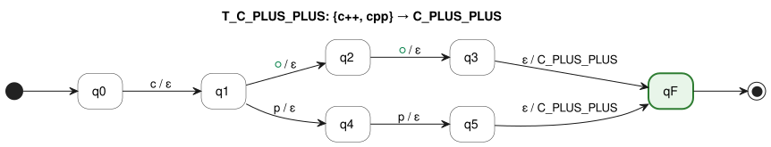

PlantUML source: [`fst/T_C_PLUS_PLUS.puml`](fst/T_C_PLUS_PLUS.puml)

Example: `c++` ⟼ C_PLUS_PLUS; `c+` has no accepting run (rejected).

### T_C_SHARP

Transforms `C#`, `CSharp`, `C Sharp` → **C_SHARP**

**M_C_SHARP = (Q, Σ, Γ, δ, ω, q0, F)**

- **Q** = {q0, q1, q2, q3, q4, q5, q6, q7, qF} — |Q| = |Pref(V)| + 1 = 8 + 1 = 9
- **Σ** = {`#`, `a`, `c`, `h`, `p`, `r`, `s`}
- **Γ** = {C_SHARP}
- **q0** = q0
- **F** = {qF}
- **V** = dom(M) = {`c#`, `csharp`}; T(M) = V × {C_SHARP} (Proposition 2)
- **δ** and **ω** — |δ| = (|Pref(V)| − 1) + |V| = 7 + 2 = 9:

| #   | q   | a ∈ Σ ∪ {ε} | δ(q, a) | ω(q, a) |
| --- | --- | ----------- | ------- | ------- |
| 1   | q0  | `c`         | q1      | ε       |
| 2   | q1  | `#`         | q2      | ε       |
| 3   | q1  | `s`         | q3      | ε       |
| 4   | q2  | ε           | qF      | C_SHARP |
| 5   | q3  | `h`         | q4      | ε       |
| 6   | q4  | `a`         | q5      | ε       |
| 7   | q5  | `r`         | q6      | ε       |
| 8   | q6  | `p`         | q7      | ε       |
| 9   | q7  | ε           | qF      | C_SHARP |

δ is undefined for every other pair (q, a).

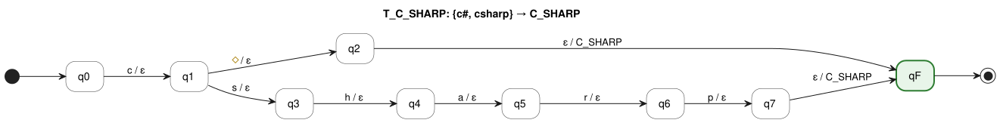

PlantUML source: [`fst/T_C_SHARP.puml`](fst/T_C_SHARP.puml)

Example: `csharp` ⟼ C_SHARP; `cshar` has no accepting run (rejected).

### T_GO

Transforms `Golang` → **GO**

**M_GO = (Q, Σ, Γ, δ, ω, q0, F)**

- **Q** = {q0, q1, q2, q3, q4, q5, q6, qF} — |Q| = |Pref(V)| + 1 = 7 + 1 = 8
- **Σ** = {`a`, `g`, `l`, `n`, `o`}
- **Γ** = {GO}
- **q0** = q0
- **F** = {qF}
- **V** = dom(M) = {`golang`}; T(M) = V × {GO} (Proposition 2)
- **δ** and **ω** — |δ| = (|Pref(V)| − 1) + |V| = 6 + 1 = 7:

| #   | q   | a ∈ Σ ∪ {ε} | δ(q, a) | ω(q, a) |
| --- | --- | ----------- | ------- | ------- |
| 1   | q0  | `g`         | q1      | ε       |
| 2   | q1  | `o`         | q2      | ε       |
| 3   | q2  | `l`         | q3      | ε       |
| 4   | q3  | `a`         | q4      | ε       |
| 5   | q4  | `n`         | q5      | ε       |
| 6   | q5  | `g`         | q6      | ε       |
| 7   | q6  | ε           | qF      | GO      |

δ is undefined for every other pair (q, a).

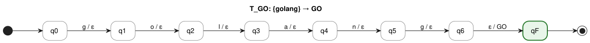

PlantUML source: [`fst/T_GO.puml`](fst/T_GO.puml)

Example: `golang` ⟼ GO; `golan` has no accepting run (rejected).

### T_KOTLIN

Transforms `Kotlin` → **KOTLIN**

**M_KOTLIN = (Q, Σ, Γ, δ, ω, q0, F)**

- **Q** = {q0, q1, q2, q3, q4, q5, q6, qF} — |Q| = |Pref(V)| + 1 = 7 + 1 = 8
- **Σ** = {`i`, `k`, `l`, `n`, `o`, `t`}
- **Γ** = {KOTLIN}
- **q0** = q0
- **F** = {qF}
- **V** = dom(M) = {`kotlin`}; T(M) = V × {KOTLIN} (Proposition 2)
- **δ** and **ω** — |δ| = (|Pref(V)| − 1) + |V| = 6 + 1 = 7:

| #   | q   | a ∈ Σ ∪ {ε} | δ(q, a) | ω(q, a) |
| --- | --- | ----------- | ------- | ------- |
| 1   | q0  | `k`         | q1      | ε       |
| 2   | q1  | `o`         | q2      | ε       |
| 3   | q2  | `t`         | q3      | ε       |
| 4   | q3  | `l`         | q4      | ε       |
| 5   | q4  | `i`         | q5      | ε       |
| 6   | q5  | `n`         | q6      | ε       |
| 7   | q6  | ε           | qF      | KOTLIN  |

δ is undefined for every other pair (q, a).

PlantUML source: [`fst/T_KOTLIN.puml`](fst/T_KOTLIN.puml)

Example: `kotlin` ⟼ KOTLIN; `kotli` has no accepting run (rejected).

### T_SWIFT

Transforms `Swift` → **SWIFT**

**M_SWIFT = (Q, Σ, Γ, δ, ω, q0, F)**

- **Q** = {q0, q1, q2, q3, q4, q5, qF} — |Q| = |Pref(V)| + 1 = 6 + 1 = 7
- **Σ** = {`f`, `i`, `s`, `t`, `w`}
- **Γ** = {SWIFT}
- **q0** = q0
- **F** = {qF}
- **V** = dom(M) = {`swift`}; T(M) = V × {SWIFT} (Proposition 2)
- **δ** and **ω** — |δ| = (|Pref(V)| − 1) + |V| = 5 + 1 = 6:

| #   | q   | a ∈ Σ ∪ {ε} | δ(q, a) | ω(q, a) |
| --- | --- | ----------- | ------- | ------- |
| 1   | q0  | `s`         | q1      | ε       |
| 2   | q1  | `w`         | q2      | ε       |
| 3   | q2  | `i`         | q3      | ε       |
| 4   | q3  | `f`         | q4      | ε       |
| 5   | q4  | `t`         | q5      | ε       |
| 6   | q5  | ε           | qF      | SWIFT   |

δ is undefined for every other pair (q, a).

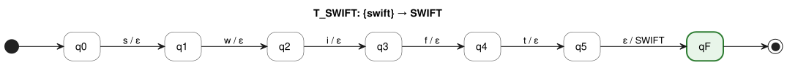

PlantUML source: [`fst/T_SWIFT.puml`](fst/T_SWIFT.puml)

Example: `swift` ⟼ SWIFT; `swif` has no accepting run (rejected).

### T_RUST

Transforms `Rust` → **RUST**

**M_RUST = (Q, Σ, Γ, δ, ω, q0, F)**

- **Q** = {q0, q1, q2, q3, q4, qF} — |Q| = |Pref(V)| + 1 = 5 + 1 = 6
- **Σ** = {`r`, `s`, `t`, `u`}
- **Γ** = {RUST}
- **q0** = q0
- **F** = {qF}
- **V** = dom(M) = {`rust`}; T(M) = V × {RUST} (Proposition 2)
- **δ** and **ω** — |δ| = (|Pref(V)| − 1) + |V| = 4 + 1 = 5:

| #   | q   | a ∈ Σ ∪ {ε} | δ(q, a) | ω(q, a) |
| --- | --- | ----------- | ------- | ------- |
| 1   | q0  | `r`         | q1      | ε       |
| 2   | q1  | `u`         | q2      | ε       |
| 3   | q2  | `s`         | q3      | ε       |
| 4   | q3  | `t`         | q4      | ε       |
| 5   | q4  | ε           | qF      | RUST    |

δ is undefined for every other pair (q, a).

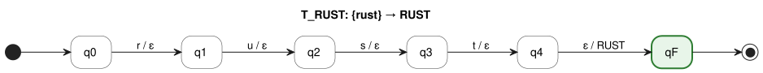

PlantUML source: [`fst/T_RUST.puml`](fst/T_RUST.puml)

Example: `rust` ⟼ RUST; `rus` has no accepting run (rejected).

### T_PHP

Transforms `PHP` → **PHP**

**M_PHP = (Q, Σ, Γ, δ, ω, q0, F)**

- **Q** = {q0, q1, q2, q3, qF} — |Q| = |Pref(V)| + 1 = 4 + 1 = 5
- **Σ** = {`h`, `p`}
- **Γ** = {PHP}
- **q0** = q0
- **F** = {qF}
- **V** = dom(M) = {`php`}; T(M) = V × {PHP} (Proposition 2)
- **δ** and **ω** — |δ| = (|Pref(V)| − 1) + |V| = 3 + 1 = 4:

| #   | q   | a ∈ Σ ∪ {ε} | δ(q, a) | ω(q, a) |
| --- | --- | ----------- | ------- | ------- |
| 1   | q0  | `p`         | q1      | ε       |
| 2   | q1  | `h`         | q2      | ε       |
| 3   | q2  | `p`         | q3      | ε       |
| 4   | q3  | ε           | qF      | PHP     |

δ is undefined for every other pair (q, a).

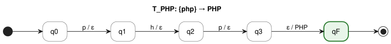

PlantUML source: [`fst/T_PHP.puml`](fst/T_PHP.puml)

Example: `php` ⟼ PHP; `ph` has no accepting run (rejected).

### T_RUBY

Transforms `Ruby` → **RUBY**

**M_RUBY = (Q, Σ, Γ, δ, ω, q0, F)**

- **Q** = {q0, q1, q2, q3, q4, qF} — |Q| = |Pref(V)| + 1 = 5 + 1 = 6
- **Σ** = {`b`, `r`, `u`, `y`}
- **Γ** = {RUBY}
- **q0** = q0
- **F** = {qF}
- **V** = dom(M) = {`ruby`}; T(M) = V × {RUBY} (Proposition 2)
- **δ** and **ω** — |δ| = (|Pref(V)| − 1) + |V| = 4 + 1 = 5:

| #   | q   | a ∈ Σ ∪ {ε} | δ(q, a) | ω(q, a) |
| --- | --- | ----------- | ------- | ------- |
| 1   | q0  | `r`         | q1      | ε       |
| 2   | q1  | `u`         | q2      | ε       |
| 3   | q2  | `b`         | q3      | ε       |
| 4   | q3  | `y`         | q4      | ε       |
| 5   | q4  | ε           | qF      | RUBY    |

δ is undefined for every other pair (q, a).

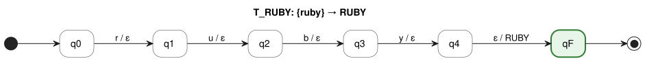

PlantUML source: [`fst/T_RUBY.puml`](fst/T_RUBY.puml)

Example: `ruby` ⟼ RUBY; `rub` has no accepting run (rejected).

### T_SCALA

Transforms `Scala` → **SCALA**

**M_SCALA = (Q, Σ, Γ, δ, ω, q0, F)**

- **Q** = {q0, q1, q2, q3, q4, q5, qF} — |Q| = |Pref(V)| + 1 = 6 + 1 = 7
- **Σ** = {`a`, `c`, `l`, `s`}
- **Γ** = {SCALA}
- **q0** = q0
- **F** = {qF}
- **V** = dom(M) = {`scala`}; T(M) = V × {SCALA} (Proposition 2)
- **δ** and **ω** — |δ| = (|Pref(V)| − 1) + |V| = 5 + 1 = 6:

| #   | q   | a ∈ Σ ∪ {ε} | δ(q, a) | ω(q, a) |
| --- | --- | ----------- | ------- | ------- |
| 1   | q0  | `s`         | q1      | ε       |
| 2   | q1  | `c`         | q2      | ε       |
| 3   | q2  | `a`         | q3      | ε       |
| 4   | q3  | `l`         | q4      | ε       |
| 5   | q4  | `a`         | q5      | ε       |
| 6   | q5  | ε           | qF      | SCALA   |

δ is undefined for every other pair (q, a).

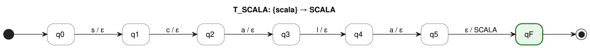

PlantUML source: [`fst/T_SCALA.puml`](fst/T_SCALA.puml)

Example: `scala` ⟼ SCALA; `scal` has no accepting run (rejected).

### T_REACT

Transforms `React`, `React.js`, `ReactJS` → **REACT**

**M_REACT = (Q, Σ, Γ, δ, ω, q0, F)**

- **Q** = {q0, q1, q2, q3, q4, q5, q6, q7, qF} — |Q| = |Pref(V)| + 1 = 8 + 1 = 9
- **Σ** = {`a`, `c`, `e`, `j`, `r`, `s`, `t`}
- **Γ** = {REACT}
- **q0** = q0
- **F** = {qF}
- **V** = dom(M) = {`react`, `reactjs`}; T(M) = V × {REACT} (Proposition 2)
- **δ** and **ω** — |δ| = (|Pref(V)| − 1) + |V| = 7 + 2 = 9:

| #   | q   | a ∈ Σ ∪ {ε} | δ(q, a) | ω(q, a) |
| --- | --- | ----------- | ------- | ------- |
| 1   | q0  | `r`         | q1      | ε       |
| 2   | q1  | `e`         | q2      | ε       |
| 3   | q2  | `a`         | q3      | ε       |
| 4   | q3  | `c`         | q4      | ε       |
| 5   | q4  | `t`         | q5      | ε       |
| 6   | q5  | `j`         | q6      | ε       |
| 7   | q5  | ε           | qF      | REACT   |
| 8   | q6  | `s`         | q7      | ε       |
| 9   | q7  | ε           | qF      | REACT   |

δ is undefined for every other pair (q, a).

PlantUML source: [`fst/T_REACT.puml`](fst/T_REACT.puml)

Example: `reactjs` ⟼ REACT; `reactj` has no accepting run (rejected).

### T_ANGULAR

Transforms `Angular`, `AngularJS`, `Angular.js` → **ANGULAR**

**M_ANGULAR = (Q, Σ, Γ, δ, ω, q0, F)**

- **Q** = {q0, q1, q2, q3, q4, q5, q6, q7, q8, q9, qF} — |Q| = |Pref(V)| + 1 = 10 + 1 = 11
- **Σ** = {`a`, `g`, `j`, `l`, `n`, `r`, `s`, `u`}
- **Γ** = {ANGULAR}
- **q0** = q0
- **F** = {qF}
- **V** = dom(M) = {`angular`, `angularjs`}; T(M) = V × {ANGULAR} (Proposition 2)
- **δ** and **ω** — |δ| = (|Pref(V)| − 1) + |V| = 9 + 2 = 11:

| #   | q   | a ∈ Σ ∪ {ε} | δ(q, a) | ω(q, a) |
| --- | --- | ----------- | ------- | ------- |
| 1   | q0  | `a`         | q1      | ε       |
| 2   | q1  | `n`         | q2      | ε       |
| 3   | q2  | `g`         | q3      | ε       |
| 4   | q3  | `u`         | q4      | ε       |
| 5   | q4  | `l`         | q5      | ε       |
| 6   | q5  | `a`         | q6      | ε       |
| 7   | q6  | `r`         | q7      | ε       |
| 8   | q7  | `j`         | q8      | ε       |
| 9   | q7  | ε           | qF      | ANGULAR |
| 10  | q8  | `s`         | q9      | ε       |
| 11  | q9  | ε           | qF      | ANGULAR |

δ is undefined for every other pair (q, a).

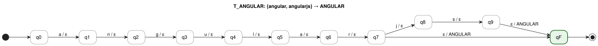

PlantUML source: [`fst/T_ANGULAR.puml`](fst/T_ANGULAR.puml)

Example: `angularjs` ⟼ ANGULAR; `angularj` has no accepting run (rejected).

### T_VUE

Transforms `Vue`, `Vue.js`, `VueJS` → **VUE**

**M_VUE = (Q, Σ, Γ, δ, ω, q0, F)**

- **Q** = {q0, q1, q2, q3, q4, q5, qF} — |Q| = |Pref(V)| + 1 = 6 + 1 = 7
- **Σ** = {`e`, `j`, `s`, `u`, `v`}
- **Γ** = {VUE}
- **q0** = q0
- **F** = {qF}
- **V** = dom(M) = {`vue`, `vuejs`}; T(M) = V × {VUE} (Proposition 2)
- **δ** and **ω** — |δ| = (|Pref(V)| − 1) + |V| = 5 + 2 = 7:

| #   | q   | a ∈ Σ ∪ {ε} | δ(q, a) | ω(q, a) |
| --- | --- | ----------- | ------- | ------- |
| 1   | q0  | `v`         | q1      | ε       |
| 2   | q1  | `u`         | q2      | ε       |
| 3   | q2  | `e`         | q3      | ε       |
| 4   | q3  | `j`         | q4      | ε       |
| 5   | q3  | ε           | qF      | VUE     |
| 6   | q4  | `s`         | q5      | ε       |
| 7   | q5  | ε           | qF      | VUE     |

δ is undefined for every other pair (q, a).

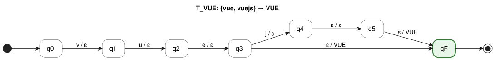

PlantUML source: [`fst/T_VUE.puml`](fst/T_VUE.puml)

Example: `vuejs` ⟼ VUE; `vuej` has no accepting run (rejected).

### T_NEXT_JS

Transforms `Next.js`, `NextJS` → **NEXT_JS**

**M_NEXT_JS = (Q, Σ, Γ, δ, ω, q0, F)**

- **Q** = {q0, q1, q2, q3, q4, q5, q6, qF} — |Q| = |Pref(V)| + 1 = 7 + 1 = 8
- **Σ** = {`e`, `j`, `n`, `s`, `t`, `x`}
- **Γ** = {NEXT_JS}
- **q0** = q0
- **F** = {qF}
- **V** = dom(M) = {`nextjs`}; T(M) = V × {NEXT_JS} (Proposition 2)
- **δ** and **ω** — |δ| = (|Pref(V)| − 1) + |V| = 6 + 1 = 7:

| #   | q   | a ∈ Σ ∪ {ε} | δ(q, a) | ω(q, a) |
| --- | --- | ----------- | ------- | ------- |
| 1   | q0  | `n`         | q1      | ε       |
| 2   | q1  | `e`         | q2      | ε       |
| 3   | q2  | `x`         | q3      | ε       |
| 4   | q3  | `t`         | q4      | ε       |
| 5   | q4  | `j`         | q5      | ε       |
| 6   | q5  | `s`         | q6      | ε       |
| 7   | q6  | ε           | qF      | NEXT_JS |

δ is undefined for every other pair (q, a).

PlantUML source: [`fst/T_NEXT_JS.puml`](fst/T_NEXT_JS.puml)

Example: `nextjs` ⟼ NEXT_JS; `nextj` has no accepting run (rejected).

### T_NODE_JS

Transforms `Node`, `Node.js`, `NodeJS` → **NODE_JS**

**M_NODE_JS = (Q, Σ, Γ, δ, ω, q0, F)**

- **Q** = {q0, q1, q2, q3, q4, q5, q6, qF} — |Q| = |Pref(V)| + 1 = 7 + 1 = 8
- **Σ** = {`d`, `e`, `j`, `n`, `o`, `s`}
- **Γ** = {NODE_JS}
- **q0** = q0
- **F** = {qF}
- **V** = dom(M) = {`node`, `nodejs`}; T(M) = V × {NODE_JS} (Proposition 2)
- **δ** and **ω** — |δ| = (|Pref(V)| − 1) + |V| = 6 + 2 = 8:

| #   | q   | a ∈ Σ ∪ {ε} | δ(q, a) | ω(q, a) |
| --- | --- | ----------- | ------- | ------- |
| 1   | q0  | `n`         | q1      | ε       |
| 2   | q1  | `o`         | q2      | ε       |
| 3   | q2  | `d`         | q3      | ε       |
| 4   | q3  | `e`         | q4      | ε       |
| 5   | q4  | `j`         | q5      | ε       |
| 6   | q4  | ε           | qF      | NODE_JS |
| 7   | q5  | `s`         | q6      | ε       |
| 8   | q6  | ε           | qF      | NODE_JS |

δ is undefined for every other pair (q, a).

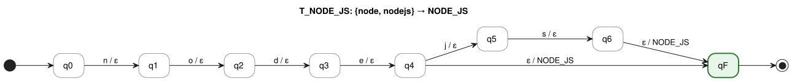

PlantUML source: [`fst/T_NODE_JS.puml`](fst/T_NODE_JS.puml)

Example: `nodejs` ⟼ NODE_JS; `nodej` has no accepting run (rejected).

### T_EXPRESS

Transforms `Express.js`, `ExpressJS` → **EXPRESS**

**M_EXPRESS = (Q, Σ, Γ, δ, ω, q0, F)**

- **Q** = {q0, q1, q2, q3, q4, q5, q6, q7, q8, q9, qF} — |Q| = |Pref(V)| + 1 = 10 + 1 = 11
- **Σ** = {`e`, `j`, `p`, `r`, `s`, `x`}
- **Γ** = {EXPRESS}
- **q0** = q0
- **F** = {qF}
- **V** = dom(M) = {`expressjs`}; T(M) = V × {EXPRESS} (Proposition 2)
- **δ** and **ω** — |δ| = (|Pref(V)| − 1) + |V| = 9 + 1 = 10:

| #   | q   | a ∈ Σ ∪ {ε} | δ(q, a) | ω(q, a) |
| --- | --- | ----------- | ------- | ------- |
| 1   | q0  | `e`         | q1      | ε       |
| 2   | q1  | `x`         | q2      | ε       |
| 3   | q2  | `p`         | q3      | ε       |
| 4   | q3  | `r`         | q4      | ε       |
| 5   | q4  | `e`         | q5      | ε       |
| 6   | q5  | `s`         | q6      | ε       |
| 7   | q6  | `s`         | q7      | ε       |
| 8   | q7  | `j`         | q8      | ε       |
| 9   | q8  | `s`         | q9      | ε       |
| 10  | q9  | ε           | qF      | EXPRESS |

δ is undefined for every other pair (q, a).

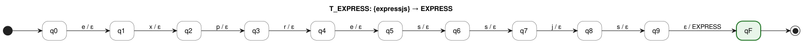

PlantUML source: [`fst/T_EXPRESS.puml`](fst/T_EXPRESS.puml)

Example: `expressjs` ⟼ EXPRESS; `expressj` has no accepting run (rejected).

### T_DJANGO

Transforms `Django` → **DJANGO**

**M_DJANGO = (Q, Σ, Γ, δ, ω, q0, F)**

- **Q** = {q0, q1, q2, q3, q4, q5, q6, qF} — |Q| = |Pref(V)| + 1 = 7 + 1 = 8
- **Σ** = {`a`, `d`, `g`, `j`, `n`, `o`}
- **Γ** = {DJANGO}
- **q0** = q0
- **F** = {qF}
- **V** = dom(M) = {`django`}; T(M) = V × {DJANGO} (Proposition 2)
- **δ** and **ω** — |δ| = (|Pref(V)| − 1) + |V| = 6 + 1 = 7:

| #   | q   | a ∈ Σ ∪ {ε} | δ(q, a) | ω(q, a) |
| --- | --- | ----------- | ------- | ------- |
| 1   | q0  | `d`         | q1      | ε       |
| 2   | q1  | `j`         | q2      | ε       |
| 3   | q2  | `a`         | q3      | ε       |
| 4   | q3  | `n`         | q4      | ε       |
| 5   | q4  | `g`         | q5      | ε       |
| 6   | q5  | `o`         | q6      | ε       |
| 7   | q6  | ε           | qF      | DJANGO  |

δ is undefined for every other pair (q, a).

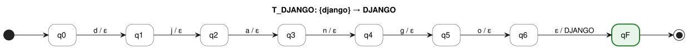

PlantUML source: [`fst/T_DJANGO.puml`](fst/T_DJANGO.puml)

Example: `django` ⟼ DJANGO; `djang` has no accepting run (rejected).

### T_FLASK

Transforms `Flask` → **FLASK**

**M_FLASK = (Q, Σ, Γ, δ, ω, q0, F)**

- **Q** = {q0, q1, q2, q3, q4, q5, qF} — |Q| = |Pref(V)| + 1 = 6 + 1 = 7
- **Σ** = {`a`, `f`, `k`, `l`, `s`}
- **Γ** = {FLASK}
- **q0** = q0
- **F** = {qF}
- **V** = dom(M) = {`flask`}; T(M) = V × {FLASK} (Proposition 2)
- **δ** and **ω** — |δ| = (|Pref(V)| − 1) + |V| = 5 + 1 = 6:

| #   | q   | a ∈ Σ ∪ {ε} | δ(q, a) | ω(q, a) |
| --- | --- | ----------- | ------- | ------- |
| 1   | q0  | `f`         | q1      | ε       |
| 2   | q1  | `l`         | q2      | ε       |
| 3   | q2  | `a`         | q3      | ε       |
| 4   | q3  | `s`         | q4      | ε       |
| 5   | q4  | `k`         | q5      | ε       |
| 6   | q5  | ε           | qF      | FLASK   |

δ is undefined for every other pair (q, a).

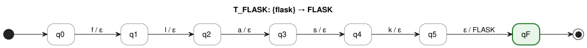

PlantUML source: [`fst/T_FLASK.puml`](fst/T_FLASK.puml)

Example: `flask` ⟼ FLASK; `flas` has no accepting run (rejected).

### T_FASTAPI

Transforms `FastAPI`, `Fast API` → **FASTAPI**

**M_FASTAPI = (Q, Σ, Γ, δ, ω, q0, F)**

- **Q** = {q0, q1, q2, q3, q4, q5, q6, q7, qF} — |Q| = |Pref(V)| + 1 = 8 + 1 = 9
- **Σ** = {`a`, `f`, `i`, `p`, `s`, `t`}
- **Γ** = {FASTAPI}
- **q0** = q0
- **F** = {qF}
- **V** = dom(M) = {`fastapi`}; T(M) = V × {FASTAPI} (Proposition 2)
- **δ** and **ω** — |δ| = (|Pref(V)| − 1) + |V| = 7 + 1 = 8:

| #   | q   | a ∈ Σ ∪ {ε} | δ(q, a) | ω(q, a) |
| --- | --- | ----------- | ------- | ------- |
| 1   | q0  | `f`         | q1      | ε       |
| 2   | q1  | `a`         | q2      | ε       |
| 3   | q2  | `s`         | q3      | ε       |
| 4   | q3  | `t`         | q4      | ε       |
| 5   | q4  | `a`         | q5      | ε       |
| 6   | q5  | `p`         | q6      | ε       |
| 7   | q6  | `i`         | q7      | ε       |
| 8   | q7  | ε           | qF      | FASTAPI |

δ is undefined for every other pair (q, a).

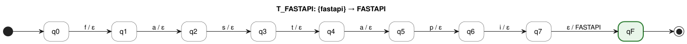

PlantUML source: [`fst/T_FASTAPI.puml`](fst/T_FASTAPI.puml)

Example: `fastapi` ⟼ FASTAPI; `fastap` has no accepting run (rejected).

### T_SPRING_BOOT

Transforms `Spring Boot`, `SpringBoot` → **SPRING_BOOT**

**M_SPRING_BOOT = (Q, Σ, Γ, δ, ω, q0, F)**

- **Q** = {q0, q1, q2, q3, q4, q5, q6, q7, q8, q9, q10, qF} — |Q| = |Pref(V)| + 1 = 11 + 1 = 12
- **Σ** = {`b`, `g`, `i`, `n`, `o`, `p`, `r`, `s`, `t`}
- **Γ** = {SPRING_BOOT}
- **q0** = q0
- **F** = {qF}
- **V** = dom(M) = {`springboot`}; T(M) = V × {SPRING_BOOT} (Proposition 2)
- **δ** and **ω** — |δ| = (|Pref(V)| − 1) + |V| = 10 + 1 = 11:

| #   | q   | a ∈ Σ ∪ {ε} | δ(q, a) | ω(q, a)     |
| --- | --- | ----------- | ------- | ----------- |
| 1   | q0  | `s`         | q1      | ε           |
| 2   | q1  | `p`         | q2      | ε           |
| 3   | q2  | `r`         | q3      | ε           |
| 4   | q3  | `i`         | q4      | ε           |
| 5   | q4  | `n`         | q5      | ε           |
| 6   | q5  | `g`         | q6      | ε           |
| 7   | q6  | `b`         | q7      | ε           |
| 8   | q7  | `o`         | q8      | ε           |
| 9   | q8  | `o`         | q9      | ε           |
| 10  | q9  | `t`         | q10     | ε           |
| 11  | q10 | ε           | qF      | SPRING_BOOT |

δ is undefined for every other pair (q, a).

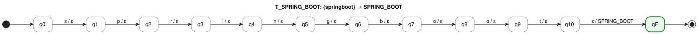

PlantUML source: [`fst/T_SPRING_BOOT.puml`](fst/T_SPRING_BOOT.puml)

Example: `springboot` ⟼ SPRING_BOOT; `springboo` has no accepting run (rejected).

### T_PANDAS

Transforms `pandas` → **PANDAS**

**M_PANDAS = (Q, Σ, Γ, δ, ω, q0, F)**

- **Q** = {q0, q1, q2, q3, q4, q5, q6, qF} — |Q| = |Pref(V)| + 1 = 7 + 1 = 8
- **Σ** = {`a`, `d`, `n`, `p`, `s`}
- **Γ** = {PANDAS}
- **q0** = q0
- **F** = {qF}
- **V** = dom(M) = {`pandas`}; T(M) = V × {PANDAS} (Proposition 2)
- **δ** and **ω** — |δ| = (|Pref(V)| − 1) + |V| = 6 + 1 = 7:

| #   | q   | a ∈ Σ ∪ {ε} | δ(q, a) | ω(q, a) |
| --- | --- | ----------- | ------- | ------- |
| 1   | q0  | `p`         | q1      | ε       |
| 2   | q1  | `a`         | q2      | ε       |
| 3   | q2  | `n`         | q3      | ε       |
| 4   | q3  | `d`         | q4      | ε       |
| 5   | q4  | `a`         | q5      | ε       |
| 6   | q5  | `s`         | q6      | ε       |
| 7   | q6  | ε           | qF      | PANDAS  |

δ is undefined for every other pair (q, a).

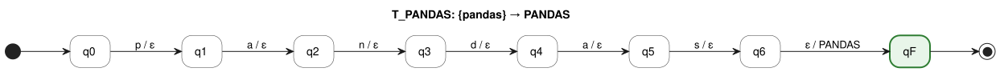

PlantUML source: [`fst/T_PANDAS.puml`](fst/T_PANDAS.puml)

Example: `pandas` ⟼ PANDAS; `panda` has no accepting run (rejected).

### T_NUMPY

Transforms `NumPy`, `Num Py` → **NUMPY**

**M_NUMPY = (Q, Σ, Γ, δ, ω, q0, F)**

- **Q** = {q0, q1, q2, q3, q4, q5, qF} — |Q| = |Pref(V)| + 1 = 6 + 1 = 7
- **Σ** = {`m`, `n`, `p`, `u`, `y`}
- **Γ** = {NUMPY}
- **q0** = q0
- **F** = {qF}
- **V** = dom(M) = {`numpy`}; T(M) = V × {NUMPY} (Proposition 2)
- **δ** and **ω** — |δ| = (|Pref(V)| − 1) + |V| = 5 + 1 = 6:

| #   | q   | a ∈ Σ ∪ {ε} | δ(q, a) | ω(q, a) |
| --- | --- | ----------- | ------- | ------- |
| 1   | q0  | `n`         | q1      | ε       |
| 2   | q1  | `u`         | q2      | ε       |
| 3   | q2  | `m`         | q3      | ε       |
| 4   | q3  | `p`         | q4      | ε       |
| 5   | q4  | `y`         | q5      | ε       |
| 6   | q5  | ε           | qF      | NUMPY   |

δ is undefined for every other pair (q, a).

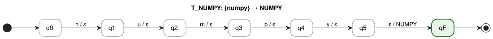

PlantUML source: [`fst/T_NUMPY.puml`](fst/T_NUMPY.puml)

Example: `numpy` ⟼ NUMPY; `nump` has no accepting run (rejected).

### T_SCIKIT_LEARN

Transforms `Scikit-learn`, `scikit learn`, `scikitlearn`, `sklearn` → **SCIKIT_LEARN**

**M_SCIKIT_LEARN = (Q, Σ, Γ, δ, ω, q0, F)**

- **Q** = {q0, q1, q2, q3, q4, q5, q6, q7, q8, q9, q10, q11, q12, q13, q14, q15, q16, q17, qF} — |Q| = |Pref(V)| + 1 = 18 + 1 = 19
- **Σ** = {`a`, `c`, `e`, `i`, `k`, `l`, `n`, `r`, `s`, `t`}
- **Γ** = {SCIKIT_LEARN}
- **q0** = q0
- **F** = {qF}
- **V** = dom(M) = {`scikitlearn`, `sklearn`}; T(M) = V × {SCIKIT_LEARN} (Proposition 2)
- **δ** and **ω** — |δ| = (|Pref(V)| − 1) + |V| = 17 + 2 = 19:

| #   | q   | a ∈ Σ ∪ {ε} | δ(q, a) | ω(q, a)      |
| --- | --- | ----------- | ------- | ------------ |
| 1   | q0  | `s`         | q1      | ε            |
| 2   | q1  | `c`         | q2      | ε            |
| 3   | q1  | `k`         | q12     | ε            |
| 4   | q2  | `i`         | q3      | ε            |
| 5   | q3  | `k`         | q4      | ε            |
| 6   | q4  | `i`         | q5      | ε            |
| 7   | q5  | `t`         | q6      | ε            |
| 8   | q6  | `l`         | q7      | ε            |
| 9   | q7  | `e`         | q8      | ε            |
| 10  | q8  | `a`         | q9      | ε            |
| 11  | q9  | `r`         | q10     | ε            |
| 12  | q10 | `n`         | q11     | ε            |
| 13  | q11 | ε           | qF      | SCIKIT_LEARN |
| 14  | q12 | `l`         | q13     | ε            |
| 15  | q13 | `e`         | q14     | ε            |
| 16  | q14 | `a`         | q15     | ε            |
| 17  | q15 | `r`         | q16     | ε            |
| 18  | q16 | `n`         | q17     | ε            |
| 19  | q17 | ε           | qF      | SCIKIT_LEARN |

δ is undefined for every other pair (q, a).

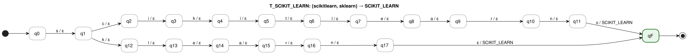

PlantUML source: [`fst/T_SCIKIT_LEARN.puml`](fst/T_SCIKIT_LEARN.puml)

Example: `scikitlearn` ⟼ SCIKIT_LEARN; `scikitlear` has no accepting run (rejected).

### T_TENSORFLOW

Transforms `TensorFlow`, `Tensor Flow` → **TENSORFLOW**

**M_TENSORFLOW = (Q, Σ, Γ, δ, ω, q0, F)**

- **Q** = {q0, q1, q2, q3, q4, q5, q6, q7, q8, q9, q10, qF} — |Q| = |Pref(V)| + 1 = 11 + 1 = 12
- **Σ** = {`e`, `f`, `l`, `n`, `o`, `r`, `s`, `t`, `w`}
- **Γ** = {TENSORFLOW}
- **q0** = q0
- **F** = {qF}
- **V** = dom(M) = {`tensorflow`}; T(M) = V × {TENSORFLOW} (Proposition 2)
- **δ** and **ω** — |δ| = (|Pref(V)| − 1) + |V| = 10 + 1 = 11:

| #   | q   | a ∈ Σ ∪ {ε} | δ(q, a) | ω(q, a)    |
| --- | --- | ----------- | ------- | ---------- |
| 1   | q0  | `t`         | q1      | ε          |
| 2   | q1  | `e`         | q2      | ε          |
| 3   | q2  | `n`         | q3      | ε          |
| 4   | q3  | `s`         | q4      | ε          |
| 5   | q4  | `o`         | q5      | ε          |
| 6   | q5  | `r`         | q6      | ε          |
| 7   | q6  | `f`         | q7      | ε          |
| 8   | q7  | `l`         | q8      | ε          |
| 9   | q8  | `o`         | q9      | ε          |
| 10  | q9  | `w`         | q10     | ε          |
| 11  | q10 | ε           | qF      | TENSORFLOW |

δ is undefined for every other pair (q, a).

PlantUML source: [`fst/T_TENSORFLOW.puml`](fst/T_TENSORFLOW.puml)

Example: `tensorflow` ⟼ TENSORFLOW; `tensorflo` has no accepting run (rejected).

### T_PYTORCH

Transforms `PyTorch`, `Py Torch` → **PYTORCH**

**M_PYTORCH = (Q, Σ, Γ, δ, ω, q0, F)**

- **Q** = {q0, q1, q2, q3, q4, q5, q6, q7, qF} — |Q| = |Pref(V)| + 1 = 8 + 1 = 9
- **Σ** = {`c`, `h`, `o`, `p`, `r`, `t`, `y`}
- **Γ** = {PYTORCH}
- **q0** = q0
- **F** = {qF}
- **V** = dom(M) = {`pytorch`}; T(M) = V × {PYTORCH} (Proposition 2)
- **δ** and **ω** — |δ| = (|Pref(V)| − 1) + |V| = 7 + 1 = 8:

| #   | q   | a ∈ Σ ∪ {ε} | δ(q, a) | ω(q, a) |
| --- | --- | ----------- | ------- | ------- |
| 1   | q0  | `p`         | q1      | ε       |
| 2   | q1  | `y`         | q2      | ε       |
| 3   | q2  | `t`         | q3      | ε       |
| 4   | q3  | `o`         | q4      | ε       |
| 5   | q4  | `r`         | q5      | ε       |
| 6   | q5  | `c`         | q6      | ε       |
| 7   | q6  | `h`         | q7      | ε       |
| 8   | q7  | ε           | qF      | PYTORCH |

δ is undefined for every other pair (q, a).

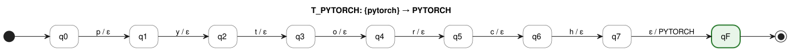

PlantUML source: [`fst/T_PYTORCH.puml`](fst/T_PYTORCH.puml)

Example: `pytorch` ⟼ PYTORCH; `pytorc` has no accepting run (rejected).

### T_KERAS

Transforms `Keras` → **KERAS**

**M_KERAS = (Q, Σ, Γ, δ, ω, q0, F)**

- **Q** = {q0, q1, q2, q3, q4, q5, qF} — |Q| = |Pref(V)| + 1 = 6 + 1 = 7
- **Σ** = {`a`, `e`, `k`, `r`, `s`}
- **Γ** = {KERAS}
- **q0** = q0
- **F** = {qF}
- **V** = dom(M) = {`keras`}; T(M) = V × {KERAS} (Proposition 2)
- **δ** and **ω** — |δ| = (|Pref(V)| − 1) + |V| = 5 + 1 = 6:

| #   | q   | a ∈ Σ ∪ {ε} | δ(q, a) | ω(q, a) |
| --- | --- | ----------- | ------- | ------- |
| 1   | q0  | `k`         | q1      | ε       |
| 2   | q1  | `e`         | q2      | ε       |
| 3   | q2  | `r`         | q3      | ε       |
| 4   | q3  | `a`         | q4      | ε       |
| 5   | q4  | `s`         | q5      | ε       |
| 6   | q5  | ε           | qF      | KERAS   |

δ is undefined for every other pair (q, a).

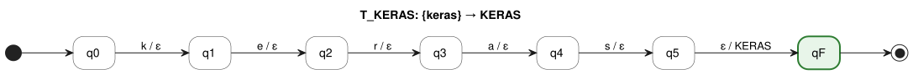

PlantUML source: [`fst/T_KERAS.puml`](fst/T_KERAS.puml)

Example: `keras` ⟼ KERAS; `kera` has no accepting run (rejected).

### T_MATPLOTLIB

Transforms `Matplotlib` → **MATPLOTLIB**

**M_MATPLOTLIB = (Q, Σ, Γ, δ, ω, q0, F)**

- **Q** = {q0, q1, q2, q3, q4, q5, q6, q7, q8, q9, q10, qF} — |Q| = |Pref(V)| + 1 = 11 + 1 = 12
- **Σ** = {`a`, `b`, `i`, `l`, `m`, `o`, `p`, `t`}
- **Γ** = {MATPLOTLIB}
- **q0** = q0
- **F** = {qF}
- **V** = dom(M) = {`matplotlib`}; T(M) = V × {MATPLOTLIB} (Proposition 2)
- **δ** and **ω** — |δ| = (|Pref(V)| − 1) + |V| = 10 + 1 = 11:

| #   | q   | a ∈ Σ ∪ {ε} | δ(q, a) | ω(q, a)    |
| --- | --- | ----------- | ------- | ---------- |
| 1   | q0  | `m`         | q1      | ε          |
| 2   | q1  | `a`         | q2      | ε          |
| 3   | q2  | `t`         | q3      | ε          |
| 4   | q3  | `p`         | q4      | ε          |
| 5   | q4  | `l`         | q5      | ε          |
| 6   | q5  | `o`         | q6      | ε          |
| 7   | q6  | `t`         | q7      | ε          |
| 8   | q7  | `l`         | q8      | ε          |
| 9   | q8  | `i`         | q9      | ε          |
| 10  | q9  | `b`         | q10     | ε          |
| 11  | q10 | ε           | qF      | MATPLOTLIB |

δ is undefined for every other pair (q, a).

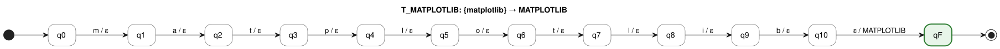

PlantUML source: [`fst/T_MATPLOTLIB.puml`](fst/T_MATPLOTLIB.puml)

Example: `matplotlib` ⟼ MATPLOTLIB; `matplotli` has no accepting run (rejected).

### T_SQL

Transforms `SQL` → **SQL**

**M_SQL = (Q, Σ, Γ, δ, ω, q0, F)**

- **Q** = {q0, q1, q2, q3, qF} — |Q| = |Pref(V)| + 1 = 4 + 1 = 5
- **Σ** = {`l`, `q`, `s`}
- **Γ** = {SQL}
- **q0** = q0
- **F** = {qF}
- **V** = dom(M) = {`sql`}; T(M) = V × {SQL} (Proposition 2)
- **δ** and **ω** — |δ| = (|Pref(V)| − 1) + |V| = 3 + 1 = 4:

| #   | q   | a ∈ Σ ∪ {ε} | δ(q, a) | ω(q, a) |
| --- | --- | ----------- | ------- | ------- |
| 1   | q0  | `s`         | q1      | ε       |
| 2   | q1  | `q`         | q2      | ε       |
| 3   | q2  | `l`         | q3      | ε       |
| 4   | q3  | ε           | qF      | SQL     |

δ is undefined for every other pair (q, a).

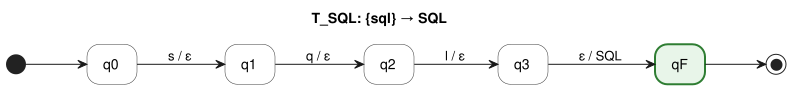

PlantUML source: [`fst/T_SQL.puml`](fst/T_SQL.puml)

Example: `sql` ⟼ SQL; `sq` has no accepting run (rejected).

### T_NOSQL

Transforms `NoSQL`, `No SQL` → **NOSQL**

**M_NOSQL = (Q, Σ, Γ, δ, ω, q0, F)**

- **Q** = {q0, q1, q2, q3, q4, q5, qF} — |Q| = |Pref(V)| + 1 = 6 + 1 = 7
- **Σ** = {`l`, `n`, `o`, `q`, `s`}
- **Γ** = {NOSQL}
- **q0** = q0
- **F** = {qF}
- **V** = dom(M) = {`nosql`}; T(M) = V × {NOSQL} (Proposition 2)
- **δ** and **ω** — |δ| = (|Pref(V)| − 1) + |V| = 5 + 1 = 6:

| #   | q   | a ∈ Σ ∪ {ε} | δ(q, a) | ω(q, a) |
| --- | --- | ----------- | ------- | ------- |
| 1   | q0  | `n`         | q1      | ε       |
| 2   | q1  | `o`         | q2      | ε       |
| 3   | q2  | `s`         | q3      | ε       |
| 4   | q3  | `q`         | q4      | ε       |
| 5   | q4  | `l`         | q5      | ε       |
| 6   | q5  | ε           | qF      | NOSQL   |

δ is undefined for every other pair (q, a).

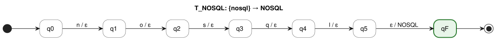

PlantUML source: [`fst/T_NOSQL.puml`](fst/T_NOSQL.puml)

Example: `nosql` ⟼ NOSQL; `nosq` has no accepting run (rejected).

### T_POSTGRESQL

Transforms `PostgreSQL`, `Postgres` → **POSTGRESQL**

**M_POSTGRESQL = (Q, Σ, Γ, δ, ω, q0, F)**

- **Q** = {q0, q1, q2, q3, q4, q5, q6, q7, q8, q9, q10, qF} — |Q| = |Pref(V)| + 1 = 11 + 1 = 12
- **Σ** = {`e`, `g`, `l`, `o`, `p`, `q`, `r`, `s`, `t`}
- **Γ** = {POSTGRESQL}
- **q0** = q0
- **F** = {qF}
- **V** = dom(M) = {`postgres`, `postgresql`}; T(M) = V × {POSTGRESQL} (Proposition 2)
- **δ** and **ω** — |δ| = (|Pref(V)| − 1) + |V| = 10 + 2 = 12:

| #   | q   | a ∈ Σ ∪ {ε} | δ(q, a) | ω(q, a)    |
| --- | --- | ----------- | ------- | ---------- |
| 1   | q0  | `p`         | q1      | ε          |
| 2   | q1  | `o`         | q2      | ε          |
| 3   | q2  | `s`         | q3      | ε          |
| 4   | q3  | `t`         | q4      | ε          |
| 5   | q4  | `g`         | q5      | ε          |
| 6   | q5  | `r`         | q6      | ε          |
| 7   | q6  | `e`         | q7      | ε          |
| 8   | q7  | `s`         | q8      | ε          |
| 9   | q8  | `q`         | q9      | ε          |
| 10  | q8  | ε           | qF      | POSTGRESQL |
| 11  | q9  | `l`         | q10     | ε          |
| 12  | q10 | ε           | qF      | POSTGRESQL |

δ is undefined for every other pair (q, a).

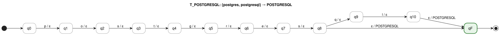

PlantUML source: [`fst/T_POSTGRESQL.puml`](fst/T_POSTGRESQL.puml)

Example: `postgresql` ⟼ POSTGRESQL; `postgresq` has no accepting run (rejected).

### T_MYSQL

Transforms `MySQL`, `My SQL` → **MYSQL**

**M_MYSQL = (Q, Σ, Γ, δ, ω, q0, F)**

- **Q** = {q0, q1, q2, q3, q4, q5, qF} — |Q| = |Pref(V)| + 1 = 6 + 1 = 7
- **Σ** = {`l`, `m`, `q`, `s`, `y`}
- **Γ** = {MYSQL}
- **q0** = q0
- **F** = {qF}
- **V** = dom(M) = {`mysql`}; T(M) = V × {MYSQL} (Proposition 2)
- **δ** and **ω** — |δ| = (|Pref(V)| − 1) + |V| = 5 + 1 = 6:

| #   | q   | a ∈ Σ ∪ {ε} | δ(q, a) | ω(q, a) |
| --- | --- | ----------- | ------- | ------- |
| 1   | q0  | `m`         | q1      | ε       |
| 2   | q1  | `y`         | q2      | ε       |
| 3   | q2  | `s`         | q3      | ε       |
| 4   | q3  | `q`         | q4      | ε       |
| 5   | q4  | `l`         | q5      | ε       |
| 6   | q5  | ε           | qF      | MYSQL   |

δ is undefined for every other pair (q, a).

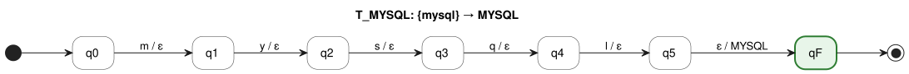

PlantUML source: [`fst/T_MYSQL.puml`](fst/T_MYSQL.puml)

Example: `mysql` ⟼ MYSQL; `mysq` has no accepting run (rejected).

### T_MARIADB

Transforms `MariaDB` → **MARIADB**

**M_MARIADB = (Q, Σ, Γ, δ, ω, q0, F)**

- **Q** = {q0, q1, q2, q3, q4, q5, q6, q7, qF} — |Q| = |Pref(V)| + 1 = 8 + 1 = 9
- **Σ** = {`a`, `b`, `d`, `i`, `m`, `r`}
- **Γ** = {MARIADB}
- **q0** = q0
- **F** = {qF}
- **V** = dom(M) = {`mariadb`}; T(M) = V × {MARIADB} (Proposition 2)
- **δ** and **ω** — |δ| = (|Pref(V)| − 1) + |V| = 7 + 1 = 8:

| #   | q   | a ∈ Σ ∪ {ε} | δ(q, a) | ω(q, a) |
| --- | --- | ----------- | ------- | ------- |
| 1   | q0  | `m`         | q1      | ε       |
| 2   | q1  | `a`         | q2      | ε       |
| 3   | q2  | `r`         | q3      | ε       |
| 4   | q3  | `i`         | q4      | ε       |
| 5   | q4  | `a`         | q5      | ε       |
| 6   | q5  | `d`         | q6      | ε       |
| 7   | q6  | `b`         | q7      | ε       |
| 8   | q7  | ε           | qF      | MARIADB |

δ is undefined for every other pair (q, a).

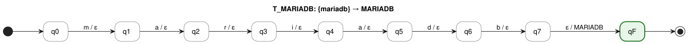

PlantUML source: [`fst/T_MARIADB.puml`](fst/T_MARIADB.puml)

Example: `mariadb` ⟼ MARIADB; `mariad` has no accepting run (rejected).

### T_SQLITE

Transforms `SQLite` → **SQLITE**

**M_SQLITE = (Q, Σ, Γ, δ, ω, q0, F)**

- **Q** = {q0, q1, q2, q3, q4, q5, q6, qF} — |Q| = |Pref(V)| + 1 = 7 + 1 = 8
- **Σ** = {`e`, `i`, `l`, `q`, `s`, `t`}
- **Γ** = {SQLITE}
- **q0** = q0
- **F** = {qF}
- **V** = dom(M) = {`sqlite`}; T(M) = V × {SQLITE} (Proposition 2)
- **δ** and **ω** — |δ| = (|Pref(V)| − 1) + |V| = 6 + 1 = 7:

| #   | q   | a ∈ Σ ∪ {ε} | δ(q, a) | ω(q, a) |
| --- | --- | ----------- | ------- | ------- |
| 1   | q0  | `s`         | q1      | ε       |
| 2   | q1  | `q`         | q2      | ε       |
| 3   | q2  | `l`         | q3      | ε       |
| 4   | q3  | `i`         | q4      | ε       |
| 5   | q4  | `t`         | q5      | ε       |
| 6   | q5  | `e`         | q6      | ε       |
| 7   | q6  | ε           | qF      | SQLITE  |

δ is undefined for every other pair (q, a).

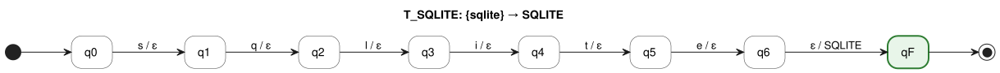

PlantUML source: [`fst/T_SQLITE.puml`](fst/T_SQLITE.puml)

Example: `sqlite` ⟼ SQLITE; `sqlit` has no accepting run (rejected).

### T_SQL_SERVER

Transforms `SQL Server`, `SQLServer` → **SQL_SERVER**

**M_SQL_SERVER = (Q, Σ, Γ, δ, ω, q0, F)**

- **Q** = {q0, q1, q2, q3, q4, q5, q6, q7, q8, q9, qF} — |Q| = |Pref(V)| + 1 = 10 + 1 = 11
- **Σ** = {`e`, `l`, `q`, `r`, `s`, `v`}
- **Γ** = {SQL_SERVER}
- **q0** = q0
- **F** = {qF}
- **V** = dom(M) = {`sqlserver`}; T(M) = V × {SQL_SERVER} (Proposition 2)
- **δ** and **ω** — |δ| = (|Pref(V)| − 1) + |V| = 9 + 1 = 10:

| #   | q   | a ∈ Σ ∪ {ε} | δ(q, a) | ω(q, a)    |
| --- | --- | ----------- | ------- | ---------- |
| 1   | q0  | `s`         | q1      | ε          |
| 2   | q1  | `q`         | q2      | ε          |
| 3   | q2  | `l`         | q3      | ε          |
| 4   | q3  | `s`         | q4      | ε          |
| 5   | q4  | `e`         | q5      | ε          |
| 6   | q5  | `r`         | q6      | ε          |
| 7   | q6  | `v`         | q7      | ε          |
| 8   | q7  | `e`         | q8      | ε          |
| 9   | q8  | `r`         | q9      | ε          |
| 10  | q9  | ε           | qF      | SQL_SERVER |

δ is undefined for every other pair (q, a).

PlantUML source: [`fst/T_SQL_SERVER.puml`](fst/T_SQL_SERVER.puml)

Example: `sqlserver` ⟼ SQL_SERVER; `sqlserve` has no accepting run (rejected).

### T_ORACLE

Transforms `Oracle` → **ORACLE**

**M_ORACLE = (Q, Σ, Γ, δ, ω, q0, F)**

- **Q** = {q0, q1, q2, q3, q4, q5, q6, qF} — |Q| = |Pref(V)| + 1 = 7 + 1 = 8
- **Σ** = {`a`, `c`, `e`, `l`, `o`, `r`}
- **Γ** = {ORACLE}
- **q0** = q0
- **F** = {qF}
- **V** = dom(M) = {`oracle`}; T(M) = V × {ORACLE} (Proposition 2)
- **δ** and **ω** — |δ| = (|Pref(V)| − 1) + |V| = 6 + 1 = 7:

| #   | q   | a ∈ Σ ∪ {ε} | δ(q, a) | ω(q, a) |
| --- | --- | ----------- | ------- | ------- |
| 1   | q0  | `o`         | q1      | ε       |
| 2   | q1  | `r`         | q2      | ε       |
| 3   | q2  | `a`         | q3      | ε       |
| 4   | q3  | `c`         | q4      | ε       |
| 5   | q4  | `l`         | q5      | ε       |
| 6   | q5  | `e`         | q6      | ε       |
| 7   | q6  | ε           | qF      | ORACLE  |

δ is undefined for every other pair (q, a).

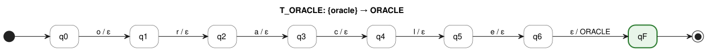

PlantUML source: [`fst/T_ORACLE.puml`](fst/T_ORACLE.puml)

Example: `oracle` ⟼ ORACLE; `oracl` has no accepting run (rejected).

### T_MONGODB

Transforms `MongoDB`, `Mongo DB`, `Mongo` → **MONGODB**

**M_MONGODB = (Q, Σ, Γ, δ, ω, q0, F)**

- **Q** = {q0, q1, q2, q3, q4, q5, q6, q7, qF} — |Q| = |Pref(V)| + 1 = 8 + 1 = 9
- **Σ** = {`b`, `d`, `g`, `m`, `n`, `o`}
- **Γ** = {MONGODB}
- **q0** = q0
- **F** = {qF}
- **V** = dom(M) = {`mongo`, `mongodb`}; T(M) = V × {MONGODB} (Proposition 2)
- **δ** and **ω** — |δ| = (|Pref(V)| − 1) + |V| = 7 + 2 = 9:

| #   | q   | a ∈ Σ ∪ {ε} | δ(q, a) | ω(q, a) |
| --- | --- | ----------- | ------- | ------- |
| 1   | q0  | `m`         | q1      | ε       |
| 2   | q1  | `o`         | q2      | ε       |
| 3   | q2  | `n`         | q3      | ε       |
| 4   | q3  | `g`         | q4      | ε       |
| 5   | q4  | `o`         | q5      | ε       |
| 6   | q5  | `d`         | q6      | ε       |
| 7   | q5  | ε           | qF      | MONGODB |
| 8   | q6  | `b`         | q7      | ε       |
| 9   | q7  | ε           | qF      | MONGODB |

δ is undefined for every other pair (q, a).

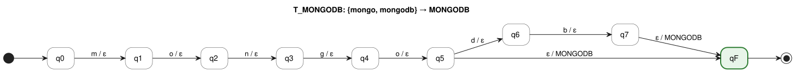

PlantUML source: [`fst/T_MONGODB.puml`](fst/T_MONGODB.puml)

Example: `mongodb` ⟼ MONGODB; `mongod` has no accepting run (rejected).

### T_REDIS

Transforms `Redis` → **REDIS**

**M_REDIS = (Q, Σ, Γ, δ, ω, q0, F)**

- **Q** = {q0, q1, q2, q3, q4, q5, qF} — |Q| = |Pref(V)| + 1 = 6 + 1 = 7
- **Σ** = {`d`, `e`, `i`, `r`, `s`}
- **Γ** = {REDIS}
- **q0** = q0
- **F** = {qF}
- **V** = dom(M) = {`redis`}; T(M) = V × {REDIS} (Proposition 2)
- **δ** and **ω** — |δ| = (|Pref(V)| − 1) + |V| = 5 + 1 = 6:

| #   | q   | a ∈ Σ ∪ {ε} | δ(q, a) | ω(q, a) |
| --- | --- | ----------- | ------- | ------- |
| 1   | q0  | `r`         | q1      | ε       |
| 2   | q1  | `e`         | q2      | ε       |
| 3   | q2  | `d`         | q3      | ε       |
| 4   | q3  | `i`         | q4      | ε       |
| 5   | q4  | `s`         | q5      | ε       |
| 6   | q5  | ε           | qF      | REDIS   |

δ is undefined for every other pair (q, a).

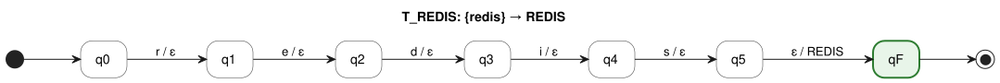

PlantUML source: [`fst/T_REDIS.puml`](fst/T_REDIS.puml)

Example: `redis` ⟼ REDIS; `redi` has no accepting run (rejected).

### T_CASSANDRA

Transforms `Cassandra` → **CASSANDRA**

**M_CASSANDRA = (Q, Σ, Γ, δ, ω, q0, F)**

- **Q** = {q0, q1, q2, q3, q4, q5, q6, q7, q8, q9, qF} — |Q| = |Pref(V)| + 1 = 10 + 1 = 11
- **Σ** = {`a`, `c`, `d`, `n`, `r`, `s`}
- **Γ** = {CASSANDRA}
- **q0** = q0
- **F** = {qF}
- **V** = dom(M) = {`cassandra`}; T(M) = V × {CASSANDRA} (Proposition 2)
- **δ** and **ω** — |δ| = (|Pref(V)| − 1) + |V| = 9 + 1 = 10:

| #   | q   | a ∈ Σ ∪ {ε} | δ(q, a) | ω(q, a)   |
| --- | --- | ----------- | ------- | --------- |
| 1   | q0  | `c`         | q1      | ε         |
| 2   | q1  | `a`         | q2      | ε         |
| 3   | q2  | `s`         | q3      | ε         |
| 4   | q3  | `s`         | q4      | ε         |
| 5   | q4  | `a`         | q5      | ε         |
| 6   | q5  | `n`         | q6      | ε         |
| 7   | q6  | `d`         | q7      | ε         |
| 8   | q7  | `r`         | q8      | ε         |
| 9   | q8  | `a`         | q9      | ε         |
| 10  | q9  | ε           | qF      | CASSANDRA |

δ is undefined for every other pair (q, a).

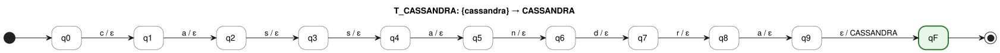

PlantUML source: [`fst/T_CASSANDRA.puml`](fst/T_CASSANDRA.puml)

Example: `cassandra` ⟼ CASSANDRA; `cassandr` has no accepting run (rejected).

### T_DYNAMODB

Transforms `DynamoDB` → **DYNAMODB**

**M_DYNAMODB = (Q, Σ, Γ, δ, ω, q0, F)**

- **Q** = {q0, q1, q2, q3, q4, q5, q6, q7, q8, qF} — |Q| = |Pref(V)| + 1 = 9 + 1 = 10
- **Σ** = {`a`, `b`, `d`, `m`, `n`, `o`, `y`}
- **Γ** = {DYNAMODB}
- **q0** = q0
- **F** = {qF}
- **V** = dom(M) = {`dynamodb`}; T(M) = V × {DYNAMODB} (Proposition 2)
- **δ** and **ω** — |δ| = (|Pref(V)| − 1) + |V| = 8 + 1 = 9:

| #   | q   | a ∈ Σ ∪ {ε} | δ(q, a) | ω(q, a)  |
| --- | --- | ----------- | ------- | -------- |
| 1   | q0  | `d`         | q1      | ε        |
| 2   | q1  | `y`         | q2      | ε        |
| 3   | q2  | `n`         | q3      | ε        |
| 4   | q3  | `a`         | q4      | ε        |
| 5   | q4  | `m`         | q5      | ε        |
| 6   | q5  | `o`         | q6      | ε        |
| 7   | q6  | `d`         | q7      | ε        |
| 8   | q7  | `b`         | q8      | ε        |
| 9   | q8  | ε           | qF      | DYNAMODB |

δ is undefined for every other pair (q, a).

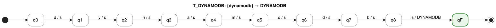

PlantUML source: [`fst/T_DYNAMODB.puml`](fst/T_DYNAMODB.puml)

Example: `dynamodb` ⟼ DYNAMODB; `dynamod` has no accepting run (rejected).

### T_FIREBASE

Transforms `Firebase` → **FIREBASE**

**M_FIREBASE = (Q, Σ, Γ, δ, ω, q0, F)**

- **Q** = {q0, q1, q2, q3, q4, q5, q6, q7, q8, qF} — |Q| = |Pref(V)| + 1 = 9 + 1 = 10
- **Σ** = {`a`, `b`, `e`, `f`, `i`, `r`, `s`}
- **Γ** = {FIREBASE}
- **q0** = q0
- **F** = {qF}
- **V** = dom(M) = {`firebase`}; T(M) = V × {FIREBASE} (Proposition 2)
- **δ** and **ω** — |δ| = (|Pref(V)| − 1) + |V| = 8 + 1 = 9:

| #   | q   | a ∈ Σ ∪ {ε} | δ(q, a) | ω(q, a)  |
| --- | --- | ----------- | ------- | -------- |
| 1   | q0  | `f`         | q1      | ε        |
| 2   | q1  | `i`         | q2      | ε        |
| 3   | q2  | `r`         | q3      | ε        |
| 4   | q3  | `e`         | q4      | ε        |
| 5   | q4  | `b`         | q5      | ε        |
| 6   | q5  | `a`         | q6      | ε        |
| 7   | q6  | `s`         | q7      | ε        |
| 8   | q7  | `e`         | q8      | ε        |
| 9   | q8  | ε           | qF      | FIREBASE |

δ is undefined for every other pair (q, a).

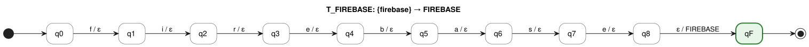

PlantUML source: [`fst/T_FIREBASE.puml`](fst/T_FIREBASE.puml)

Example: `firebase` ⟼ FIREBASE; `firebas` has no accepting run (rejected).

### T_SNOWFLAKE

Transforms `Snowflake` → **SNOWFLAKE**

**M_SNOWFLAKE = (Q, Σ, Γ, δ, ω, q0, F)**

- **Q** = {q0, q1, q2, q3, q4, q5, q6, q7, q8, q9, qF} — |Q| = |Pref(V)| + 1 = 10 + 1 = 11
- **Σ** = {`a`, `e`, `f`, `k`, `l`, `n`, `o`, `s`, `w`}
- **Γ** = {SNOWFLAKE}
- **q0** = q0
- **F** = {qF}
- **V** = dom(M) = {`snowflake`}; T(M) = V × {SNOWFLAKE} (Proposition 2)
- **δ** and **ω** — |δ| = (|Pref(V)| − 1) + |V| = 9 + 1 = 10:

| #   | q   | a ∈ Σ ∪ {ε} | δ(q, a) | ω(q, a)   |
| --- | --- | ----------- | ------- | --------- |
| 1   | q0  | `s`         | q1      | ε         |
| 2   | q1  | `n`         | q2      | ε         |
| 3   | q2  | `o`         | q3      | ε         |
| 4   | q3  | `w`         | q4      | ε         |
| 5   | q4  | `f`         | q5      | ε         |
| 6   | q5  | `l`         | q6      | ε         |
| 7   | q6  | `a`         | q7      | ε         |
| 8   | q7  | `k`         | q8      | ε         |
| 9   | q8  | `e`         | q9      | ε         |
| 10  | q9  | ε           | qF      | SNOWFLAKE |

δ is undefined for every other pair (q, a).

PlantUML source: [`fst/T_SNOWFLAKE.puml`](fst/T_SNOWFLAKE.puml)

Example: `snowflake` ⟼ SNOWFLAKE; `snowflak` has no accepting run (rejected).

### T_BIGQUERY

Transforms `BigQuery`, `Big Query` → **BIGQUERY**

**M_BIGQUERY = (Q, Σ, Γ, δ, ω, q0, F)**

- **Q** = {q0, q1, q2, q3, q4, q5, q6, q7, q8, qF} — |Q| = |Pref(V)| + 1 = 9 + 1 = 10
- **Σ** = {`b`, `e`, `g`, `i`, `q`, `r`, `u`, `y`}
- **Γ** = {BIGQUERY}
- **q0** = q0
- **F** = {qF}
- **V** = dom(M) = {`bigquery`}; T(M) = V × {BIGQUERY} (Proposition 2)
- **δ** and **ω** — |δ| = (|Pref(V)| − 1) + |V| = 8 + 1 = 9:

| #   | q   | a ∈ Σ ∪ {ε} | δ(q, a) | ω(q, a)  |
| --- | --- | ----------- | ------- | -------- |
| 1   | q0  | `b`         | q1      | ε        |
| 2   | q1  | `i`         | q2      | ε        |
| 3   | q2  | `g`         | q3      | ε        |
| 4   | q3  | `q`         | q4      | ε        |
| 5   | q4  | `u`         | q5      | ε        |
| 6   | q5  | `e`         | q6      | ε        |
| 7   | q6  | `r`         | q7      | ε        |
| 8   | q7  | `y`         | q8      | ε        |
| 9   | q8  | ε           | qF      | BIGQUERY |

δ is undefined for every other pair (q, a).

PlantUML source: [`fst/T_BIGQUERY.puml`](fst/T_BIGQUERY.puml)

Example: `bigquery` ⟼ BIGQUERY; `bigquer` has no accepting run (rejected).

### T_GIT

Transforms `Git` → **GIT**

**M_GIT = (Q, Σ, Γ, δ, ω, q0, F)**

- **Q** = {q0, q1, q2, q3, qF} — |Q| = |Pref(V)| + 1 = 4 + 1 = 5
- **Σ** = {`g`, `i`, `t`}
- **Γ** = {GIT}
- **q0** = q0
- **F** = {qF}
- **V** = dom(M) = {`git`}; T(M) = V × {GIT} (Proposition 2)
- **δ** and **ω** — |δ| = (|Pref(V)| − 1) + |V| = 3 + 1 = 4:

| #   | q   | a ∈ Σ ∪ {ε} | δ(q, a) | ω(q, a) |
| --- | --- | ----------- | ------- | ------- |
| 1   | q0  | `g`         | q1      | ε       |
| 2   | q1  | `i`         | q2      | ε       |
| 3   | q2  | `t`         | q3      | ε       |
| 4   | q3  | ε           | qF      | GIT     |

δ is undefined for every other pair (q, a).

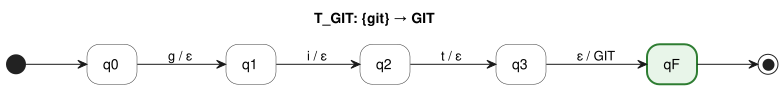

PlantUML source: [`fst/T_GIT.puml`](fst/T_GIT.puml)

Example: `git` ⟼ GIT; `gi` has no accepting run (rejected).

### T_GITHUB

Transforms `GitHub` → **GITHUB**

**M_GITHUB = (Q, Σ, Γ, δ, ω, q0, F)**

- **Q** = {q0, q1, q2, q3, q4, q5, q6, qF} — |Q| = |Pref(V)| + 1 = 7 + 1 = 8
- **Σ** = {`b`, `g`, `h`, `i`, `t`, `u`}
- **Γ** = {GITHUB}
- **q0** = q0
- **F** = {qF}
- **V** = dom(M) = {`github`}; T(M) = V × {GITHUB} (Proposition 2)
- **δ** and **ω** — |δ| = (|Pref(V)| − 1) + |V| = 6 + 1 = 7:

| #   | q   | a ∈ Σ ∪ {ε} | δ(q, a) | ω(q, a) |
| --- | --- | ----------- | ------- | ------- |
| 1   | q0  | `g`         | q1      | ε       |
| 2   | q1  | `i`         | q2      | ε       |
| 3   | q2  | `t`         | q3      | ε       |
| 4   | q3  | `h`         | q4      | ε       |
| 5   | q4  | `u`         | q5      | ε       |
| 6   | q5  | `b`         | q6      | ε       |
| 7   | q6  | ε           | qF      | GITHUB  |

δ is undefined for every other pair (q, a).

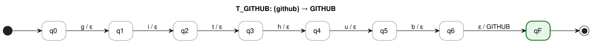

PlantUML source: [`fst/T_GITHUB.puml`](fst/T_GITHUB.puml)

Example: `github` ⟼ GITHUB; `githu` has no accepting run (rejected).

### T_GITLAB

Transforms `GitLab` → **GITLAB**

**M_GITLAB = (Q, Σ, Γ, δ, ω, q0, F)**

- **Q** = {q0, q1, q2, q3, q4, q5, q6, qF} — |Q| = |Pref(V)| + 1 = 7 + 1 = 8
- **Σ** = {`a`, `b`, `g`, `i`, `l`, `t`}
- **Γ** = {GITLAB}
- **q0** = q0
- **F** = {qF}
- **V** = dom(M) = {`gitlab`}; T(M) = V × {GITLAB} (Proposition 2)
- **δ** and **ω** — |δ| = (|Pref(V)| − 1) + |V| = 6 + 1 = 7:

| #   | q   | a ∈ Σ ∪ {ε} | δ(q, a) | ω(q, a) |
| --- | --- | ----------- | ------- | ------- |
| 1   | q0  | `g`         | q1      | ε       |
| 2   | q1  | `i`         | q2      | ε       |
| 3   | q2  | `t`         | q3      | ε       |
| 4   | q3  | `l`         | q4      | ε       |
| 5   | q4  | `a`         | q5      | ε       |
| 6   | q5  | `b`         | q6      | ε       |
| 7   | q6  | ε           | qF      | GITLAB  |

δ is undefined for every other pair (q, a).

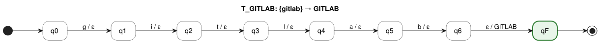

PlantUML source: [`fst/T_GITLAB.puml`](fst/T_GITLAB.puml)

Example: `gitlab` ⟼ GITLAB; `gitla` has no accepting run (rejected).

### T_DOCKER

Transforms `Docker` → **DOCKER**

**M_DOCKER = (Q, Σ, Γ, δ, ω, q0, F)**

- **Q** = {q0, q1, q2, q3, q4, q5, q6, qF} — |Q| = |Pref(V)| + 1 = 7 + 1 = 8
- **Σ** = {`c`, `d`, `e`, `k`, `o`, `r`}
- **Γ** = {DOCKER}
- **q0** = q0
- **F** = {qF}
- **V** = dom(M) = {`docker`}; T(M) = V × {DOCKER} (Proposition 2)
- **δ** and **ω** — |δ| = (|Pref(V)| − 1) + |V| = 6 + 1 = 7:

| #   | q   | a ∈ Σ ∪ {ε} | δ(q, a) | ω(q, a) |
| --- | --- | ----------- | ------- | ------- |
| 1   | q0  | `d`         | q1      | ε       |
| 2   | q1  | `o`         | q2      | ε       |
| 3   | q2  | `c`         | q3      | ε       |
| 4   | q3  | `k`         | q4      | ε       |
| 5   | q4  | `e`         | q5      | ε       |
| 6   | q5  | `r`         | q6      | ε       |
| 7   | q6  | ε           | qF      | DOCKER  |

δ is undefined for every other pair (q, a).

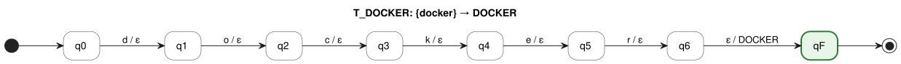

PlantUML source: [`fst/T_DOCKER.puml`](fst/T_DOCKER.puml)

Example: `docker` ⟼ DOCKER; `docke` has no accepting run (rejected).

### T_KUBERNETES

Transforms `Kubernetes`, `K8s` → **KUBERNETES**

**M_KUBERNETES = (Q, Σ, Γ, δ, ω, q0, F)**

- **Q** = {q0, q1, q2, q3, q4, q5, q6, q7, q8, q9, q10, q11, q12, qF} — |Q| = |Pref(V)| + 1 = 13 + 1 = 14
- **Σ** = {`8`, `b`, `e`, `k`, `n`, `r`, `s`, `t`, `u`}
- **Γ** = {KUBERNETES}
- **q0** = q0
- **F** = {qF}
- **V** = dom(M) = {`k8s`, `kubernetes`}; T(M) = V × {KUBERNETES} (Proposition 2)
- **δ** and **ω** — |δ| = (|Pref(V)| − 1) + |V| = 12 + 2 = 14:

| #   | q   | a ∈ Σ ∪ {ε} | δ(q, a) | ω(q, a)    |
| --- | --- | ----------- | ------- | ---------- |
| 1   | q0  | `k`         | q1      | ε          |
| 2   | q1  | `8`         | q2      | ε          |
| 3   | q1  | `u`         | q4      | ε          |
| 4   | q2  | `s`         | q3      | ε          |
| 5   | q3  | ε           | qF      | KUBERNETES |
| 6   | q4  | `b`         | q5      | ε          |
| 7   | q5  | `e`         | q6      | ε          |
| 8   | q6  | `r`         | q7      | ε          |
| 9   | q7  | `n`         | q8      | ε          |
| 10  | q8  | `e`         | q9      | ε          |
| 11  | q9  | `t`         | q10     | ε          |
| 12  | q10 | `e`         | q11     | ε          |
| 13  | q11 | `s`         | q12     | ε          |
| 14  | q12 | ε           | qF      | KUBERNETES |

δ is undefined for every other pair (q, a).

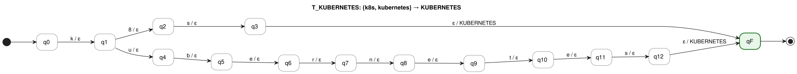

PlantUML source: [`fst/T_KUBERNETES.puml`](fst/T_KUBERNETES.puml)

Example: `kubernetes` ⟼ KUBERNETES; `kubernete` has no accepting run (rejected).

### T_AWS

Transforms `AWS`, `Amazon Web Services` → **AWS**

**M_AWS = (Q, Σ, Γ, δ, ω, q0, F)**

- **Q** = {q0, q1, q2, q3, q4, q5, q6, q7, q8, q9, q10, q11, q12, q13, q14, q15, q16, q17, q18, q19, qF} — |Q| = |Pref(V)| + 1 = 20 + 1 = 21
- **Σ** = {`a`, `b`, `c`, `e`, `i`, `m`, `n`, `o`, `r`, `s`, `v`, `w`, `z`}
- **Γ** = {AWS}
- **q0** = q0
- **F** = {qF}
- **V** = dom(M) = {`amazonwebservices`, `aws`}; T(M) = V × {AWS} (Proposition 2)
- **δ** and **ω** — |δ| = (|Pref(V)| − 1) + |V| = 19 + 2 = 21:

| #   | q   | a ∈ Σ ∪ {ε} | δ(q, a) | ω(q, a) |
| --- | --- | ----------- | ------- | ------- |
| 1   | q0  | `a`         | q1      | ε       |
| 2   | q1  | `m`         | q2      | ε       |
| 3   | q1  | `w`         | q18     | ε       |
| 4   | q2  | `a`         | q3      | ε       |
| 5   | q3  | `z`         | q4      | ε       |
| 6   | q4  | `o`         | q5      | ε       |
| 7   | q5  | `n`         | q6      | ε       |
| 8   | q6  | `w`         | q7      | ε       |
| 9   | q7  | `e`         | q8      | ε       |
| 10  | q8  | `b`         | q9      | ε       |
| 11  | q9  | `s`         | q10     | ε       |
| 12  | q10 | `e`         | q11     | ε       |
| 13  | q11 | `r`         | q12     | ε       |
| 14  | q12 | `v`         | q13     | ε       |
| 15  | q13 | `i`         | q14     | ε       |
| 16  | q14 | `c`         | q15     | ε       |
| 17  | q15 | `e`         | q16     | ε       |
| 18  | q16 | `s`         | q17     | ε       |
| 19  | q17 | ε           | qF      | AWS     |
| 20  | q18 | `s`         | q19     | ε       |
| 21  | q19 | ε           | qF      | AWS     |

δ is undefined for every other pair (q, a).

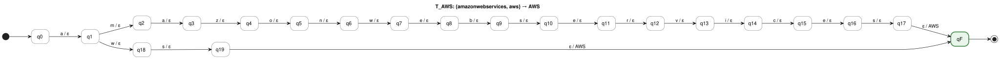

PlantUML source: [`fst/T_AWS.puml`](fst/T_AWS.puml)

Example: `amazonwebservices` ⟼ AWS; `amazonwebservice` has no accepting run (rejected).

### T_AZURE

Transforms `Azure` → **AZURE**

**M_AZURE = (Q, Σ, Γ, δ, ω, q0, F)**

- **Q** = {q0, q1, q2, q3, q4, q5, qF} — |Q| = |Pref(V)| + 1 = 6 + 1 = 7
- **Σ** = {`a`, `e`, `r`, `u`, `z`}
- **Γ** = {AZURE}
- **q0** = q0
- **F** = {qF}
- **V** = dom(M) = {`azure`}; T(M) = V × {AZURE} (Proposition 2)
- **δ** and **ω** — |δ| = (|Pref(V)| − 1) + |V| = 5 + 1 = 6:

| #   | q   | a ∈ Σ ∪ {ε} | δ(q, a) | ω(q, a) |
| --- | --- | ----------- | ------- | ------- |
| 1   | q0  | `a`         | q1      | ε       |
| 2   | q1  | `z`         | q2      | ε       |
| 3   | q2  | `u`         | q3      | ε       |
| 4   | q3  | `r`         | q4      | ε       |
| 5   | q4  | `e`         | q5      | ε       |
| 6   | q5  | ε           | qF      | AZURE   |

δ is undefined for every other pair (q, a).

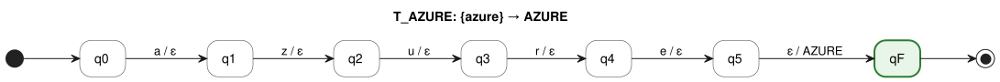

PlantUML source: [`fst/T_AZURE.puml`](fst/T_AZURE.puml)

Example: `azure` ⟼ AZURE; `azur` has no accepting run (rejected).

### T_GCP

Transforms `GCP`, `Google Cloud`, `Google Cloud Platform` → **GCP**

**M_GCP = (Q, Σ, Γ, δ, ω, q0, F)**

- **Q** = {q0, q1, q2, q3, q4, q5, q6, q7, q8, q9, q10, q11, q12, q13, q14, q15, q16, q17, q18, q19, q20, q21, qF} — |Q| = |Pref(V)| + 1 = 22 + 1 = 23
- **Σ** = {`a`, `c`, `d`, `e`, `f`, `g`, `l`, `m`, `o`, `p`, `r`, `t`, `u`}
- **Γ** = {GCP}
- **q0** = q0
- **F** = {qF}
- **V** = dom(M) = {`gcp`, `googlecloud`, `googlecloudplatform`}; T(M) = V × {GCP} (Proposition 2)
- **δ** and **ω** — |δ| = (|Pref(V)| − 1) + |V| = 21 + 3 = 24:

| #   | q   | a ∈ Σ ∪ {ε} | δ(q, a) | ω(q, a) |
| --- | --- | ----------- | ------- | ------- |
| 1   | q0  | `g`         | q1      | ε       |
| 2   | q1  | `c`         | q2      | ε       |
| 3   | q1  | `o`         | q4      | ε       |
| 4   | q2  | `p`         | q3      | ε       |
| 5   | q3  | ε           | qF      | GCP     |
| 6   | q4  | `o`         | q5      | ε       |
| 7   | q5  | `g`         | q6      | ε       |
| 8   | q6  | `l`         | q7      | ε       |
| 9   | q7  | `e`         | q8      | ε       |
| 10  | q8  | `c`         | q9      | ε       |
| 11  | q9  | `l`         | q10     | ε       |
| 12  | q10 | `o`         | q11     | ε       |
| 13  | q11 | `u`         | q12     | ε       |
| 14  | q12 | `d`         | q13     | ε       |
| 15  | q13 | `p`         | q14     | ε       |
| 16  | q13 | ε           | qF      | GCP     |
| 17  | q14 | `l`         | q15     | ε       |
| 18  | q15 | `a`         | q16     | ε       |
| 19  | q16 | `t`         | q17     | ε       |
| 20  | q17 | `f`         | q18     | ε       |
| 21  | q18 | `o`         | q19     | ε       |
| 22  | q19 | `r`         | q20     | ε       |
| 23  | q20 | `m`         | q21     | ε       |
| 24  | q21 | ε           | qF      | GCP     |

δ is undefined for every other pair (q, a).

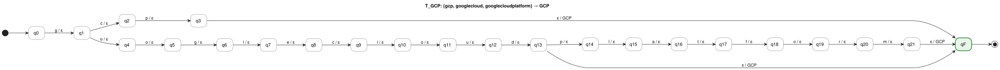

PlantUML source: [`fst/T_GCP.puml`](fst/T_GCP.puml)

Example: `googlecloudplatform` ⟼ GCP; `googlecloudplatfor` has no accepting run (rejected).

### T_LINUX

Transforms `Linux` → **LINUX**

**M_LINUX = (Q, Σ, Γ, δ, ω, q0, F)**

- **Q** = {q0, q1, q2, q3, q4, q5, qF} — |Q| = |Pref(V)| + 1 = 6 + 1 = 7
- **Σ** = {`i`, `l`, `n`, `u`, `x`}
- **Γ** = {LINUX}
- **q0** = q0
- **F** = {qF}
- **V** = dom(M) = {`linux`}; T(M) = V × {LINUX} (Proposition 2)
- **δ** and **ω** — |δ| = (|Pref(V)| − 1) + |V| = 5 + 1 = 6:

| #   | q   | a ∈ Σ ∪ {ε} | δ(q, a) | ω(q, a) |
| --- | --- | ----------- | ------- | ------- |
| 1   | q0  | `l`         | q1      | ε       |
| 2   | q1  | `i`         | q2      | ε       |
| 3   | q2  | `n`         | q3      | ε       |
| 4   | q3  | `u`         | q4      | ε       |
| 5   | q4  | `x`         | q5      | ε       |
| 6   | q5  | ε           | qF      | LINUX   |

δ is undefined for every other pair (q, a).

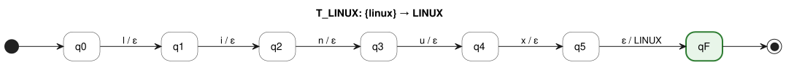

PlantUML source: [`fst/T_LINUX.puml`](fst/T_LINUX.puml)

Example: `linux` ⟼ LINUX; `linu` has no accepting run (rejected).

### T_JUPYTER

Transforms `Jupyter`, `Jupyter Notebook`, `Jupyter Notebooks` → **JUPYTER**

**M_JUPYTER = (Q, Σ, Γ, δ, ω, q0, F)**

- **Q** = {q0, q1, q2, q3, q4, q5, q6, q7, q8, q9, q10, q11, q12, q13, q14, q15, q16, qF} — |Q| = |Pref(V)| + 1 = 17 + 1 = 18
- **Σ** = {`b`, `e`, `j`, `k`, `n`, `o`, `p`, `r`, `s`, `t`, `u`, `y`}
- **Γ** = {JUPYTER}
- **q0** = q0
- **F** = {qF}
- **V** = dom(M) = {`jupyter`, `jupyternotebook`, `jupyternotebooks`}; T(M) = V × {JUPYTER} (Proposition 2)
- **δ** and **ω** — |δ| = (|Pref(V)| − 1) + |V| = 16 + 3 = 19:

| #   | q   | a ∈ Σ ∪ {ε} | δ(q, a) | ω(q, a) |
| --- | --- | ----------- | ------- | ------- |
| 1   | q0  | `j`         | q1      | ε       |
| 2   | q1  | `u`         | q2      | ε       |
| 3   | q2  | `p`         | q3      | ε       |
| 4   | q3  | `y`         | q4      | ε       |
| 5   | q4  | `t`         | q5      | ε       |
| 6   | q5  | `e`         | q6      | ε       |
| 7   | q6  | `r`         | q7      | ε       |
| 8   | q7  | `n`         | q8      | ε       |
| 9   | q7  | ε           | qF      | JUPYTER |
| 10  | q8  | `o`         | q9      | ε       |
| 11  | q9  | `t`         | q10     | ε       |
| 12  | q10 | `e`         | q11     | ε       |
| 13  | q11 | `b`         | q12     | ε       |
| 14  | q12 | `o`         | q13     | ε       |
| 15  | q13 | `o`         | q14     | ε       |
| 16  | q14 | `k`         | q15     | ε       |
| 17  | q15 | `s`         | q16     | ε       |
| 18  | q15 | ε           | qF      | JUPYTER |
| 19  | q16 | ε           | qF      | JUPYTER |

δ is undefined for every other pair (q, a).

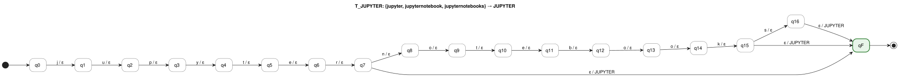

PlantUML source: [`fst/T_JUPYTER.puml`](fst/T_JUPYTER.puml)

Example: `jupyternotebooks` ⟼ JUPYTER; `jupyternotebooksx` has no accepting run (rejected).

### T_JENKINS

Transforms `Jenkins` → **JENKINS**

**M_JENKINS = (Q, Σ, Γ, δ, ω, q0, F)**

- **Q** = {q0, q1, q2, q3, q4, q5, q6, q7, qF} — |Q| = |Pref(V)| + 1 = 8 + 1 = 9
- **Σ** = {`e`, `i`, `j`, `k`, `n`, `s`}
- **Γ** = {JENKINS}
- **q0** = q0
- **F** = {qF}
- **V** = dom(M) = {`jenkins`}; T(M) = V × {JENKINS} (Proposition 2)
- **δ** and **ω** — |δ| = (|Pref(V)| − 1) + |V| = 7 + 1 = 8:

| #   | q   | a ∈ Σ ∪ {ε} | δ(q, a) | ω(q, a) |
| --- | --- | ----------- | ------- | ------- |
| 1   | q0  | `j`         | q1      | ε       |
| 2   | q1  | `e`         | q2      | ε       |
| 3   | q2  | `n`         | q3      | ε       |
| 4   | q3  | `k`         | q4      | ε       |
| 5   | q4  | `i`         | q5      | ε       |
| 6   | q5  | `n`         | q6      | ε       |
| 7   | q6  | `s`         | q7      | ε       |
| 8   | q7  | ε           | qF      | JENKINS |

δ is undefined for every other pair (q, a).

PlantUML source: [`fst/T_JENKINS.puml`](fst/T_JENKINS.puml)

Example: `jenkins` ⟼ JENKINS; `jenkin` has no accepting run (rejected).

### T_POSTMAN

Transforms `Postman` → **POSTMAN**

**M_POSTMAN = (Q, Σ, Γ, δ, ω, q0, F)**

- **Q** = {q0, q1, q2, q3, q4, q5, q6, q7, qF} — |Q| = |Pref(V)| + 1 = 8 + 1 = 9
- **Σ** = {`a`, `m`, `n`, `o`, `p`, `s`, `t`}
- **Γ** = {POSTMAN}
- **q0** = q0
- **F** = {qF}
- **V** = dom(M) = {`postman`}; T(M) = V × {POSTMAN} (Proposition 2)
- **δ** and **ω** — |δ| = (|Pref(V)| − 1) + |V| = 7 + 1 = 8:

| #   | q   | a ∈ Σ ∪ {ε} | δ(q, a) | ω(q, a) |
| --- | --- | ----------- | ------- | ------- |
| 1   | q0  | `p`         | q1      | ε       |
| 2   | q1  | `o`         | q2      | ε       |
| 3   | q2  | `s`         | q3      | ε       |
| 4   | q3  | `t`         | q4      | ε       |
| 5   | q4  | `m`         | q5      | ε       |
| 6   | q5  | `a`         | q6      | ε       |
| 7   | q6  | `n`         | q7      | ε       |
| 8   | q7  | ε           | qF      | POSTMAN |

δ is undefined for every other pair (q, a).

PlantUML source: [`fst/T_POSTMAN.puml`](fst/T_POSTMAN.puml)

Example: `postman` ⟼ POSTMAN; `postma` has no accepting run (rejected).

### T_JIRA

Transforms `Jira` → **JIRA**

**M_JIRA = (Q, Σ, Γ, δ, ω, q0, F)**

- **Q** = {q0, q1, q2, q3, q4, qF} — |Q| = |Pref(V)| + 1 = 5 + 1 = 6
- **Σ** = {`a`, `i`, `j`, `r`}
- **Γ** = {JIRA}
- **q0** = q0
- **F** = {qF}
- **V** = dom(M) = {`jira`}; T(M) = V × {JIRA} (Proposition 2)
- **δ** and **ω** — |δ| = (|Pref(V)| − 1) + |V| = 4 + 1 = 5:

| #   | q   | a ∈ Σ ∪ {ε} | δ(q, a) | ω(q, a) |
| --- | --- | ----------- | ------- | ------- |
| 1   | q0  | `j`         | q1      | ε       |
| 2   | q1  | `i`         | q2      | ε       |
| 3   | q2  | `r`         | q3      | ε       |
| 4   | q3  | `a`         | q4      | ε       |
| 5   | q4  | ε           | qF      | JIRA    |

δ is undefined for every other pair (q, a).

PlantUML source: [`fst/T_JIRA.puml`](fst/T_JIRA.puml)

Example: `jira` ⟼ JIRA; `jir` has no accepting run (rejected).

### T_MLFLOW

Transforms `MLflow` → **MLFLOW**

**M_MLFLOW = (Q, Σ, Γ, δ, ω, q0, F)**

- **Q** = {q0, q1, q2, q3, q4, q5, q6, qF} — |Q| = |Pref(V)| + 1 = 7 + 1 = 8
- **Σ** = {`f`, `l`, `m`, `o`, `w`}
- **Γ** = {MLFLOW}
- **q0** = q0
- **F** = {qF}
- **V** = dom(M) = {`mlflow`}; T(M) = V × {MLFLOW} (Proposition 2)
- **δ** and **ω** — |δ| = (|Pref(V)| − 1) + |V| = 6 + 1 = 7:

| #   | q   | a ∈ Σ ∪ {ε} | δ(q, a) | ω(q, a) |
| --- | --- | ----------- | ------- | ------- |
| 1   | q0  | `m`         | q1      | ε       |
| 2   | q1  | `l`         | q2      | ε       |
| 3   | q2  | `f`         | q3      | ε       |
| 4   | q3  | `l`         | q4      | ε       |
| 5   | q4  | `o`         | q5      | ε       |
| 6   | q5  | `w`         | q6      | ε       |
| 7   | q6  | ε           | qF      | MLFLOW  |

δ is undefined for every other pair (q, a).

PlantUML source: [`fst/T_MLFLOW.puml`](fst/T_MLFLOW.puml)

Example: `mlflow` ⟼ MLFLOW; `mlflo` has no accepting run (rejected).

### T_AIRFLOW

Transforms `Airflow`, `Apache Airflow` → **AIRFLOW**

**M_AIRFLOW = (Q, Σ, Γ, δ, ω, q0, F)**

- **Q** = {q0, q1, q2, q3, q4, q5, q6, q7, q8, q9, q10, q11, q12, q13, q14, q15, q16, q17, q18, q19, qF} — |Q| = |Pref(V)| + 1 = 20 + 1 = 21
- **Σ** = {`a`, `c`, `e`, `f`, `h`, `i`, `l`, `o`, `p`, `r`, `w`}
- **Γ** = {AIRFLOW}
- **q0** = q0
- **F** = {qF}
- **V** = dom(M) = {`airflow`, `apacheairflow`}; T(M) = V × {AIRFLOW} (Proposition 2)
- **δ** and **ω** — |δ| = (|Pref(V)| − 1) + |V| = 19 + 2 = 21:

| #   | q   | a ∈ Σ ∪ {ε} | δ(q, a) | ω(q, a) |
| --- | --- | ----------- | ------- | ------- |
| 1   | q0  | `a`         | q1      | ε       |
| 2   | q1  | `i`         | q2      | ε       |
| 3   | q1  | `p`         | q8      | ε       |
| 4   | q2  | `r`         | q3      | ε       |
| 5   | q3  | `f`         | q4      | ε       |
| 6   | q4  | `l`         | q5      | ε       |
| 7   | q5  | `o`         | q6      | ε       |
| 8   | q6  | `w`         | q7      | ε       |
| 9   | q7  | ε           | qF      | AIRFLOW |
| 10  | q8  | `a`         | q9      | ε       |
| 11  | q9  | `c`         | q10     | ε       |
| 12  | q10 | `h`         | q11     | ε       |
| 13  | q11 | `e`         | q12     | ε       |
| 14  | q12 | `a`         | q13     | ε       |
| 15  | q13 | `i`         | q14     | ε       |
| 16  | q14 | `r`         | q15     | ε       |
| 17  | q15 | `f`         | q16     | ε       |
| 18  | q16 | `l`         | q17     | ε       |
| 19  | q17 | `o`         | q18     | ε       |
| 20  | q18 | `w`         | q19     | ε       |
| 21  | q19 | ε           | qF      | AIRFLOW |

δ is undefined for every other pair (q, a).

PlantUML source: [`fst/T_AIRFLOW.puml`](fst/T_AIRFLOW.puml)

Example: `apacheairflow` ⟼ AIRFLOW; `apacheairflo` has no accepting run (rejected).

### T_SPARK

Transforms `Spark`, `Apache Spark`, `PySpark` → **SPARK**

**M_SPARK = (Q, Σ, Γ, δ, ω, q0, F)**

- **Q** = {q0, q1, q2, q3, q4, q5, q6, q7, q8, q9, q10, q11, q12, q13, q14, q15, q16, q17, q18, q19, q20, q21, q22, q23, qF} — |Q| = |Pref(V)| + 1 = 24 + 1 = 25
- **Σ** = {`a`, `c`, `e`, `h`, `k`, `p`, `r`, `s`, `y`}
- **Γ** = {SPARK}
- **q0** = q0
- **F** = {qF}
- **V** = dom(M) = {`apachespark`, `pyspark`, `spark`}; T(M) = V × {SPARK} (Proposition 2)
- **δ** and **ω** — |δ| = (|Pref(V)| − 1) + |V| = 23 + 3 = 26:

| #   | q   | a ∈ Σ ∪ {ε} | δ(q, a) | ω(q, a) |
| --- | --- | ----------- | ------- | ------- |
| 1   | q0  | `a`         | q1      | ε       |
| 2   | q0  | `p`         | q12     | ε       |
| 3   | q0  | `s`         | q19     | ε       |
| 4   | q1  | `p`         | q2      | ε       |
| 5   | q2  | `a`         | q3      | ε       |
| 6   | q3  | `c`         | q4      | ε       |
| 7   | q4  | `h`         | q5      | ε       |
| 8   | q5  | `e`         | q6      | ε       |
| 9   | q6  | `s`         | q7      | ε       |
| 10  | q7  | `p`         | q8      | ε       |
| 11  | q8  | `a`         | q9      | ε       |
| 12  | q9  | `r`         | q10     | ε       |
| 13  | q10 | `k`         | q11     | ε       |
| 14  | q11 | ε           | qF      | SPARK   |
| 15  | q12 | `y`         | q13     | ε       |
| 16  | q13 | `s`         | q14     | ε       |
| 17  | q14 | `p`         | q15     | ε       |
| 18  | q15 | `a`         | q16     | ε       |
| 19  | q16 | `r`         | q17     | ε       |
| 20  | q17 | `k`         | q18     | ε       |
| 21  | q18 | ε           | qF      | SPARK   |
| 22  | q19 | `p`         | q20     | ε       |
| 23  | q20 | `a`         | q21     | ε       |
| 24  | q21 | `r`         | q22     | ε       |
| 25  | q22 | `k`         | q23     | ε       |
| 26  | q23 | ε           | qF      | SPARK   |

δ is undefined for every other pair (q, a).

PlantUML source: [`fst/T_SPARK.puml`](fst/T_SPARK.puml)

Example: `apachespark` ⟼ SPARK; `apachespar` has no accepting run (rejected).

### T_HADOOP

Transforms `Hadoop`, `Apache Hadoop` → **HADOOP**

**M_HADOOP = (Q, Σ, Γ, δ, ω, q0, F)**

- **Q** = {q0, q1, q2, q3, q4, q5, q6, q7, q8, q9, q10, q11, q12, q13, q14, q15, q16, q17, q18, qF} — |Q| = |Pref(V)| + 1 = 19 + 1 = 20
- **Σ** = {`a`, `c`, `d`, `e`, `h`, `o`, `p`}
- **Γ** = {HADOOP}
- **q0** = q0
- **F** = {qF}
- **V** = dom(M) = {`apachehadoop`, `hadoop`}; T(M) = V × {HADOOP} (Proposition 2)
- **δ** and **ω** — |δ| = (|Pref(V)| − 1) + |V| = 18 + 2 = 20:

| #   | q   | a ∈ Σ ∪ {ε} | δ(q, a) | ω(q, a) |
| --- | --- | ----------- | ------- | ------- |
| 1   | q0  | `a`         | q1      | ε       |
| 2   | q0  | `h`         | q13     | ε       |
| 3   | q1  | `p`         | q2      | ε       |
| 4   | q2  | `a`         | q3      | ε       |
| 5   | q3  | `c`         | q4      | ε       |
| 6   | q4  | `h`         | q5      | ε       |
| 7   | q5  | `e`         | q6      | ε       |
| 8   | q6  | `h`         | q7      | ε       |
| 9   | q7  | `a`         | q8      | ε       |
| 10  | q8  | `d`         | q9      | ε       |
| 11  | q9  | `o`         | q10     | ε       |
| 12  | q10 | `o`         | q11     | ε       |
| 13  | q11 | `p`         | q12     | ε       |
| 14  | q12 | ε           | qF      | HADOOP  |
| 15  | q13 | `a`         | q14     | ε       |
| 16  | q14 | `d`         | q15     | ε       |
| 17  | q15 | `o`         | q16     | ε       |
| 18  | q16 | `o`         | q17     | ε       |
| 19  | q17 | `p`         | q18     | ε       |
| 20  | q18 | ε           | qF      | HADOOP  |

δ is undefined for every other pair (q, a).

PlantUML source: [`fst/T_HADOOP.puml`](fst/T_HADOOP.puml)

Example: `apachehadoop` ⟼ HADOOP; `apachehadoo` has no accepting run (rejected).

### T_KAFKA

Transforms `Kafka`, `Apache Kafka` → **KAFKA**

**M_KAFKA = (Q, Σ, Γ, δ, ω, q0, F)**

- **Q** = {q0, q1, q2, q3, q4, q5, q6, q7, q8, q9, q10, q11, q12, q13, q14, q15, q16, qF} — |Q| = |Pref(V)| + 1 = 17 + 1 = 18
- **Σ** = {`a`, `c`, `e`, `f`, `h`, `k`, `p`}
- **Γ** = {KAFKA}
- **q0** = q0
- **F** = {qF}
- **V** = dom(M) = {`apachekafka`, `kafka`}; T(M) = V × {KAFKA} (Proposition 2)
- **δ** and **ω** — |δ| = (|Pref(V)| − 1) + |V| = 16 + 2 = 18:

| #   | q   | a ∈ Σ ∪ {ε} | δ(q, a) | ω(q, a) |
| --- | --- | ----------- | ------- | ------- |
| 1   | q0  | `a`         | q1      | ε       |
| 2   | q0  | `k`         | q12     | ε       |
| 3   | q1  | `p`         | q2      | ε       |
| 4   | q2  | `a`         | q3      | ε       |
| 5   | q3  | `c`         | q4      | ε       |
| 6   | q4  | `h`         | q5      | ε       |
| 7   | q5  | `e`         | q6      | ε       |
| 8   | q6  | `k`         | q7      | ε       |
| 9   | q7  | `a`         | q8      | ε       |
| 10  | q8  | `f`         | q9      | ε       |
| 11  | q9  | `k`         | q10     | ε       |
| 12  | q10 | `a`         | q11     | ε       |
| 13  | q11 | ε           | qF      | KAFKA   |
| 14  | q12 | `a`         | q13     | ε       |
| 15  | q13 | `f`         | q14     | ε       |
| 16  | q14 | `k`         | q15     | ε       |
| 17  | q15 | `a`         | q16     | ε       |
| 18  | q16 | ε           | qF      | KAFKA   |

δ is undefined for every other pair (q, a).

PlantUML source: [`fst/T_KAFKA.puml`](fst/T_KAFKA.puml)

Example: `apachekafka` ⟼ KAFKA; `apachekafk` has no accepting run (rejected).

### T_DATABRICKS

Transforms `Databricks` → **DATABRICKS**

**M_DATABRICKS = (Q, Σ, Γ, δ, ω, q0, F)**

- **Q** = {q0, q1, q2, q3, q4, q5, q6, q7, q8, q9, q10, qF} — |Q| = |Pref(V)| + 1 = 11 + 1 = 12
- **Σ** = {`a`, `b`, `c`, `d`, `i`, `k`, `r`, `s`, `t`}
- **Γ** = {DATABRICKS}
- **q0** = q0
- **F** = {qF}
- **V** = dom(M) = {`databricks`}; T(M) = V × {DATABRICKS} (Proposition 2)
- **δ** and **ω** — |δ| = (|Pref(V)| − 1) + |V| = 10 + 1 = 11:

| #   | q   | a ∈ Σ ∪ {ε} | δ(q, a) | ω(q, a)    |
| --- | --- | ----------- | ------- | ---------- |
| 1   | q0  | `d`         | q1      | ε          |
| 2   | q1  | `a`         | q2      | ε          |
| 3   | q2  | `t`         | q3      | ε          |
| 4   | q3  | `a`         | q4      | ε          |
| 5   | q4  | `b`         | q5      | ε          |
| 6   | q5  | `r`         | q6      | ε          |
| 7   | q6  | `i`         | q7      | ε          |
| 8   | q7  | `c`         | q8      | ε          |
| 9   | q8  | `k`         | q9      | ε          |
| 10  | q9  | `s`         | q10     | ε          |
| 11  | q10 | ε           | qF      | DATABRICKS |

δ is undefined for every other pair (q, a).

PlantUML source: [`fst/T_DATABRICKS.puml`](fst/T_DATABRICKS.puml)

Example: `databricks` ⟼ DATABRICKS; `databrick` has no accepting run (rejected).

### T_DBT

Transforms `dbt` → **DBT**

**M_DBT = (Q, Σ, Γ, δ, ω, q0, F)**

- **Q** = {q0, q1, q2, q3, qF} — |Q| = |Pref(V)| + 1 = 4 + 1 = 5
- **Σ** = {`b`, `d`, `t`}
- **Γ** = {DBT}
- **q0** = q0
- **F** = {qF}
- **V** = dom(M) = {`dbt`}; T(M) = V × {DBT} (Proposition 2)
- **δ** and **ω** — |δ| = (|Pref(V)| − 1) + |V| = 3 + 1 = 4:

| #   | q   | a ∈ Σ ∪ {ε} | δ(q, a) | ω(q, a) |
| --- | --- | ----------- | ------- | ------- |
| 1   | q0  | `d`         | q1      | ε       |
| 2   | q1  | `b`         | q2      | ε       |
| 3   | q2  | `t`         | q3      | ε       |
| 4   | q3  | ε           | qF      | DBT     |

δ is undefined for every other pair (q, a).

PlantUML source: [`fst/T_DBT.puml`](fst/T_DBT.puml)

Example: `dbt` ⟼ DBT; `db` has no accepting run (rejected).

### T_GITHUB_ACTIONS

Transforms `GitHub Actions` → **GITHUB_ACTIONS**

**M_GITHUB_ACTIONS = (Q, Σ, Γ, δ, ω, q0, F)**

- **Q** = {q0, q1, q2, q3, q4, q5, q6, q7, q8, q9, q10, q11, q12, q13, qF} — |Q| = |Pref(V)| + 1 = 14 + 1 = 15
- **Σ** = {`a`, `b`, `c`, `g`, `h`, `i`, `n`, `o`, `s`, `t`, `u`}
- **Γ** = {GITHUB_ACTIONS}
- **q0** = q0
- **F** = {qF}
- **V** = dom(M) = {`githubactions`}; T(M) = V × {GITHUB_ACTIONS} (Proposition 2)
- **δ** and **ω** — |δ| = (|Pref(V)| − 1) + |V| = 13 + 1 = 14:

| #   | q   | a ∈ Σ ∪ {ε} | δ(q, a) | ω(q, a)        |
| --- | --- | ----------- | ------- | -------------- |
| 1   | q0  | `g`         | q1      | ε              |
| 2   | q1  | `i`         | q2      | ε              |
| 3   | q2  | `t`         | q3      | ε              |
| 4   | q3  | `h`         | q4      | ε              |
| 5   | q4  | `u`         | q5      | ε              |
| 6   | q5  | `b`         | q6      | ε              |
| 7   | q6  | `a`         | q7      | ε              |
| 8   | q7  | `c`         | q8      | ε              |
| 9   | q8  | `t`         | q9      | ε              |
| 10  | q9  | `i`         | q10     | ε              |
| 11  | q10 | `o`         | q11     | ε              |
| 12  | q11 | `n`         | q12     | ε              |
| 13  | q12 | `s`         | q13     | ε              |
| 14  | q13 | ε           | qF      | GITHUB_ACTIONS |

δ is undefined for every other pair (q, a).

PlantUML source: [`fst/T_GITHUB_ACTIONS.puml`](fst/T_GITHUB_ACTIONS.puml)

Example: `githubactions` ⟼ GITHUB_ACTIONS; `githubaction` has no accepting run (rejected).

### T_TERRAFORM

Transforms `Terraform` → **TERRAFORM**

**M_TERRAFORM = (Q, Σ, Γ, δ, ω, q0, F)**

- **Q** = {q0, q1, q2, q3, q4, q5, q6, q7, q8, q9, qF} — |Q| = |Pref(V)| + 1 = 10 + 1 = 11
- **Σ** = {`a`, `e`, `f`, `m`, `o`, `r`, `t`}
- **Γ** = {TERRAFORM}
- **q0** = q0
- **F** = {qF}
- **V** = dom(M) = {`terraform`}; T(M) = V × {TERRAFORM} (Proposition 2)
- **δ** and **ω** — |δ| = (|Pref(V)| − 1) + |V| = 9 + 1 = 10:

| #   | q   | a ∈ Σ ∪ {ε} | δ(q, a) | ω(q, a)   |
| --- | --- | ----------- | ------- | --------- |
| 1   | q0  | `t`         | q1      | ε         |
| 2   | q1  | `e`         | q2      | ε         |
| 3   | q2  | `r`         | q3      | ε         |
| 4   | q3  | `r`         | q4      | ε         |
| 5   | q4  | `a`         | q5      | ε         |
| 6   | q5  | `f`         | q6      | ε         |
| 7   | q6  | `o`         | q7      | ε         |
| 8   | q7  | `r`         | q8      | ε         |
| 9   | q8  | `m`         | q9      | ε         |
| 10  | q9  | ε           | qF      | TERRAFORM |

δ is undefined for every other pair (q, a).

PlantUML source: [`fst/T_TERRAFORM.puml`](fst/T_TERRAFORM.puml)

Example: `terraform` ⟼ TERRAFORM; `terrafor` has no accepting run (rejected).

### T_ANSIBLE

Transforms `Ansible` → **ANSIBLE**

**M_ANSIBLE = (Q, Σ, Γ, δ, ω, q0, F)**

- **Q** = {q0, q1, q2, q3, q4, q5, q6, q7, qF} — |Q| = |Pref(V)| + 1 = 8 + 1 = 9
- **Σ** = {`a`, `b`, `e`, `i`, `l`, `n`, `s`}
- **Γ** = {ANSIBLE}
- **q0** = q0
- **F** = {qF}
- **V** = dom(M) = {`ansible`}; T(M) = V × {ANSIBLE} (Proposition 2)
- **δ** and **ω** — |δ| = (|Pref(V)| − 1) + |V| = 7 + 1 = 8:

| #   | q   | a ∈ Σ ∪ {ε} | δ(q, a) | ω(q, a) |
| --- | --- | ----------- | ------- | ------- |
| 1   | q0  | `a`         | q1      | ε       |
| 2   | q1  | `n`         | q2      | ε       |
| 3   | q2  | `s`         | q3      | ε       |
| 4   | q3  | `i`         | q4      | ε       |
| 5   | q4  | `b`         | q5      | ε       |
| 6   | q5  | `l`         | q6      | ε       |
| 7   | q6  | `e`         | q7      | ε       |
| 8   | q7  | ε           | qF      | ANSIBLE |

δ is undefined for every other pair (q, a).

PlantUML source: [`fst/T_ANSIBLE.puml`](fst/T_ANSIBLE.puml)

Example: `ansible` ⟼ ANSIBLE; `ansibl` has no accepting run (rejected).

### T_PROMETHEUS

Transforms `Prometheus` → **PROMETHEUS**

**M_PROMETHEUS = (Q, Σ, Γ, δ, ω, q0, F)**

- **Q** = {q0, q1, q2, q3, q4, q5, q6, q7, q8, q9, q10, qF} — |Q| = |Pref(V)| + 1 = 11 + 1 = 12
- **Σ** = {`e`, `h`, `m`, `o`, `p`, `r`, `s`, `t`, `u`}
- **Γ** = {PROMETHEUS}
- **q0** = q0
- **F** = {qF}
- **V** = dom(M) = {`prometheus`}; T(M) = V × {PROMETHEUS} (Proposition 2)
- **δ** and **ω** — |δ| = (|Pref(V)| − 1) + |V| = 10 + 1 = 11:

| #   | q   | a ∈ Σ ∪ {ε} | δ(q, a) | ω(q, a)    |
| --- | --- | ----------- | ------- | ---------- |
| 1   | q0  | `p`         | q1      | ε          |
| 2   | q1  | `r`         | q2      | ε          |
| 3   | q2  | `o`         | q3      | ε          |
| 4   | q3  | `m`         | q4      | ε          |
| 5   | q4  | `e`         | q5      | ε          |
| 6   | q5  | `t`         | q6      | ε          |
| 7   | q6  | `h`         | q7      | ε          |
| 8   | q7  | `e`         | q8      | ε          |
| 9   | q8  | `u`         | q9      | ε          |
| 10  | q9  | `s`         | q10     | ε          |
| 11  | q10 | ε           | qF      | PROMETHEUS |

δ is undefined for every other pair (q, a).

PlantUML source: [`fst/T_PROMETHEUS.puml`](fst/T_PROMETHEUS.puml)

Example: `prometheus` ⟼ PROMETHEUS; `prometheu` has no accepting run (rejected).

### T_GRAFANA

Transforms `Grafana` → **GRAFANA**

**M_GRAFANA = (Q, Σ, Γ, δ, ω, q0, F)**

- **Q** = {q0, q1, q2, q3, q4, q5, q6, q7, qF} — |Q| = |Pref(V)| + 1 = 8 + 1 = 9
- **Σ** = {`a`, `f`, `g`, `n`, `r`}
- **Γ** = {GRAFANA}
- **q0** = q0
- **F** = {qF}
- **V** = dom(M) = {`grafana`}; T(M) = V × {GRAFANA} (Proposition 2)
- **δ** and **ω** — |δ| = (|Pref(V)| − 1) + |V| = 7 + 1 = 8:

| #   | q   | a ∈ Σ ∪ {ε} | δ(q, a) | ω(q, a) |
| --- | --- | ----------- | ------- | ------- |
| 1   | q0  | `g`         | q1      | ε       |
| 2   | q1  | `r`         | q2      | ε       |
| 3   | q2  | `a`         | q3      | ε       |
| 4   | q3  | `f`         | q4      | ε       |
| 5   | q4  | `a`         | q5      | ε       |
| 6   | q5  | `n`         | q6      | ε       |
| 7   | q6  | `a`         | q7      | ε       |
| 8   | q7  | ε           | qF      | GRAFANA |

δ is undefined for every other pair (q, a).

PlantUML source: [`fst/T_GRAFANA.puml`](fst/T_GRAFANA.puml)

Example: `grafana` ⟼ GRAFANA; `grafan` has no accepting run (rejected).

### T_BASH

Transforms `Bash`, `Shell Scripting` → **BASH**

**M_BASH = (Q, Σ, Γ, δ, ω, q0, F)**

- **Q** = {q0, q1, q2, q3, q4, q5, q6, q7, q8, q9, q10, q11, q12, q13, q14, q15, q16, q17, q18, qF} — |Q| = |Pref(V)| + 1 = 19 + 1 = 20
- **Σ** = {`a`, `b`, `c`, `e`, `g`, `h`, `i`, `l`, `n`, `p`, `r`, `s`, `t`}
- **Γ** = {BASH}
- **q0** = q0
- **F** = {qF}
- **V** = dom(M) = {`bash`, `shellscripting`}; T(M) = V × {BASH} (Proposition 2)
- **δ** and **ω** — |δ| = (|Pref(V)| − 1) + |V| = 18 + 2 = 20:

| #   | q   | a ∈ Σ ∪ {ε} | δ(q, a) | ω(q, a) |
| --- | --- | ----------- | ------- | ------- |
| 1   | q0  | `b`         | q1      | ε       |
| 2   | q0  | `s`         | q5      | ε       |
| 3   | q1  | `a`         | q2      | ε       |
| 4   | q2  | `s`         | q3      | ε       |
| 5   | q3  | `h`         | q4      | ε       |
| 6   | q4  | ε           | qF      | BASH    |
| 7   | q5  | `h`         | q6      | ε       |
| 8   | q6  | `e`         | q7      | ε       |
| 9   | q7  | `l`         | q8      | ε       |
| 10  | q8  | `l`         | q9      | ε       |
| 11  | q9  | `s`         | q10     | ε       |
| 12  | q10 | `c`         | q11     | ε       |
| 13  | q11 | `r`         | q12     | ε       |
| 14  | q12 | `i`         | q13     | ε       |
| 15  | q13 | `p`         | q14     | ε       |
| 16  | q14 | `t`         | q15     | ε       |
| 17  | q15 | `i`         | q16     | ε       |
| 18  | q16 | `n`         | q17     | ε       |
| 19  | q17 | `g`         | q18     | ε       |
| 20  | q18 | ε           | qF      | BASH    |

δ is undefined for every other pair (q, a).

PlantUML source: [`fst/T_BASH.puml`](fst/T_BASH.puml)

Example: `shellscripting` ⟼ BASH; `shellscriptin` has no accepting run (rejected).

### T_REST_API

Transforms `REST API`, `REST APIs`, `RESTful API`, `RESTful APIs`, `REST-API` → **REST_API**

**M_REST_API = (Q, Σ, Γ, δ, ω, q0, F)**

- **Q** = {q0, q1, q2, q3, q4, q5, q6, q7, q8, q9, q10, q11, q12, q13, q14, q15, qF} — |Q| = |Pref(V)| + 1 = 16 + 1 = 17
- **Σ** = {`a`, `e`, `f`, `i`, `l`, `p`, `r`, `s`, `t`, `u`}
- **Γ** = {REST_API}
- **q0** = q0
- **F** = {qF}
- **V** = dom(M) = {`restapi`, `restapis`, `restfulapi`, `restfulapis`}; T(M) = V × {REST_API} (Proposition 2)
- **δ** and **ω** — |δ| = (|Pref(V)| − 1) + |V| = 15 + 4 = 19:

| #   | q   | a ∈ Σ ∪ {ε} | δ(q, a) | ω(q, a)  |
| --- | --- | ----------- | ------- | -------- |
| 1   | q0  | `r`         | q1      | ε        |
| 2   | q1  | `e`         | q2      | ε        |
| 3   | q2  | `s`         | q3      | ε        |
| 4   | q3  | `t`         | q4      | ε        |
| 5   | q4  | `a`         | q5      | ε        |
| 6   | q4  | `f`         | q9      | ε        |
| 7   | q5  | `p`         | q6      | ε        |
| 8   | q6  | `i`         | q7      | ε        |
| 9   | q7  | `s`         | q8      | ε        |
| 10  | q7  | ε           | qF      | REST_API |
| 11  | q8  | ε           | qF      | REST_API |
| 12  | q9  | `u`         | q10     | ε        |
| 13  | q10 | `l`         | q11     | ε        |
| 14  | q11 | `a`         | q12     | ε        |
| 15  | q12 | `p`         | q13     | ε        |
| 16  | q13 | `i`         | q14     | ε        |
| 17  | q14 | `s`         | q15     | ε        |
| 18  | q14 | ε           | qF      | REST_API |
| 19  | q15 | ε           | qF      | REST_API |

δ is undefined for every other pair (q, a).

PlantUML source: [`fst/T_REST_API.puml`](fst/T_REST_API.puml)

Example: `restfulapis` ⟼ REST_API; `restfulapisx` has no accepting run (rejected).

### T_GRAPHQL

Transforms `GraphQL` → **GRAPHQL**

**M_GRAPHQL = (Q, Σ, Γ, δ, ω, q0, F)**

- **Q** = {q0, q1, q2, q3, q4, q5, q6, q7, qF} — |Q| = |Pref(V)| + 1 = 8 + 1 = 9
- **Σ** = {`a`, `g`, `h`, `l`, `p`, `q`, `r`}
- **Γ** = {GRAPHQL}
- **q0** = q0
- **F** = {qF}
- **V** = dom(M) = {`graphql`}; T(M) = V × {GRAPHQL} (Proposition 2)
- **δ** and **ω** — |δ| = (|Pref(V)| − 1) + |V| = 7 + 1 = 8:

| #   | q   | a ∈ Σ ∪ {ε} | δ(q, a) | ω(q, a) |
| --- | --- | ----------- | ------- | ------- |
| 1   | q0  | `g`         | q1      | ε       |
| 2   | q1  | `r`         | q2      | ε       |
| 3   | q2  | `a`         | q3      | ε       |
| 4   | q3  | `p`         | q4      | ε       |
| 5   | q4  | `h`         | q5      | ε       |
| 6   | q5  | `q`         | q6      | ε       |
| 7   | q6  | `l`         | q7      | ε       |
| 8   | q7  | ε           | qF      | GRAPHQL |

δ is undefined for every other pair (q, a).

PlantUML source: [`fst/T_GRAPHQL.puml`](fst/T_GRAPHQL.puml)

Example: `graphql` ⟼ GRAPHQL; `graphq` has no accepting run (rejected).

### T_MICROSERVICES

Transforms `Microservices` → **MICROSERVICES**

**M_MICROSERVICES = (Q, Σ, Γ, δ, ω, q0, F)**

- **Q** = {q0, q1, q2, q3, q4, q5, q6, q7, q8, q9, q10, q11, q12, q13, qF} — |Q| = |Pref(V)| + 1 = 14 + 1 = 15
- **Σ** = {`c`, `e`, `i`, `m`, `o`, `r`, `s`, `v`}
- **Γ** = {MICROSERVICES}
- **q0** = q0
- **F** = {qF}
- **V** = dom(M) = {`microservices`}; T(M) = V × {MICROSERVICES} (Proposition 2)
- **δ** and **ω** — |δ| = (|Pref(V)| − 1) + |V| = 13 + 1 = 14:

| #   | q   | a ∈ Σ ∪ {ε} | δ(q, a) | ω(q, a)       |
| --- | --- | ----------- | ------- | ------------- |
| 1   | q0  | `m`         | q1      | ε             |
| 2   | q1  | `i`         | q2      | ε             |
| 3   | q2  | `c`         | q3      | ε             |
| 4   | q3  | `r`         | q4      | ε             |
| 5   | q4  | `o`         | q5      | ε             |
| 6   | q5  | `s`         | q6      | ε             |
| 7   | q6  | `e`         | q7      | ε             |
| 8   | q7  | `r`         | q8      | ε             |
| 9   | q8  | `v`         | q9      | ε             |
| 10  | q9  | `i`         | q10     | ε             |
| 11  | q10 | `c`         | q11     | ε             |
| 12  | q11 | `e`         | q12     | ε             |
| 13  | q12 | `s`         | q13     | ε             |
| 14  | q13 | ε           | qF      | MICROSERVICES |

δ is undefined for every other pair (q, a).

PlantUML source: [`fst/T_MICROSERVICES.puml`](fst/T_MICROSERVICES.puml)

Example: `microservices` ⟼ MICROSERVICES; `microservice` has no accepting run (rejected).

### T_CI_CD

Transforms `CI/CD` → **CI_CD**

**M_CI_CD = (Q, Σ, Γ, δ, ω, q0, F)**

- **Q** = {q0, q1, q2, q3, q4, qF} — |Q| = |Pref(V)| + 1 = 5 + 1 = 6
- **Σ** = {`c`, `d`, `i`}
- **Γ** = {CI_CD}
- **q0** = q0
- **F** = {qF}
- **V** = dom(M) = {`cicd`}; T(M) = V × {CI_CD} (Proposition 2)
- **δ** and **ω** — |δ| = (|Pref(V)| − 1) + |V| = 4 + 1 = 5:

| #   | q   | a ∈ Σ ∪ {ε} | δ(q, a) | ω(q, a) |
| --- | --- | ----------- | ------- | ------- |
| 1   | q0  | `c`         | q1      | ε       |
| 2   | q1  | `i`         | q2      | ε       |
| 3   | q2  | `c`         | q3      | ε       |
| 4   | q3  | `d`         | q4      | ε       |
| 5   | q4  | ε           | qF      | CI_CD   |

δ is undefined for every other pair (q, a).

PlantUML source: [`fst/T_CI_CD.puml`](fst/T_CI_CD.puml)

Example: `cicd` ⟼ CI_CD; `cic` has no accepting run (rejected).

### T_ETL

Transforms `ETL`, `ELT` → **ETL**

**M_ETL = (Q, Σ, Γ, δ, ω, q0, F)**

- **Q** = {q0, q1, q2, q3, q4, q5, qF} — |Q| = |Pref(V)| + 1 = 6 + 1 = 7
- **Σ** = {`e`, `l`, `t`}
- **Γ** = {ETL}
- **q0** = q0
- **F** = {qF}
- **V** = dom(M) = {`elt`, `etl`}; T(M) = V × {ETL} (Proposition 2)
- **δ** and **ω** — |δ| = (|Pref(V)| − 1) + |V| = 5 + 2 = 7:

| #   | q   | a ∈ Σ ∪ {ε} | δ(q, a) | ω(q, a) |
| --- | --- | ----------- | ------- | ------- |
| 1   | q0  | `e`         | q1      | ε       |
| 2   | q1  | `l`         | q2      | ε       |
| 3   | q1  | `t`         | q4      | ε       |
| 4   | q2  | `t`         | q3      | ε       |
| 5   | q3  | ε           | qF      | ETL     |
| 6   | q4  | `l`         | q5      | ε       |
| 7   | q5  | ε           | qF      | ETL     |

δ is undefined for every other pair (q, a).

PlantUML source: [`fst/T_ETL.puml`](fst/T_ETL.puml)

Example: `elt` ⟼ ETL; `el` has no accepting run (rejected).

### T_INFRASTRUCTURE_AS_CODE

Transforms `Infrastructure as Code`, `IaC` → **INFRASTRUCTURE_AS_CODE**

**M_INFRASTRUCTURE_AS_CODE = (Q, Σ, Γ, δ, ω, q0, F)**

- **Q** = {q0, q1, q2, q3, q4, q5, q6, q7, q8, q9, q10, q11, q12, q13, q14, q15, q16, q17, q18, q19, q20, q21, q22, qF} — |Q| = |Pref(V)| + 1 = 23 + 1 = 24
- **Σ** = {`a`, `c`, `d`, `e`, `f`, `i`, `n`, `o`, `r`, `s`, `t`, `u`}
- **Γ** = {INFRASTRUCTURE_AS_CODE}
- **q0** = q0
- **F** = {qF}
- **V** = dom(M) = {`iac`, `infrastructureascode`}; T(M) = V × {INFRASTRUCTURE_AS_CODE} (Proposition 2)
- **δ** and **ω** — |δ| = (|Pref(V)| − 1) + |V| = 22 + 2 = 24:

| #   | q   | a ∈ Σ ∪ {ε} | δ(q, a) | ω(q, a)                |
| --- | --- | ----------- | ------- | ---------------------- |
| 1   | q0  | `i`         | q1      | ε                      |
| 2   | q1  | `a`         | q2      | ε                      |
| 3   | q1  | `n`         | q4      | ε                      |
| 4   | q2  | `c`         | q3      | ε                      |
| 5   | q3  | ε           | qF      | INFRASTRUCTURE_AS_CODE |
| 6   | q4  | `f`         | q5      | ε                      |
| 7   | q5  | `r`         | q6      | ε                      |
| 8   | q6  | `a`         | q7      | ε                      |
| 9   | q7  | `s`         | q8      | ε                      |
| 10  | q8  | `t`         | q9      | ε                      |
| 11  | q9  | `r`         | q10     | ε                      |
| 12  | q10 | `u`         | q11     | ε                      |
| 13  | q11 | `c`         | q12     | ε                      |
| 14  | q12 | `t`         | q13     | ε                      |
| 15  | q13 | `u`         | q14     | ε                      |
| 16  | q14 | `r`         | q15     | ε                      |
| 17  | q15 | `e`         | q16     | ε                      |
| 18  | q16 | `a`         | q17     | ε                      |
| 19  | q17 | `s`         | q18     | ε                      |
| 20  | q18 | `c`         | q19     | ε                      |
| 21  | q19 | `o`         | q20     | ε                      |
| 22  | q20 | `d`         | q21     | ε                      |
| 23  | q21 | `e`         | q22     | ε                      |
| 24  | q22 | ε           | qF      | INFRASTRUCTURE_AS_CODE |

δ is undefined for every other pair (q, a).

PlantUML source: [`fst/T_INFRASTRUCTURE_AS_CODE.puml`](fst/T_INFRASTRUCTURE_AS_CODE.puml)

Example: `infrastructureascode` ⟼ INFRASTRUCTURE_AS_CODE; `infrastructureascod` has no accepting run (rejected).

### T_ML_MODEL_DEVELOPMENT

Transforms `Machine Learning`, `Machine-learning`, `Machine Learning Model`, `Machine Learning Models`, `Predictive Model`, `Predictive Models` → **ML_MODEL_DEVELOPMENT**

**M_ML_MODEL_DEVELOPMENT = (Q, Σ, Γ, δ, ω, q0, F)**

- **Q** = {q0, q1, q2, q3, q4, q5, q6, q7, q8, q9, q10, q11, q12, q13, q14, q15, q16, q17, q18, q19, q20, q21, q22, q23, q24, q25, q26, q27, q28, q29, q30, q31, q32, q33, q34, q35, q36, q37, qF} — |Q| = |Pref(V)| + 1 = 38 + 1 = 39
- **Σ** = {`a`, `c`, `d`, `e`, `g`, `h`, `i`, `l`, `m`, `n`, `o`, `p`, `r`, `s`, `t`, `v`}
- **Γ** = {ML_MODEL_DEVELOPMENT}
- **q0** = q0
- **F** = {qF}
- **V** = dom(M) = {`machinelearning`, `machinelearningmodel`, `machinelearningmodels`, `predictivemodel`, `predictivemodels`}; T(M) = V × {ML_MODEL_DEVELOPMENT} (Proposition 2)
- **δ** and **ω** — |δ| = (|Pref(V)| − 1) + |V| = 37 + 5 = 42:

| #   | q   | a ∈ Σ ∪ {ε} | δ(q, a) | ω(q, a)              |
| --- | --- | ----------- | ------- | -------------------- |
| 1   | q0  | `m`         | q1      | ε                    |
| 2   | q0  | `p`         | q22     | ε                    |
| 3   | q1  | `a`         | q2      | ε                    |
| 4   | q2  | `c`         | q3      | ε                    |
| 5   | q3  | `h`         | q4      | ε                    |
| 6   | q4  | `i`         | q5      | ε                    |
| 7   | q5  | `n`         | q6      | ε                    |
| 8   | q6  | `e`         | q7      | ε                    |
| 9   | q7  | `l`         | q8      | ε                    |
| 10  | q8  | `e`         | q9      | ε                    |
| 11  | q9  | `a`         | q10     | ε                    |
| 12  | q10 | `r`         | q11     | ε                    |
| 13  | q11 | `n`         | q12     | ε                    |
| 14  | q12 | `i`         | q13     | ε                    |
| 15  | q13 | `n`         | q14     | ε                    |
| 16  | q14 | `g`         | q15     | ε                    |
| 17  | q15 | `m`         | q16     | ε                    |
| 18  | q15 | ε           | qF      | ML_MODEL_DEVELOPMENT |
| 19  | q16 | `o`         | q17     | ε                    |
| 20  | q17 | `d`         | q18     | ε                    |
| 21  | q18 | `e`         | q19     | ε                    |
| 22  | q19 | `l`         | q20     | ε                    |
| 23  | q20 | `s`         | q21     | ε                    |
| 24  | q20 | ε           | qF      | ML_MODEL_DEVELOPMENT |
| 25  | q21 | ε           | qF      | ML_MODEL_DEVELOPMENT |
| 26  | q22 | `r`         | q23     | ε                    |
| 27  | q23 | `e`         | q24     | ε                    |
| 28  | q24 | `d`         | q25     | ε                    |
| 29  | q25 | `i`         | q26     | ε                    |
| 30  | q26 | `c`         | q27     | ε                    |
| 31  | q27 | `t`         | q28     | ε                    |
| 32  | q28 | `i`         | q29     | ε                    |
| 33  | q29 | `v`         | q30     | ε                    |
| 34  | q30 | `e`         | q31     | ε                    |
| 35  | q31 | `m`         | q32     | ε                    |
| 36  | q32 | `o`         | q33     | ε                    |
| 37  | q33 | `d`         | q34     | ε                    |
| 38  | q34 | `e`         | q35     | ε                    |
| 39  | q35 | `l`         | q36     | ε                    |
| 40  | q36 | `s`         | q37     | ε                    |
| 41  | q36 | ε           | qF      | ML_MODEL_DEVELOPMENT |
| 42  | q37 | ε           | qF      | ML_MODEL_DEVELOPMENT |

δ is undefined for every other pair (q, a).

PlantUML source: [`fst/T_ML_MODEL_DEVELOPMENT.puml`](fst/T_ML_MODEL_DEVELOPMENT.puml)

Example: `machinelearningmodels` ⟼ ML_MODEL_DEVELOPMENT; `machinelearningmodelsx` has no accepting run (rejected).

### T_DEEP_LEARNING

Transforms `Deep Learning`, `Deep-learning` → **DEEP_LEARNING**

**M_DEEP_LEARNING = (Q, Σ, Γ, δ, ω, q0, F)**

- **Q** = {q0, q1, q2, q3, q4, q5, q6, q7, q8, q9, q10, q11, q12, qF} — |Q| = |Pref(V)| + 1 = 13 + 1 = 14
- **Σ** = {`a`, `d`, `e`, `g`, `i`, `l`, `n`, `p`, `r`}
- **Γ** = {DEEP_LEARNING}
- **q0** = q0
- **F** = {qF}
- **V** = dom(M) = {`deeplearning`}; T(M) = V × {DEEP_LEARNING} (Proposition 2)
- **δ** and **ω** — |δ| = (|Pref(V)| − 1) + |V| = 12 + 1 = 13:

| #   | q   | a ∈ Σ ∪ {ε} | δ(q, a) | ω(q, a)       |
| --- | --- | ----------- | ------- | ------------- |
| 1   | q0  | `d`         | q1      | ε             |
| 2   | q1  | `e`         | q2      | ε             |
| 3   | q2  | `e`         | q3      | ε             |
| 4   | q3  | `p`         | q4      | ε             |
| 5   | q4  | `l`         | q5      | ε             |
| 6   | q5  | `e`         | q6      | ε             |
| 7   | q6  | `a`         | q7      | ε             |
| 8   | q7  | `r`         | q8      | ε             |
| 9   | q8  | `n`         | q9      | ε             |
| 10  | q9  | `i`         | q10     | ε             |
| 11  | q10 | `n`         | q11     | ε             |
| 12  | q11 | `g`         | q12     | ε             |
| 13  | q12 | ε           | qF      | DEEP_LEARNING |

δ is undefined for every other pair (q, a).

PlantUML source: [`fst/T_DEEP_LEARNING.puml`](fst/T_DEEP_LEARNING.puml)

Example: `deeplearning` ⟼ DEEP_LEARNING; `deeplearnin` has no accepting run (rejected).

### T_DATA_PIPELINES

Transforms `Data Processing`, `Data-processing`, `Data Processing Pipeline`, `Data-processing pipelines`, `Data Pipeline`, `Data Pipelines` → **DATA_PIPELINES**

**M_DATA_PIPELINES = (Q, Σ, Γ, δ, ω, q0, F)**

- **Q** = {q0, q1, q2, q3, q4, q5, q6, q7, q8, q9, q10, q11, q12, q13, q14, q15, q16, q17, q18, q19, q20, q21, q22, q23, q24, q25, q26, q27, q28, q29, q30, q31, qF} — |Q| = |Pref(V)| + 1 = 32 + 1 = 33
- **Σ** = {`a`, `c`, `d`, `e`, `g`, `i`, `l`, `n`, `o`, `p`, `r`, `s`, `t`}
- **Γ** = {DATA_PIPELINES}
- **q0** = q0
- **F** = {qF}
- **V** = dom(M) = {`datapipeline`, `datapipelines`, `dataprocessing`, `dataprocessingpipeline`, `dataprocessingpipelines`}; T(M) = V × {DATA_PIPELINES} (Proposition 2)
- **δ** and **ω** — |δ| = (|Pref(V)| − 1) + |V| = 31 + 5 = 36:

| #   | q   | a ∈ Σ ∪ {ε} | δ(q, a) | ω(q, a)        |
| --- | --- | ----------- | ------- | -------------- |
| 1   | q0  | `d`         | q1      | ε              |
| 2   | q1  | `a`         | q2      | ε              |
| 3   | q2  | `t`         | q3      | ε              |
| 4   | q3  | `a`         | q4      | ε              |
| 5   | q4  | `p`         | q5      | ε              |
| 6   | q5  | `i`         | q6      | ε              |
| 7   | q5  | `r`         | q14     | ε              |
| 8   | q6  | `p`         | q7      | ε              |
| 9   | q7  | `e`         | q8      | ε              |
| 10  | q8  | `l`         | q9      | ε              |
| 11  | q9  | `i`         | q10     | ε              |
| 12  | q10 | `n`         | q11     | ε              |
| 13  | q11 | `e`         | q12     | ε              |
| 14  | q12 | `s`         | q13     | ε              |
| 15  | q12 | ε           | qF      | DATA_PIPELINES |
| 16  | q13 | ε           | qF      | DATA_PIPELINES |
| 17  | q14 | `o`         | q15     | ε              |
| 18  | q15 | `c`         | q16     | ε              |
| 19  | q16 | `e`         | q17     | ε              |
| 20  | q17 | `s`         | q18     | ε              |
| 21  | q18 | `s`         | q19     | ε              |
| 22  | q19 | `i`         | q20     | ε              |
| 23  | q20 | `n`         | q21     | ε              |
| 24  | q21 | `g`         | q22     | ε              |
| 25  | q22 | `p`         | q23     | ε              |
| 26  | q22 | ε           | qF      | DATA_PIPELINES |
| 27  | q23 | `i`         | q24     | ε              |
| 28  | q24 | `p`         | q25     | ε              |
| 29  | q25 | `e`         | q26     | ε              |
| 30  | q26 | `l`         | q27     | ε              |
| 31  | q27 | `i`         | q28     | ε              |
| 32  | q28 | `n`         | q29     | ε              |
| 33  | q29 | `e`         | q30     | ε              |
| 34  | q30 | `s`         | q31     | ε              |
| 35  | q30 | ε           | qF      | DATA_PIPELINES |
| 36  | q31 | ε           | qF      | DATA_PIPELINES |

δ is undefined for every other pair (q, a).

PlantUML source: [`fst/T_DATA_PIPELINES.puml`](fst/T_DATA_PIPELINES.puml)

Example: `dataprocessingpipelines` ⟼ DATA_PIPELINES; `dataprocessingpipelinesx` has no accepting run (rejected).

## 9. Limitations

- The vocabulary is closed: a qualification that is not in `catalog.py` has no accepting run and is reported as _unrecognized_ (it is not guessed).
- h erases every separator, so unusual spellings such as `s.c.i.k.i.t-learn` are also accepted as SCIKIT_LEARN. This is a deliberate trade-off: the class [c_i] is larger than the list of written variants, but it is still exactly h⁻¹(V_i).
- Equivalence is purely lexical: the transducers do not resolve context (e.g. `Spark` the framework vs. the English word) — that ambiguity is handled, as far as possible, by the Stage 1 regular expressions.
