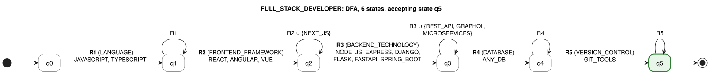
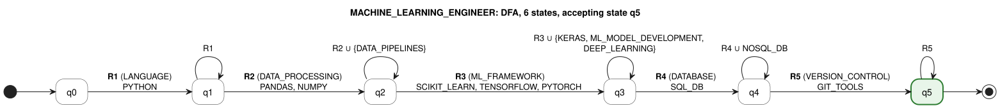
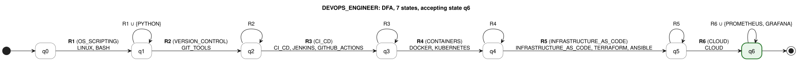
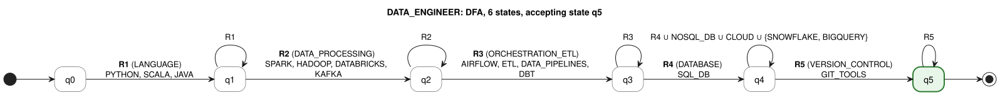

# Stage 3 — Qualification Pattern Recognition with Finite Automata

Implementation: [`src/resume_lens/recognition/patterns.py`](../src/resume_lens/recognition/patterns.py) (the profile patterns),
[`automaton.py`](../src/resume_lens/recognition/automaton.py) (`ProfileAutomaton`, built with
`pyformlang.finite_automaton.DeterministicFiniteAutomaton`) and
[`classifier.py`](../src/resume_lens/recognition/classifier.py) (`ProfileClassifier`).

Stage 3 receives the canonical tokens produced by Stage 2 (for example
`JAVASCRIPT, REACT, NODE_JS, POSTGRESQL, GIT`) and decides, for **each of the four profiles**, whether the
résumé is **ACCEPTED** or **REJECTED**. It does not rank candidates: a résumé may satisfy several profiles,
one, or none.

**Contents**

1. From a profile to a pattern
2. Input of the automata: sorting and projection
3. Generic construction and type of the automata
4. Formal definition of the four automata
5. Worked examples
6. Limitations

---

## 1. From a profile to a pattern

A profile pattern is a sequence of **stages** S_1, …, S_n. Each stage S_i has

- **R_i**, its *required* tokens: the stage is satisfied when the résumé contains **at least one** of them;
- **O_i**, its *optional* tokens: they may appear once the stage is satisfied, but never satisfy it alone.

A résumé satisfies the pattern when **every** stage is satisfied. For example, a Full Stack Developer needs
JavaScript **or** TypeScript, **and** React, Angular **or** Vue, **and** a backend technology, **and** a
database, **and** version control.

The stage sets of one profile are pairwise disjoint (`ProfilePattern` refuses a token that appears in two
stages), and every token belongs to the Stage 2 vocabulary.

## 2. Input of the automata: sorting and projection

An automaton reads a *sequence*, but a résumé lists its skills in any order and may contain skills that a
profile does not mention. `ProfileClassifier.sequence_for(tokens, profile)` therefore prepares a different
word for each profile:

1. **Sort** the distinct canonical tokens in the canonical order of the profile (`QualificationSorter`,
   Stage 2, section 6 of [`stage2-normalization-fst.md`](stage2-normalization-fst.md)). The profile
   orders list the tokens stage by stage, and inside each stage the required tokens come before the
   optional ones. So the sorted word visits S_1, S_2, …, S_n in that order.
2. **Project** onto the profile alphabet Σ: tokens that are not in Σ are erased. Formally this is the
   homomorphism π(a) = a if a ∈ Σ and π(a) = ε otherwise. A skill that the profile does not mention
   neither helps nor penalizes the résumé.

Because of step 1, the result does not depend on the order in which the candidate wrote the skills
(proved in Stage 2, Proposition 5), and the automaton only has to read each stage once, left to right.

Example for FULL_STACK_DEVELOPER: résumé tokens `GIT, NODE_JS, JAVASCRIPT, DOCKER, POSTGRESQL, REACT` →
sorted `JAVASCRIPT, REACT, NODE_JS, POSTGRESQL, GIT, DOCKER` → projected (DOCKER ∉ Σ)
`JAVASCRIPT, REACT, NODE_JS, POSTGRESQL, GIT`.

## 3. Generic construction and type of the automata

All four automata come from one builder (`ProfileAutomaton._build`), so the four profiles share the same
software solution. For a pattern with stages S_1 … S_n:

- **Q** = {q_0, q_1, …, q_n}. State q_i means "stages S_1 … S_i are satisfied".
- **Σ** = R_1 ∪ O_1 ∪ … ∪ R_n ∪ O_n.
- **δ**, for i = 1 … n:
  - δ(q_{i-1}, a) = q_i for every a ∈ R_i: a required token satisfies stage S_i;
  - δ(q_i, a) = q_i for every a ∈ R_i ∪ O_i: further tokens of the same stage are allowed.
- **q0** = q_0 and **F** = {q_n}.

The automaton recognizes the regular language

> L(M) = R_1 (R_1 ∪ O_1)* R_2 (R_2 ∪ O_2)* … R_n (R_n ∪ O_n)*

**Why each automaton is a DFA (and not an NFA or an ε-NFA).**

1. *No ε-transitions:* every transition reads one symbol of Σ.
2. *At most one next state for every (state, symbol):* from q_i the defined symbols are R_i ∪ O_i
   (the loop) and R_{i+1} (the move forward). These two sets are disjoint because the stage sets are
   pairwise disjoint, so no pair (q_i, a) has two targets.
3. *One initial state:* q_0.

δ is therefore a (partial) **function** Q × Σ → Q, which is the definition of a deterministic finite
automaton. It is *partial*: pairs that are not defined lead to an implicit dead (rejecting) state, as in
`pyformlang`; adding that state q_dead explicitly, with δ(q, a) = q_dead for every missing pair, gives the
equivalent complete DFA. The code checks this property with `pyformlang`'s `is_deterministic()`
(`ProfileAutomaton.automaton_type` returns `"DFA"` for all four profiles).

**The automata are minimal.** Two states q_i ≠ q_j (i < j) are distinguishable: from q_i at least n − i required tokens are needed to reach F, from q_j only n − j, so the shortest word accepted from each state has a different length. No two states can be merged, and `pyformlang`'s `minimize()` returns an automaton with the same number of states (test TC-R-12).

**Why a rejected word tells which stage is missing.** If the run stops in q_i (because a symbol has no
transition, or because the word ends there), stages S_1 … S_i are satisfied and S_{i+1} is not.
`ProfileAutomaton.missing_stage` returns S_{i+1}, and this is the "missing" stage that the command line and
the candidate profile show.

**Named sets used in the diagrams** (`NAMED_SETS` in `patterns.py`):

| Name | Tokens |
|---|---|
| `ANY_DB` | SQL, POSTGRESQL, MYSQL, MARIADB, SQLITE, SQL_SERVER, ORACLE, NOSQL, MONGODB, REDIS, CASSANDRA, DYNAMODB, FIREBASE |
| `SQL_DB` | SQL, POSTGRESQL, MYSQL, MARIADB, SQLITE, SQL_SERVER, ORACLE |
| `NOSQL_DB` | NOSQL, MONGODB, REDIS, CASSANDRA, DYNAMODB, FIREBASE |
| `GIT_TOOLS` | GIT, GITHUB, GITLAB |
| `CLOUD` | AWS, AZURE, GCP |

**How to read the diagrams** (PlantUML, sources in [`automata/`](automata/)):

- The edge from q_{i-1} to q_i is labelled **R_i (stage name)** followed by the required tokens of the stage.
  It stands for one transition per token.
- The loop on q_i is labelled **R_i**, or **R_i ∪ {optional tokens}** when the stage has optional tokens:
  the symbols that keep the automaton in q_i.
- A label with a set name (`ANY_DB`, `SQL_DB`, `GIT_TOOLS`, `CLOUD`) stands for all the tokens of that set.
- The green state with a bold border is the accepting state; `[*] →` marks the initial state.

---

## 4. Formal definition of the four automata

### 4.1 FULL_STACK_DEVELOPER

Builds both the client and the server side of an application: a web language, a frontend framework, a backend technology, a database and version control. REST APIs, GraphQL and microservices are typical of the backend but are not enough on their own, so they are optional in that stage; Next.js is optional in the frontend stage because it requires React.

**Stages**

| i | Stage S_i | R_i (required, at least one) | O_i (optional) |
|---|---|---|---|
| 1 | LANGUAGE | JAVASCRIPT, TYPESCRIPT | — |
| 2 | FRONTEND_FRAMEWORK | REACT, ANGULAR, VUE | NEXT_JS |
| 3 | BACKEND_TECHNOLOGY | NODE_JS, EXPRESS, DJANGO, FLASK, FASTAPI, SPRING_BOOT | REST_API, GRAPHQL, MICROSERVICES |
| 4 | DATABASE | SQL, POSTGRESQL, MYSQL, MARIADB, SQLITE, SQL_SERVER, ORACLE, NOSQL, MONGODB, REDIS, CASSANDRA, DYNAMODB, FIREBASE | — |
| 5 | VERSION_CONTROL | GIT, GITHUB, GITLAB | — |

**M_FULL_STACK_DEVELOPER = (Q, Σ, δ, q0, F)**

- **Q** = {q0, q1, q2, q3, q4, q5} — |Q| = 6
- **Σ** = R_1 ∪ O_1 ∪ … ∪ R_5 ∪ O_5 = {JAVASCRIPT, TYPESCRIPT, REACT, ANGULAR, VUE, NEXT_JS, NODE_JS, EXPRESS, DJANGO, FLASK, FASTAPI, SPRING_BOOT, REST_API, GRAPHQL, MICROSERVICES, SQL, POSTGRESQL, MYSQL, MARIADB, SQLITE, SQL_SERVER, ORACLE, NOSQL, MONGODB, REDIS, CASSANDRA, DYNAMODB, FIREBASE, GIT, GITHUB, GITLAB} — |Σ| = 31
- **q0** = q0
- **F** = {q5}
- **δ**: Q × Σ → Q, partial, |δ| = 58 transitions:

| State | Input symbols | Next state | Meaning |
|---|---|---|---|
| q0 | JAVASCRIPT, TYPESCRIPT | q1 | stage LANGUAGE satisfied |
| q1 | JAVASCRIPT, TYPESCRIPT | q1 | more tokens of LANGUAGE |
| q1 | REACT, ANGULAR, VUE | q2 | stage FRONTEND_FRAMEWORK satisfied |
| q2 | REACT, ANGULAR, VUE, NEXT_JS | q2 | more tokens of FRONTEND_FRAMEWORK |
| q2 | NODE_JS, EXPRESS, DJANGO, FLASK, FASTAPI, SPRING_BOOT | q3 | stage BACKEND_TECHNOLOGY satisfied |
| q3 | NODE_JS, EXPRESS, DJANGO, FLASK, FASTAPI, SPRING_BOOT, REST_API, GRAPHQL, MICROSERVICES | q3 | more tokens of BACKEND_TECHNOLOGY |
| q3 | SQL, POSTGRESQL, MYSQL, MARIADB, SQLITE, SQL_SERVER, ORACLE, NOSQL, MONGODB, REDIS, CASSANDRA, DYNAMODB, FIREBASE | q4 | stage DATABASE satisfied |
| q4 | SQL, POSTGRESQL, MYSQL, MARIADB, SQLITE, SQL_SERVER, ORACLE, NOSQL, MONGODB, REDIS, CASSANDRA, DYNAMODB, FIREBASE | q4 | more tokens of DATABASE |
| q4 | GIT, GITHUB, GITLAB | q5 | stage VERSION_CONTROL satisfied |
| q5 | GIT, GITHUB, GITLAB | q5 | more tokens of VERSION_CONTROL |

Every other pair (state, symbol) is undefined: the run stops and the word is rejected.

**Transition diagram**

PlantUML source: [`automata/FULL_STACK_DEVELOPER.puml`](automata/FULL_STACK_DEVELOPER.puml)

**Language.** L(M) = R1(R1∪O1)* R2(R2∪O2)* R3(R3∪O3)* R4(R4∪O4)* R5(R5∪O5)*, where each R_i / O_i stands for the union of its tokens. State q_i means "stages S_1 … S_i are satisfied"; the only accepting state is q5.

### 4.2 MACHINE_LEARNING_ENGINEER

Combines programming in Python, data processing (Pandas or NumPy), at least one machine-learning framework, SQL data access and version control. Keras, ML model development and deep learning describe ML work but do not replace a concrete framework, so they are optional. NoSQL databases may appear but the profile requires a SQL database.

**Stages**

| i | Stage S_i | R_i (required, at least one) | O_i (optional) |
|---|---|---|---|
| 1 | LANGUAGE | PYTHON | — |
| 2 | DATA_PROCESSING | PANDAS, NUMPY | DATA_PIPELINES |
| 3 | ML_FRAMEWORK | SCIKIT_LEARN, TENSORFLOW, PYTORCH | KERAS, ML_MODEL_DEVELOPMENT, DEEP_LEARNING |
| 4 | DATABASE | SQL, POSTGRESQL, MYSQL, MARIADB, SQLITE, SQL_SERVER, ORACLE | NOSQL, MONGODB, REDIS, CASSANDRA, DYNAMODB, FIREBASE |
| 5 | VERSION_CONTROL | GIT, GITHUB, GITLAB | — |

**M_MACHINE_LEARNING_ENGINEER = (Q, Σ, δ, q0, F)**

- **Q** = {q0, q1, q2, q3, q4, q5} — |Q| = 6
- **Σ** = R_1 ∪ O_1 ∪ … ∪ R_5 ∪ O_5 = {PYTHON, PANDAS, NUMPY, DATA_PIPELINES, SCIKIT_LEARN, TENSORFLOW, PYTORCH, KERAS, ML_MODEL_DEVELOPMENT, DEEP_LEARNING, SQL, POSTGRESQL, MYSQL, MARIADB, SQLITE, SQL_SERVER, ORACLE, NOSQL, MONGODB, REDIS, CASSANDRA, DYNAMODB, FIREBASE, GIT, GITHUB, GITLAB} — |Σ| = 26
- **q0** = q0
- **F** = {q5}
- **δ**: Q × Σ → Q, partial, |δ| = 42 transitions:

| State | Input symbols | Next state | Meaning |
|---|---|---|---|
| q0 | PYTHON | q1 | stage LANGUAGE satisfied |
| q1 | PYTHON | q1 | more tokens of LANGUAGE |
| q1 | PANDAS, NUMPY | q2 | stage DATA_PROCESSING satisfied |
| q2 | PANDAS, NUMPY, DATA_PIPELINES | q2 | more tokens of DATA_PROCESSING |
| q2 | SCIKIT_LEARN, TENSORFLOW, PYTORCH | q3 | stage ML_FRAMEWORK satisfied |
| q3 | SCIKIT_LEARN, TENSORFLOW, PYTORCH, KERAS, ML_MODEL_DEVELOPMENT, DEEP_LEARNING | q3 | more tokens of ML_FRAMEWORK |
| q3 | SQL, POSTGRESQL, MYSQL, MARIADB, SQLITE, SQL_SERVER, ORACLE | q4 | stage DATABASE satisfied |
| q4 | SQL, POSTGRESQL, MYSQL, MARIADB, SQLITE, SQL_SERVER, ORACLE, NOSQL, MONGODB, REDIS, CASSANDRA, DYNAMODB, FIREBASE | q4 | more tokens of DATABASE |
| q4 | GIT, GITHUB, GITLAB | q5 | stage VERSION_CONTROL satisfied |
| q5 | GIT, GITHUB, GITLAB | q5 | more tokens of VERSION_CONTROL |

Every other pair (state, symbol) is undefined: the run stops and the word is rejected.

**Transition diagram**

PlantUML source: [`automata/MACHINE_LEARNING_ENGINEER.puml`](automata/MACHINE_LEARNING_ENGINEER.puml)

**Language.** L(M) = R1(R1∪O1)* R2(R2∪O2)* R3(R3∪O3)* R4(R4∪O4)* R5(R5∪O5)*, where each R_i / O_i stands for the union of its tokens. State q_i means "stages S_1 … S_i are satisfied"; the only accepting state is q5.

### 4.3 DEVOPS_ENGINEER

Team-defined software-engineering profile. A DevOps engineer automates building, deploying and operating software: shell/OS skills, version control, a CI/CD tool, containers, infrastructure as code and a cloud provider. Python is optional for scripting; Prometheus and Grafana (monitoring) are optional in the cloud stage.

**Stages**

| i | Stage S_i | R_i (required, at least one) | O_i (optional) |
|---|---|---|---|
| 1 | OS_SCRIPTING | LINUX, BASH | PYTHON |
| 2 | VERSION_CONTROL | GIT, GITHUB, GITLAB | — |
| 3 | CI_CD | CI_CD, JENKINS, GITHUB_ACTIONS | — |
| 4 | CONTAINERS | DOCKER, KUBERNETES | — |
| 5 | INFRASTRUCTURE_AS_CODE | INFRASTRUCTURE_AS_CODE, TERRAFORM, ANSIBLE | — |
| 6 | CLOUD | AWS, AZURE, GCP | PROMETHEUS, GRAFANA |

**M_DEVOPS_ENGINEER = (Q, Σ, δ, q0, F)**

- **Q** = {q0, q1, q2, q3, q4, q5, q6} — |Q| = 7
- **Σ** = R_1 ∪ O_1 ∪ … ∪ R_6 ∪ O_6 = {LINUX, BASH, PYTHON, GIT, GITHUB, GITLAB, CI_CD, JENKINS, GITHUB_ACTIONS, DOCKER, KUBERNETES, INFRASTRUCTURE_AS_CODE, TERRAFORM, ANSIBLE, AWS, AZURE, GCP, PROMETHEUS, GRAFANA} — |Σ| = 19
- **q0** = q0
- **F** = {q6}
- **δ**: Q × Σ → Q, partial, |δ| = 35 transitions:

| State | Input symbols | Next state | Meaning |
|---|---|---|---|
| q0 | LINUX, BASH | q1 | stage OS_SCRIPTING satisfied |
| q1 | LINUX, BASH, PYTHON | q1 | more tokens of OS_SCRIPTING |
| q1 | GIT, GITHUB, GITLAB | q2 | stage VERSION_CONTROL satisfied |
| q2 | GIT, GITHUB, GITLAB | q2 | more tokens of VERSION_CONTROL |
| q2 | CI_CD, JENKINS, GITHUB_ACTIONS | q3 | stage CI_CD satisfied |
| q3 | CI_CD, JENKINS, GITHUB_ACTIONS | q3 | more tokens of CI_CD |
| q3 | DOCKER, KUBERNETES | q4 | stage CONTAINERS satisfied |
| q4 | DOCKER, KUBERNETES | q4 | more tokens of CONTAINERS |
| q4 | INFRASTRUCTURE_AS_CODE, TERRAFORM, ANSIBLE | q5 | stage INFRASTRUCTURE_AS_CODE satisfied |
| q5 | INFRASTRUCTURE_AS_CODE, TERRAFORM, ANSIBLE | q5 | more tokens of INFRASTRUCTURE_AS_CODE |
| q5 | AWS, AZURE, GCP | q6 | stage CLOUD satisfied |
| q6 | AWS, AZURE, GCP, PROMETHEUS, GRAFANA | q6 | more tokens of CLOUD |

Every other pair (state, symbol) is undefined: the run stops and the word is rejected.

**Transition diagram**

PlantUML source: [`automata/DEVOPS_ENGINEER.puml`](automata/DEVOPS_ENGINEER.puml)

**Language.** L(M) = R1(R1∪O1)* R2(R2∪O2)* R3(R3∪O3)* R4(R4∪O4)* R5(R5∪O5)* R6(R6∪O6)*, where each R_i / O_i stands for the union of its tokens. State q_i means "stages S_1 … S_i are satisfied"; the only accepting state is q6.

### 4.4 DATA_ENGINEER

Team-defined AI/data profile. A data engineer builds the pipelines that move and transform data: a data language (Python, Scala or Java), a distributed processing engine, an orchestration/ETL tool, a SQL database and version control. NoSQL stores, cloud data warehouses (Snowflake, BigQuery) and cloud providers are optional in the database stage.

**Stages**

| i | Stage S_i | R_i (required, at least one) | O_i (optional) |
|---|---|---|---|
| 1 | LANGUAGE | PYTHON, SCALA, JAVA | — |
| 2 | DATA_PROCESSING | SPARK, HADOOP, DATABRICKS, KAFKA | — |
| 3 | ORCHESTRATION_ETL | AIRFLOW, ETL, DATA_PIPELINES, DBT | — |
| 4 | DATABASE | SQL, POSTGRESQL, MYSQL, MARIADB, SQLITE, SQL_SERVER, ORACLE | NOSQL, MONGODB, REDIS, CASSANDRA, DYNAMODB, FIREBASE, SNOWFLAKE, BIGQUERY, AWS, AZURE, GCP |
| 5 | VERSION_CONTROL | GIT, GITHUB, GITLAB | — |

**M_DATA_ENGINEER = (Q, Σ, δ, q0, F)**

- **Q** = {q0, q1, q2, q3, q4, q5} — |Q| = 6
- **Σ** = R_1 ∪ O_1 ∪ … ∪ R_5 ∪ O_5 = {PYTHON, SCALA, JAVA, SPARK, HADOOP, DATABRICKS, KAFKA, AIRFLOW, ETL, DATA_PIPELINES, DBT, SQL, POSTGRESQL, MYSQL, MARIADB, SQLITE, SQL_SERVER, ORACLE, NOSQL, MONGODB, REDIS, CASSANDRA, DYNAMODB, FIREBASE, SNOWFLAKE, BIGQUERY, AWS, AZURE, GCP, GIT, GITHUB, GITLAB} — |Σ| = 32
- **q0** = q0
- **F** = {q5}
- **δ**: Q × Σ → Q, partial, |δ| = 53 transitions:

| State | Input symbols | Next state | Meaning |
|---|---|---|---|
| q0 | PYTHON, SCALA, JAVA | q1 | stage LANGUAGE satisfied |
| q1 | PYTHON, SCALA, JAVA | q1 | more tokens of LANGUAGE |
| q1 | SPARK, HADOOP, DATABRICKS, KAFKA | q2 | stage DATA_PROCESSING satisfied |
| q2 | SPARK, HADOOP, DATABRICKS, KAFKA | q2 | more tokens of DATA_PROCESSING |
| q2 | AIRFLOW, ETL, DATA_PIPELINES, DBT | q3 | stage ORCHESTRATION_ETL satisfied |
| q3 | AIRFLOW, ETL, DATA_PIPELINES, DBT | q3 | more tokens of ORCHESTRATION_ETL |
| q3 | SQL, POSTGRESQL, MYSQL, MARIADB, SQLITE, SQL_SERVER, ORACLE | q4 | stage DATABASE satisfied |
| q4 | SQL, POSTGRESQL, MYSQL, MARIADB, SQLITE, SQL_SERVER, ORACLE, NOSQL, MONGODB, REDIS, CASSANDRA, DYNAMODB, FIREBASE, SNOWFLAKE, BIGQUERY, AWS, AZURE, GCP | q4 | more tokens of DATABASE |
| q4 | GIT, GITHUB, GITLAB | q5 | stage VERSION_CONTROL satisfied |
| q5 | GIT, GITHUB, GITLAB | q5 | more tokens of VERSION_CONTROL |

Every other pair (state, symbol) is undefined: the run stops and the word is rejected.

**Transition diagram**

PlantUML source: [`automata/DATA_ENGINEER.puml`](automata/DATA_ENGINEER.puml)

**Language.** L(M) = R1(R1∪O1)* R2(R2∪O2)* R3(R3∪O3)* R4(R4∪O4)* R5(R5∪O5)*, where each R_i / O_i stands for the union of its tokens. State q_i means "stages S_1 … S_i are satisfied"; the only accepting state is q5.

---

## 5. Worked examples

**Example from the assignment** — MACHINE_LEARNING_ENGINEER, word `PYTHON, PANDAS, TENSORFLOW, POSTGRESQL, GIT`:

q0 —PYTHON→ q1 —PANDAS→ q2 —TENSORFLOW→ q3 —POSTGRESQL→ q4 —GIT→ q5 ∈ F → **ACCEPTED**.

**Wednesday Addams** (`tests/resources/wednesday_addams.txt`), Stage 2 tokens
`JAVASCRIPT, REACT, NODE_JS, POSTGRESQL, GIT`:

| Profile | Word read (sorted + projected) | Run | Result |
|---|---|---|---|
| FULL_STACK_DEVELOPER | JAVASCRIPT, REACT, NODE_JS, POSTGRESQL, GIT | q0 → q1 → q2 → q3 → q4 → q5 | ACCEPTED |
| MACHINE_LEARNING_ENGINEER | POSTGRESQL, GIT | stops in q0: δ(q0, POSTGRESQL) undefined | REJECTED, missing LANGUAGE |

**Mary Jane Watson** (`tests/resources/mary_jane_watson.txt`), MACHINE_LEARNING_ENGINEER:

| Symbol | PYTHON | PANDAS | NUMPY | DATA_PIPELINES | SCIKIT_LEARN | TENSORFLOW | ML_MODEL_DEVELOPMENT | SQL | GIT |
|---|---|---|---|---|---|---|---|---|---|
| State after | q1 | q2 | q2 | q2 | q3 | q3 | q3 | q4 | q5 |

The word ends in q5 ∈ F → **ACCEPTED**. The loops on q2 and q3 read the extra and optional tokens of a
stage that is already satisfied.

**A rejection at the end of the word** — `full_resume.txt`, FULL_STACK_DEVELOPER, word
`JAVASCRIPT, TYPESCRIPT, ANGULAR, VUE, SPRING_BOOT, REST_API, MICROSERVICES, MYSQL, NOSQL, MONGODB`:
the run reads every symbol and ends in q4, which is not accepting. The résumé has no Git/GitHub/GitLab, so
the result is **REJECTED, missing VERSION_CONTROL**.

## 6. Limitations

- A pattern is a conjunction of "at least one of" conditions. It cannot express counts ("two backend
  frameworks") or years of experience per skill; that would need more states (counting up to a fixed
  bound is still regular) or information that Stage 1 does not extract.
- Required and optional tokens are fixed per profile; a technology outside Σ is ignored for that profile
  even if it is related (for example Svelte for Full Stack).
- The automata only see what Stages 1 and 2 recognized. A qualification written in an unknown way is
  reported as unrecognized and never reaches Stage 3.
